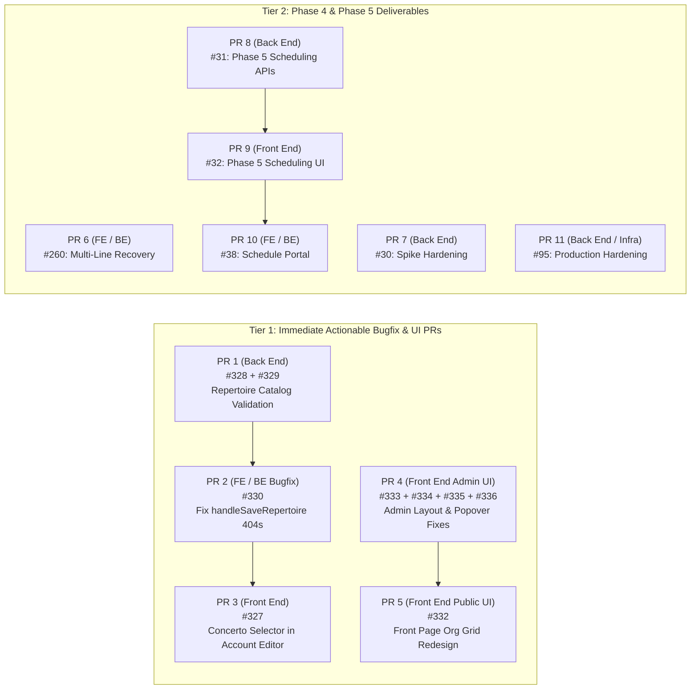

# Pull Request Roadmap & Issue Grouping Proposal

This document outlines the architecture boundaries of the Festival monorepo, catalogs all 21 open GitHub issues by architectural layer and functional domain, establishes best practices for combining vs. separating Front End and Back End work in pull requests, and proposes a sequenced PR roadmap for team review.

---

## 1. Overview & Architecture Boundaries

Festival is structured as a Bun workspace monorepo with strict separation of concerns across four primary boundaries:

- **`packages/frontend` (Front End)**:
  - **Tech Stack**: SolidJS, TypeScript, and global CSS (`packages/frontend/src/styles.css`).
  - **Responsibilities**: Client-side routing and app state (`src/app/`), reusable UI components and modals (`src/components/`), route page views and page-specific hooks/helpers (`src/pages/`), client API wrappers and cart state (`src/lib/`), and frontend unit/integration tests (`tests/`).
  - **Related UI Extension**: `packages/shopify-confirmation` provides the Shopify checkout thank-you and order-status return UI extension.

- **`packages/backend` (Back End)**:
  - **Tech Stack**: Hono HTTP server on Bun, PostgreSQL repositories, Firebase Admin authentication, and Shopify Admin/Storefront API clients.
  - **Responsibilities**: HTTP route handlers (`src/routes/`), domain services (`src/services/`, `src/customer/`, `src/checkout/`, `src/commerce/`, `src/reconciliation/`, `src/registration/`, `src/repertoire/`, `src/rooms/`, `src/shopify/`, `src/volunteers/`, `src/waitlist/`, `src/billing/`, `src/communication/`), data persistence (`src/repo/`), authentication/security middleware (`src/auth/`, `src/security/`, `src/middleware/`), and backend tests (`tests/`).

- **`packages/common` (Shared Contracts)**:
  - **Tech Stack**: Pure TypeScript domain contracts, types, and validation logic (`organization.ts`, `customer-account.ts`, `repertoire.ts`, `registration.ts`, `entitlements.ts`, `shopify.ts`, etc.).
  - **Responsibilities**: Acts as the contract boundary consumed by both `packages/frontend` and `packages/backend`.

- **`database/` (Database Schema & Migrations)**:
  - **Tech Stack**: PostgreSQL 17 SQL schemas (`postgres17-schema.sql`), timestamped migrations (`database/migrations/`), and seed scripts (`database/seeds/`).

---

## 2. Open Issues Grouped by Related Scope

All 21 open issues have been standardized with `Front End:`, `Back End:`, or `Front End / Back End:` prefixes to make architectural ownership immediately visible.

### Group A: Repertoire Validation & Customer Account Repertoire Editing

| Issue    | Title                                                                                        | Layer                | Primary Affected Files                                                                                                                                              |
| :------- | :------------------------------------------------------------------------------------------- | :------------------- | :------------------------------------------------------------------------------------------------------------------------------------------------------------------ |
| **#329** | `Back End: Validate repertoire piece limits before querying the catalog`                     | Back End             | `packages/backend/src/checkout/class-checkout-helpers.ts`, backend checkout/metadata tests                                                                          |
| **#328** | `Back End: Use canonical work details for catalog-linked registration repertoire`            | Back End             | `packages/backend/src/checkout/class-checkout-helpers.ts`, backend checkout/metadata tests                                                                          |
| **#330** | `Front End / Back End: Resolve 404 bugs in CustomerAccountOrdersPage handleSaveRepertoire`   | Front End / Back End | `packages/frontend/src/pages/CustomerAccountOrdersPage.tsx`, `packages/common/src/customer-account.ts`, `packages/backend/src/customer/customer-account-service.ts` |
| **#327** | `Front End: Let families select a concerto catalog work when editing existing registrations` | Front End            | `packages/frontend/src/pages/CustomerAccountOrdersPage.tsx`, `packages/frontend/src/components/FestivalRepertoireModal.tsx`, frontend customer account tests        |

### Group B: Organization & Festival Admin UI / CSS Layout Polish

| Issue    | Title                                                                          | Layer     | Primary Affected Files                                                                                                                                                 |
| :------- | :----------------------------------------------------------------------------- | :-------- | :--------------------------------------------------------------------------------------------------------------------------------------------------------------------- |
| **#336** | `Front End: Move classes popover below the top of the page`                    | Front End | `packages/frontend/src/styles.css`, `packages/frontend/src/components/FestivalClassModal.tsx`, `packages/frontend/src/pages/FestivalAdminClassesPage.tsx`              |
| **#335** | `Front End: Improve membership cards with separated details and actions`       | Front End | `packages/frontend/src/pages/AdminMembershipProductsPage.tsx`, `packages/frontend/src/styles.css`                                                                      |
| **#334** | `Front End: Display entitlement state badges in a wrapping horizontal list`    | Front End | `packages/frontend/src/pages/AdminEntitlementOperationsSection.tsx`, `packages/frontend/src/pages/AdminMembershipProductsPage.tsx`, `packages/frontend/src/styles.css` |
| **#333** | `Front End: Fix overlapping festival dates and controls in organization admin` | Front End | `packages/frontend/src/pages/AdminFestivalsPage.tsx`, `packages/frontend/src/components/FestivalRegistrationWindowEditor.tsx`, `packages/frontend/src/styles.css`      |

### Group C: Public Front Page Redesign

| Issue    | Title                                                                               | Layer     | Primary Affected Files                                                                                                                                                                  |
| :------- | :---------------------------------------------------------------------------------- | :-------- | :-------------------------------------------------------------------------------------------------------------------------------------------------------------------------------------- |
| **#332** | `Front End: Redesign front page with organization grid and new organization signup` | Front End | `packages/frontend/src/pages/HomePage.tsx`, `packages/frontend/src/pages/OrganizationChooser.tsx`, `packages/frontend/src/components/AppHeader.tsx`, `packages/frontend/src/styles.css` |

### Group D: Phase 4 & Phase 5 Core Roadmap Deliverables

| Issue    | Title                                                                                       | Layer                | Primary Affected Files                                                                                                                                                                                              |
| :------- | :------------------------------------------------------------------------------------------ | :------------------- | :------------------------------------------------------------------------------------------------------------------------------------------------------------------------------------------------------------------ |
| **#260** | `Front End / Back End: Phase 4 Multi-Line Item Recovery`                                    | Front End / Back End | `packages/backend/src/checkout/`, `packages/backend/src/commerce/`, `packages/frontend/src/pages/CustomerCheckoutRecoveryPage.tsx`, `packages/frontend/src/pages/AdminCheckoutRecoveryPage.tsx`, `packages/common/` |
| **#30**  | `Back End: Phase 4 Registration Spike Performance Hardening`                                | Back End             | `packages/backend/scripts/`, `packages/backend/src/customer/`, `packages/backend/src/checkout/`, `database/migrations/`                                                                                             |
| **#31**  | `Back End: Phase 5 Scheduling Domain and Assignment APIs`                                   | Back End             | `packages/backend/src/rooms/`, `packages/backend/src/routes/`, `packages/common/`, `database/migrations/`                                                                                                           |
| **#32**  | `Front End: Phase 5 Manual Scheduling and Export Workspace`                                 | Front End            | `packages/frontend/src/pages/`, `packages/frontend/src/components/`, `packages/frontend/src/lib/api.ts`                                                                                                             |
| **#38**  | `Front End / Back End (Side Quest): Personalized Schedule Portal and Public Class Schedule` | Front End / Back End | `packages/backend/src/`, `packages/frontend/src/pages/`, `packages/common/`                                                                                                                                         |

### Group E: Security, Infrastructure, Deferred & Tracking Issues

| Issue    | Title                                                                                        | Layer                | Primary Affected Files                                                                                                                   |
| :------- | :------------------------------------------------------------------------------------------- | :------------------- | :--------------------------------------------------------------------------------------------------------------------------------------- |
| **#95**  | `Back End: Security - Production edge, network, and operator hardening`                      | Back End / Infra     | `cloud-setup/`, `docker/`, `nginx/`, production operator runbooks                                                                        |
| **#216** | `Front End / Back End (FYI): Repository files exceeding 500 lines for modularization review` | Front End / Back End | 33 cataloged files across `packages/backend`, `packages/frontend`, `packages/common`, and `database/`                                    |
| **#247** | `Back End (Deferred): Shopify Defense in Depth`                                              | Back End             | Future Shopify checkout validation architecture                                                                                          |
| **#246** | `Front End / Back End (Future): Waitlist Entitlements`                                       | Front End / Back End | Future waitlist purchase-permission domain model                                                                                         |
| **#172** | `Front End / Back End (Deferred): Teacher multi-division policy and checkout snapshots`      | Front End / Back End | `packages/common/`, `packages/backend/src/checkout/`, `packages/backend/src/commerce/`, `packages/frontend/src/pages/MembershipPage.tsx` |
| **#133** | `Front End / Back End (Later Phase): Paid accompanist Shopify checkout and order projection` | Front End / Back End | `packages/backend/src/checkout/`, `packages/backend/src/commerce/`, `packages/frontend/src/pages/AccompanistMembershipPage.tsx`          |
| **#98**  | `Front End / Back End (Post-MVP): Membership cancellation and refund approval workflow`      | Front End / Back End | `packages/backend/src/commerce/`, `packages/backend/src/shopify/`, `packages/frontend/src/pages/`                                        |

---

## 3. Best Practices: Combining vs. Separating Front End and Back End Issues in PRs

### Why Separate Front End and Back End PRs by Default

1. **Atomic Rollback & Blast Radius**: Separating backend business logic/persistence changes from frontend UI changes ensures that a CSS/UI regression never forces a rollback of backend validation or database migrations (and vice versa).
2. **Contract-First Sequencing**: When an issue spans both layers (or when a frontend feature depends on a backend fix), landing the `@festival/common` + `packages/backend` contract change first gives the frontend PR a stable, typed, and tested API surface to build against.
3. **Focused Code Review**: Reviewers can verify backend invariants, SQL queries, and security bounds independently from DOM layout, responsive viewport behavior, and SolidJS reactivity.

### Criteria for Combining Issues into a Single PR

Multiple issues should be combined into a single PR **only** when they meet all of the following criteria:

- **Same Architectural Layer**: Both issues are pure Back End or pure Front End.
- **Shared File Neighborhood & Test Suite**: The issues modify the exact same helper functions, components, or CSS sections, such that working on them in parallel branches would guarantee merge conflicts.
- **Tightly Coupled Invariants**: Fixing them together produces cleaner, non-redundant code and unified regression tests.

### Merge-Conflict Hotspot Analysis

1. **`packages/backend/src/checkout/class-checkout-helpers.ts` (#328 and #329)**:
   - Both #328 and #329 are direct follow-ups to #322 in `class-checkout-helpers.ts` (lines 37–45 and lines 132–133) and share `class-checkout-service.test.ts`. Running them on separate branches would conflict directly in validation ordering and test fixtures. **Recommendation**: Combine #328 + #329 into a single Back End PR.
2. **`packages/frontend/src/pages/CustomerAccountOrdersPage.tsx` (#330 and #327)**:
   - #330 fixes two 404 bugs in `handleSaveRepertoire` (passing `entitlement.id` instead of `metadata.id`, and exposing `festivalShortName` on the customer entitlement/class summary so the `PUT` URL resolves the festival by short name rather than UUID).
   - #327 upgrades the repertoire editor modal invoked from `CustomerAccountOrdersPage.tsx` so families can select a concerto catalog work when editing existing registrations.
   - Because #327 relies on saving edited repertoire from `CustomerAccountOrdersPage.tsx` without hitting a 404, **#330 is a direct prerequisite for #327**. Sequencing PR 2 (#330) before PR 3 (#327) prevents merge conflicts in `CustomerAccountOrdersPage.tsx`.
3. **`packages/frontend/src/styles.css` (#333, #334, #335, #336, and #332)**:
   - All five pure frontend layout issues touch `packages/frontend/src/styles.css`.
   - Grouping the four Admin UI layout fixes (#333, #334, #335, #336) eliminates 4-way CSS merge conflicts while keeping public landing page redesign (#332) isolated in its own PR.

---

## 4. Proposed Draft PR Roadmap

### Tier 1: Immediate Actionable Bugfix & UI PRs

#### PR 1 — Back End: Repertoire Catalog Validation Hardening

- **Issues Included**:
  - **#329**: `Back End: Validate repertoire piece limits before querying the catalog`
  - **#328**: `Back End: Use canonical work details for catalog-linked registration repertoire`
- **Layer**: Pure Back End (`packages/backend`)
- **Scope & Files**:
  - `packages/backend/src/checkout/class-checkout-helpers.ts`
  - `packages/backend/tests/class-checkout-service.test.ts` and customer metadata edit tests
- **Rationale**: Both issues modify the exact same validation helper function in `class-checkout-helpers.ts`. Validating array shape, piece count limits, and basic fields before issuing catalog DB lookups (#329) naturally precedes enforcing canonical work title/composer on resolved catalog works (#328).
- **Merge Order**: Independent; can merge immediately (recommended before PR 3 so backend concerto catalog semantics are locked first).

#### PR 2 — Front End / Back End: Customer Account Repertoire Save 404 Fixes

- **Issues Included**:
  - **#330**: `Front End / Back End: Resolve 404 bugs in CustomerAccountOrdersPage handleSaveRepertoire`
- **Layer**: Shared Contract + Back End Summary + Front End Bugfix (`packages/common`, `packages/backend`, `packages/frontend`)
- **Scope & Files**:
  - `packages/common/src/customer-account.ts` (include `festivalShortName` on `CustomerClassEntitlementSummary` or `CustomerFestivalClassSummary`)
  - `packages/backend/src/customer/customer-account-service.ts` (populate `festivalShortName` in customer account summary projection)
  - `packages/frontend/src/pages/CustomerAccountOrdersPage.tsx` (pass `target.entitlement.id` instead of `target.metadata.id` and use `festivalShortName` in `handleSaveRepertoire`)
  - Unit tests in `packages/backend/tests/customer-account-service.test.ts` and `packages/frontend/tests/customer-account.test.ts`
- **Rationale**: Tightly scoped cross-layer bugfix that restores `PUT .../class-registrations/:registrationId/metadata` functionality.
- **Merge Order**: Must merge **before PR 3 (#327)**.

#### PR 3 — Front End: Concerto Catalog Work Selector in Customer Account Repertoire Editor

- **Issues Included**:
  - **#327**: `Front End: Let families select a concerto catalog work when editing existing registrations`
- **Layer**: Pure Front End (`packages/frontend`)
- **Scope & Files**:
  - `packages/frontend/src/pages/CustomerAccountOrdersPage.tsx`
  - `packages/frontend/src/components/FestivalRepertoireModal.tsx`
  - `packages/frontend/tests/customer-account.test.ts`
- **Rationale**: Builds directly on top of the working repertoire save flow fixed in PR 2 (#330) and the backend catalog validation rules from PR 1 (#328/#329).
- **Merge Order**: Merges **after PR 1 and PR 2**.

#### PR 4 — Front End: Admin Layout, Cards, Badges & Popover Polish

- **Issues Included**:
  - **#336**: `Front End: Move classes popover below the top of the page`
  - **#335**: `Front End: Improve membership cards with separated details and actions`
  - **#334**: `Front End: Display entitlement state badges in a wrapping horizontal list`
  - **#333**: `Front End: Fix overlapping festival dates and controls in organization admin`
- **Layer**: Pure Front End (`packages/frontend`)
- **Scope & Files**:
  - `packages/frontend/src/styles.css`
  - `packages/frontend/src/pages/AdminMembershipProductsPage.tsx` (#335, #334)
  - `packages/frontend/src/pages/AdminEntitlementOperationsSection.tsx` (#334)
  - `packages/frontend/src/pages/AdminFestivalsPage.tsx` & `packages/frontend/src/components/FestivalRegistrationWindowEditor.tsx` (#333)
  - `packages/frontend/src/components/FestivalClassModal.tsx` & `packages/frontend/src/pages/FestivalAdminClassesPage.tsx` (#336)
- **Sub-Splitting Option (Option 4A vs. Option 4B)**:
  - **Option 4-Unified**: Keep all four Admin UI/CSS polish issues in a single PR to avoid any `styles.css` conflicts.
  - **Option 4A + 4B Split**:
    - **PR 4A (Admin Memberships UI)**: Combine **#334 + #335** (both on `/org/:slug/admin/memberships` touching `AdminMembershipProductsPage.tsx`, `AdminEntitlementOperationsSection.tsx`, and `styles.css`).
    - **PR 4B (Admin Festivals & Classes UI)**: Combine **#333 + #336** (touching `/org/:slug/admin/festivals` and `/org/:slug/festival/:short-festival-name/admin/classes` plus `styles.css`).
- **Merge Order**: Independent of PRs 1–3; coordinate merge before or after PR 5 to cleanly sequence `styles.css` additions.

#### PR 5 — Front End: Public Front Page Redesign

- **Issues Included**:
  - **#332**: `Front End: Redesign front page with organization grid and new organization signup`
- **Layer**: Pure Front End (`packages/frontend`)
- **Scope & Files**:
  - `packages/frontend/src/pages/HomePage.tsx`
  - `packages/frontend/src/pages/OrganizationChooser.tsx`
  - `packages/frontend/src/components/AppHeader.tsx`
  - `packages/frontend/src/styles.css`
  - `packages/frontend/tests/onboarding-integration.test.ts` / `organization-landing.test.ts`
- **Rationale**: Standalone functional and visual redesign of the `/` route with specific acceptance criteria for tile dimensions, uppercase short names, conditional divider rendering, and signup copy changes.
- **Merge Order**: Sequence after PR 4 to avoid `styles.css` conflicts.

---

### Tier 2: Roadmap Phase 4 & Phase 5 Deliverables

| Draft PR  | Issue(s)                                                                                             | Layer                | Dependency & Sequencing Notes                                                                                                                                                   |
| :-------- | :--------------------------------------------------------------------------------------------------- | :------------------- | :------------------------------------------------------------------------------------------------------------------------------------------------------------------------------ |
| **PR 6**  | **#260**: `Front End / Back End: Phase 4 Multi-Line Item Recovery`                                   | Front End / Back End | Requires #258 deployed and verified first. Can be split into PR 6A (Backend recovery state machine + projection) and PR 6B (Frontend multi-line recovery review UI) if desired. |
| **PR 7**  | **#30**: `Back End: Phase 4 Registration Spike Performance Hardening`                                | Back End             | Independent Phase 4 performance, caching, indexing, and load-test workstream.                                                                                                   |
| **PR 8**  | **#31**: `Back End: Phase 5 Scheduling Domain and Assignment APIs`                                   | Back End             | Foundation for Phase 5 scheduling. Must land **before PR 9 (#32) and PR 10 (#38)**.                                                                                             |
| **PR 9**  | **#32**: `Front End: Phase 5 Manual Scheduling and Export Workspace`                                 | Front End            | Depends on **PR 8 (#31)** backend APIs and export read models.                                                                                                                  |
| **PR 10** | **#38**: `Front End / Back End (Side Quest): Personalized Schedule Portal and Public Class Schedule` | Front End / Back End | Depends on **PR 8 (#31)** and **PR 9 (#32)**.                                                                                                                                   |
| **PR 11** | **#95**: `Back End: Security - Production edge, network, and operator hardening`                     | Back End / Infra     | Operational & edge deployment hardening; independent of application feature PRs.                                                                                                |

---

### Tier 3: Deferred, Post-MVP & Tracking Issues (No Active PR Scheduled)

These issues are explicitly marked in their specifications as FYI tracking, post-MVP, or deferred future work and should **not** be bundled into active feature PRs until scheduled:

- **#216** (`Front End / Back End (FYI): Repository files exceeding 500 lines for modularization review`): Tracking catalog of 33 files > 500 lines. When actioned, each modularization effort should be scoped to a single package/module per PR (never mixing backend repository splits with frontend CSS/state splits).
- **#247** (`Back End (Deferred): Shopify Defense in Depth`): Future Shopify checkout validation layer.
- **#246** (`Front End / Back End (Future): Waitlist Entitlements`): Future waitlist purchase-permission model.
- **#172** (`Front End / Back End (Deferred): Teacher multi-division policy and checkout snapshots`): Deferred from #166.
- **#133** (`Front End / Back End (Later Phase): Paid accompanist Shopify checkout and order projection`): Postponed work outside #129 critical path.
- **#98** (`Front End / Back End (Post-MVP): Membership cancellation and refund approval workflow`): Split from #78; outside Teacher Membership MVP.

---

## 5. Open Decisions for Team Review

Before creating branches and opening the Tier 1 PRs, please confirm your preference on two grouping decisions:

1. **Decision 1 — Admin UI Polish Grouping (PR 4)**:
   - **Option A (Unified PR 4)**: Combine all four Admin UI layout fixes (**#333, #334, #335, #336**) into one Front End PR.
   - **Option B (Split PR 4A + PR 4B)**: Split by admin route into **PR 4A (#334 + #335 on `/org/:slug/admin/memberships`)** and **PR 4B (#333 + #336 on festival admin pages)**.

2. **Decision 2 — Customer Account Repertoire Fixes (PR 2 & PR 3)**:
   - **Option A (Sequential PR 2 then PR 3 — Recommended)**: Land **PR 2 (#330)** first to fix the 404 bugs and update the shared `CustomerClassEntitlementSummary` contract, then land **PR 3 (#327)** for the pure Front End concerto catalog selector UI.
   - **Option B (Combined PR 2+3)**: Combine **#330 + #327** into a single full-stack Customer Account Repertoire Editor PR since both center on `CustomerAccountOrdersPage.tsx`.
