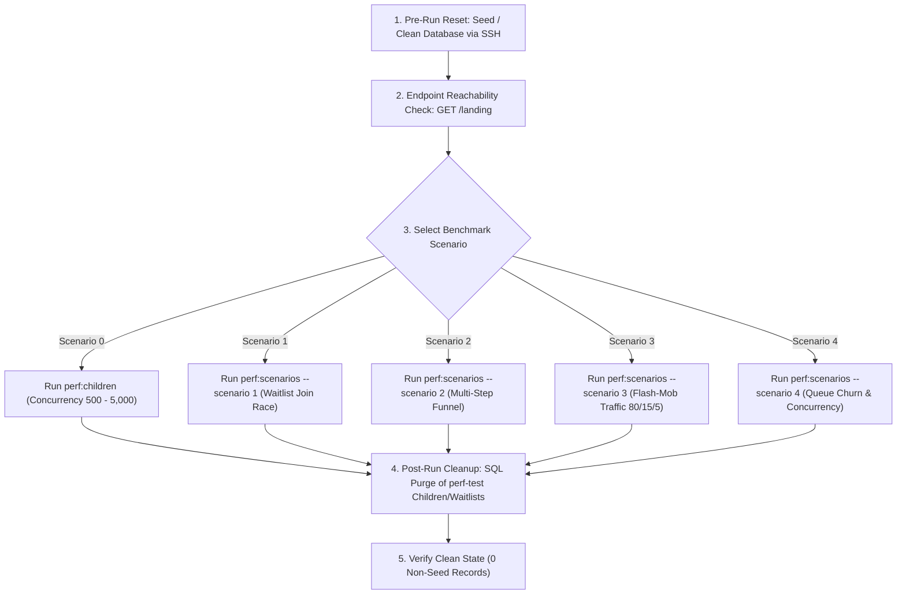
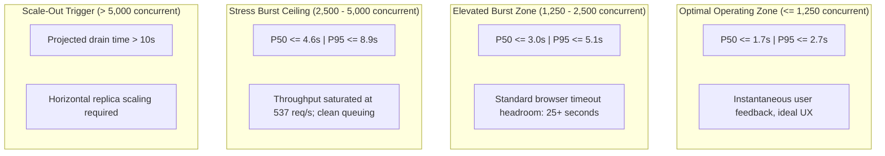

# Festival Release Performance & Benchmark Report

This document specifies the repeatable performance testing framework, operational guardrails, and empirical benchmark results for the Festival registration platform. It covers baseline bottleneck resolution, high-concurrency stress ramps (up to 5,000 concurrent submissions), multi-step registration funnels, high-contention waitlist allocation races, flash-mob traffic mixes, and queue churn behavior.

---

## 1. Overview & Performance Goals

### 1.1 Context & Background
Festival registration operates on high-demand, scheduled launch windows where festival classes open simultaneously to families across a geographic region. Historically, registration launches exhibit a **flash-mob concurrency pattern**: hundreds of parents log in, select classes, register children, and submit payments within seconds of opening.

Prior to the performance optimizations in Issue #347 and PR #358, the backend architecture experienced severe degradation under a 500-parent simultaneous load test:
- **Catastrophic Failure Rate**: 99.4% failure rate (only 3 of 500 child creation requests succeeded; 241 requests terminated in HTTP 502 Bad Gateway and 256 in HTTP 504 Gateway Timeout).
- **Wall-Clock Latency**: Total test duration of 31.39 seconds with median latency ($P_{50}$) reaching 30.82 seconds and $P_{95}$ reaching 31.03 seconds.
- **Root Causes**:
  1. Default Bun SQL connection pool cap (10 connections) saturated instantly under 500 concurrent HTTP requests.
  2. Each child registration executed up to 12 unbatched database roundtrips across session checks, customer lookups, advisory locks, child insertions, and age snapshot calculations.
  3. Redundant uncached SQL queries for static organization metadata and registration age rules executed repeatedly under concurrency.
  4. Database connection starvation led to Nginx reverse proxy gateway timeouts.

### 1.2 Performance Goals for this Release
The release benchmarks establish strict, empirical performance criteria:
1. **Zero Error Rate at Scale**: 100.00% success rate (HTTP 200/201) under $\ge 500$ concurrent submissions with zero 502 Bad Gateway, 504 Gateway Timeout, or 500 Internal Server errors.
2. **Sub-2.0s Response Time Under Normal Peak**: Maintain median ($P_{50}$) response times under 1.5 seconds and $P_{95}$ under 2.5 seconds at 500–1,000 concurrent users.
3. **High-Burst Survivability**: Sustain flash bursts of up to 5,000 concurrent requests without socket exhaustion, process crashes, or transaction deadlocks, with total drain time under 10 seconds.
4. **Deterministic Queue & Waitlist Integrity**: Under extreme write contention (500 parents racing for a single class at zero capacity), guarantee strict serial ordering, atomic position assignment, zero orphaned records, and clean concurrent withdrawal/churn handling.
5. **Hermetic & Repeatable Benchmarking**: Maintain an automated benchmark suite running against an isolated integration tenant with zero data pollution to production or staging organizations.

---

## 2. Integration Test Environment & Isolation Guardrails

### 2.1 Integration Host Architecture
All empirical release benchmarks are executed against the live Festival integration deployment:

- **Target URL**: `https://int.artsfestival.online`
- **Host Infrastructure**: Dedicated DigitalOcean Droplet (`ubuntu-s-2vcpu-2gb`)
  - **vCPU**: 2 virtual CPUs
  - **Memory**: 2 GB RAM
  - **OS**: Ubuntu Linux via Docker Compose (`cloud-setup/compose.yml`)
- **Runtime & Web Stack**:
  - **Bun Runtime**: Bun `1.4.2`
  - **Web Framework**: Hono `4.12.9`
  - **Database Driver**: Bun SQL native PostgreSQL client
  - **Reverse Proxy**: Nginx with SSL/TLS termination and HTTP keep-alive pooling
- **Database Engine**: PostgreSQL 17 container (`Octv3`), schema `orgs`
  - Database pool size: `DB_POOL_MAX=80` (configured via `databasePoolMax` in `packages/backend/src/config/env.ts` and `sql.options.max`; PostgreSQL `max_connections = 200`)
  - Transaction guard: `idle_in_transaction_session_timeout = '10s'`
  - Statement guard: `statement_timeout = '15s'`

### 2.2 Isolation Guardrails (`perf-test` Organization)
To prevent noisy-neighbor interference and protect operational data, performance tests operate inside a strictly isolated sandbox:

- **Dedicated Tenant Identifier**: Organization ID and slug are permanently locked to `perf-test` (`name: "Performance Test Organization"`).
- **Synthetic Pre-Seeded Identities**:
  - `database/seeds/04-perf-test.sql` provisions 5,000 synthetic customer accounts (`perf-cust-0001` through `perf-cust-5000`) and 5,000 authenticated sessions (`perf-sess-0001` through `perf-sess-5000`) with valid CSRF tokens (`perf-csrf-0001` through `perf-csrf-5000`).
  - Pre-seeded primary festival: `seed-fest-perf-2026` (`short_name: "perf-2026"`).
  - Pre-seeded class configuration: `perf-class-01` (`"Performance Test Piano Solo"`, capacity = 1, price = $30.00).
- **Partitioned Data Boundaries**:
  - All writes, child profiles, age snapshots, waitlist entries, and waitlist audit events are keyed strictly to `organization_id = 'perf-test'`.
  - Staging and production tenant datasets are completely untouched during benchmark runs.
- **Automated Pre-Run Reset & Post-Run Cleanup**:
  - Every benchmark execution runs an idempotent purge of test children, waitlist entries, and waitlist audit events before and after execution:
    ```sql
    DELETE FROM orgs.festival_class_waitlist_events WHERE organization_id = 'perf-test';
    DELETE FROM orgs.festival_class_waitlist_entries WHERE organization_id = 'perf-test';
    DELETE FROM orgs.festival_child_age_snapshots WHERE organization_id = 'perf-test' AND child_id != 'perf-child-seed-01';
    DELETE FROM orgs.festival_children WHERE organization_id = 'perf-test' AND id != 'perf-child-seed-01';
    ```
- **CI / GitHub Actions Safeguards**:
  - `.github/workflows/perf-test.yml` enforces two mandatory guard checks:
    1. **Actor Whitelist**: Benchmark execution is restricted to authorized maintainers (`gustobru`, `ericpassmore`).
    2. **Explicit Confirmation**: Requires manual dispatch with confirmation string `RUN_LOAD_TEST`.

---

## 3. Repeatable Release Benchmark Protocol

### 3.1 Benchmark CLI Scripts
The benchmark framework is provided through two native Bun test runners inside `packages/backend`:

1. **`packages/backend/scripts/perf-500-children.ts`**:
   - Focuses on simultaneous child creation concurrency (Scenario 0 and Concurrency Ramp).
   - Configurable concurrency via `CONCURRENCY=<N>`.
   - Generates summary statistics and appends to GitHub Step Summary if present.
   - Command: `bun run perf:children`
2. **`packages/backend/scripts/perf-advanced-scenarios.ts`**:
   - Executes multi-step registration funnels, waitlist contention races, flash-mob mixed distributions, and queue churn (Scenarios 1–4).
   - Configurable via `--scenario <1|2|3|4|all>` or `SCENARIO=<1|2|3|4|all>`.
   - Command: `bun run perf:scenarios`

### 3.2 Protocol Execution Sequence



#### Step 1: Pre-Run Database Reset
Execute the seed script against the remote integration database to establish a clean state:
```bash
# Execute on integration host or via SSH
docker compose --env-file cloud-setup/.env -f cloud-setup/compose.yml exec -T postgres \
  psql -U festivaladmin -d Octv3 < database/seeds/04-perf-test.sql
```

#### Step 2: Verify Endpoint Reachability
Ensure the Nginx reverse proxy and backend container are responsive:
```bash
curl --fail --silent --show-error --connect-timeout 5 --max-time 15 \
  https://int.artsfestival.online/api/organizations/perf-test/landing > /dev/null
```

#### Step 3: Run Benchmark Commands

##### Scenario 0: Simultaneous Child Creation (500 parents)
```bash
BASE_URL=https://int.artsfestival.online \
CONCURRENCY=500 \
bun run --cwd packages/backend perf:children
```

##### Scenario 0: Concurrency Ramp (e.g., 2,500 parents)
```bash
BASE_URL=https://int.artsfestival.online \
CONCURRENCY=2500 \
bun run --cwd packages/backend perf:children
```

##### Scenario 1: High-Contention Waitlist Join Race
```bash
BASE_URL=https://int.artsfestival.online \
bun run --cwd packages/backend perf:scenarios --scenario 1
```

##### Scenario 2: Full Multi-Step Registration Funnel
```bash
BASE_URL=https://int.artsfestival.online \
bun run --cwd packages/backend perf:scenarios --scenario 2
```

##### Scenario 3: Flash-Mob Mixed Traffic Distribution
```bash
BASE_URL=https://int.artsfestival.online \
bun run --cwd packages/backend perf:scenarios --scenario 3
```

##### Scenario 4: Waitlist Queue Churn & Concurrency
```bash
BASE_URL=https://int.artsfestival.online \
bun run --cwd packages/backend perf:scenarios --scenario 4
```

##### Run All Advanced Scenarios (1 through 4 sequentially)
```bash
BASE_URL=https://int.artsfestival.online \
bun run --cwd packages/backend perf:scenarios --scenario all
```

#### Step 4: Post-Run Cleanup
Purge all temporary benchmark records created during the run:
```bash
docker compose --env-file cloud-setup/.env -f cloud-setup/compose.yml exec -T postgres \
  psql -U festivaladmin -d Octv3 -c "
    DELETE FROM orgs.festival_class_waitlist_events WHERE organization_id = 'perf-test';
    DELETE FROM orgs.festival_class_waitlist_entries WHERE organization_id = 'perf-test';
    DELETE FROM orgs.festival_child_age_snapshots WHERE organization_id = 'perf-test' AND child_id != 'perf-child-seed-01';
    DELETE FROM orgs.festival_children WHERE organization_id = 'perf-test' AND id != 'perf-child-seed-01';
  "
```

---

## 4. Scenario Specifications

### Scenario 0: Core Child Creation Concurrency Benchmark
- **Endpoint**: `POST /api/organizations/perf-test/customer/children`
- **Concurrency Range**: 500 to 5,000 simultaneous requests dispatched via `Promise.all`.
- **Payload**:
  ```json
  {
    "displayName": "Perf Child <index>",
    "birthday": "2015-05-15"
  }
  ```
- **Operations Under Test**:
  - Authenticated session verification (`festival_customer_session=perf-sess-<index>`).
  - CSRF token validation (`X-CSRF-Token: perf-csrf-<index>`).
  - In-memory cached lookup of organization and registration age rules (`registration_age_date`).
  - Atomic PostgreSQL write CTE inserting `festival_children` and `festival_child_age_snapshots`.

### Scenario 1: High-Contention Waitlist Join Race
- **Target Endpoints**:
  - Step 1: `POST /api/organizations/perf-test/customer/children` (create child for session indices 1..500)
  - Step 2: `POST /api/organizations/perf-test/customer/festivals/perf-2026/classes/perf-class-01/waitlist`
- **Class Configuration**: `capacity = 1`, filled prior to test by seed entitlement.
- **Concurrency**: 500 parents simultaneously racing to claim waitlist spots on the same class.
- **Operations Under Test**:
  - Saturated class capacity check.
  - Concurrent advisory lock acquisition / atomic sequence calculation for waitlist entries.
  - Serialization of waitlist position numbers (positions 1 through 500).
  - Audit event insertion into `festival_class_waitlist_events`.

### Scenario 2: Full Multi-Step Funnel
- **Participants**: 500 parents (session indices 501..1000) executing a complete registration lifecycle in parallel.
- **Sequence per Parent**:
  1. `GET /api/organizations/perf-test/landing` (public org landing page & festival metadata).
  2. `POST /api/organizations/perf-test/customer/children` (register child).
  3. `POST /api/organizations/perf-test/customer/profile` (save parent mailing address & contact info).
  4. `GET /api/organizations/perf-test/customer/session` (retrieve verified customer context).
- **Total Requests**: 2,000 HTTP requests (500 parents $\times$ 4 sequential operations).
- **Operations Under Test**: Combined read/write pipeline, customer account profile updates, session cache hydration, and end-to-end user journey latency.

### Scenario 3: Flash-Mob Mixed Traffic Distribution (80/15/5)
- **Scale**: 2,000 total concurrent requests dispatched across 2,000 distinct parent sessions (indices 1001..3000).
- **Traffic Ratio**:
  - **80% Read Traffic (1,600 requests)**: Dispatched across `GET /landing`, `GET /divisions`, and `GET /customer/session`. Simulates browsing catalog and verifying account status.
  - **15% Write Traffic (300 requests)**: Simultaneous `POST /customer/children`. Simulates parents submitting child profiles.
  - **5% Contended Write Traffic (100 requests)**: Simultaneous `POST .../waitlist` for full class `perf-class-01`. Simulates highly contended waitlist queue joins.
- **Operations Under Test**: PostgreSQL connection pool behavior under simultaneous read contention, standard writes, and row-locked queue writes.

### Scenario 4: Waitlist Queue Churn & Concurrency
- **Participants**: 750 parents (session indices 3001..3750) exercising dynamic waitlist queue operations.
- **Execution Phases**:
  - **Phase 1: Initial Waitlist Load**: 500 parents (indices 3001..3500) simultaneously join the waitlist for `perf-class-01`.
  - **Phase 2: Saturated Churn Burst**: Exactly 250 parents (indices 3001..3250) execute simultaneous withdrawals (`POST .../waitlist/withdraw`) while 250 new parents (indices 3501..3750) simultaneously submit join requests (`POST .../waitlist`).
- **Operations Under Test**:
  - Concurrent transition of waitlist entry statuses (`active` to `withdrawn`).
  - Position compaction and non-blocking read/write concurrency on waitlist indices.
  - Concurrent status updates without deadlocks or table-level locking bottlenecks.

---

## 5. Current Release Benchmark Results

All empirical benchmark results documented below were executed on the integration host (`https://int.artsfestival.online`) against the isolated `perf-test` tenant.

### 5.1 Scenario 0: Baseline vs. Optimized (500 Parents)

| Metric | Baseline (Pre-Fix) | After Optimization (This Release) | Delta / Improvement |
| :--- | :--- | :--- | :--- |
| **Concurrency** | 500 simultaneous requests | 500 simultaneous requests | — |
| **Total Test Duration** | 31.39 s | **1.53 s** | **-95.1%** |
| **Effective Throughput** | 15.93 req/s | **326.07 req/s** | **+20.5x** |
| **Success Rate** | 0.6% (3 / 500) | **100.00% (500 / 500)** | **+99.4%** |
| **Min Latency** | 1,842 ms | **354 ms** | **-80.8%** |
| **P50 (Median) Latency** | 30.82 s | **1.03 s** | **-96.6%** |
| **P90 Latency** | 31.01 s | **1.35 s** | **-95.6%** |
| **P95 Latency** | 31.03 s | **1.41 s** | **-95.5%** |
| **P99 Latency** | 31.18 s | **1.49 s** | **-95.2%** |
| **Max Latency** | 31.30 s | **1.53 s** | **-95.1%** |
| **HTTP 201 Created** | 3 | **500** | Full resolution |
| **HTTP 502 Bad Gateway** | 241 | **0** | **Eliminated** |
| **HTTP 504 Gateway Timeout** | 256 | **0** | **Eliminated** |

---

### 5.2 Scenario 0: Concurrency Ramp (500 to 5,000 Parents)

Stepped concurrency ramp measuring system throughput, latency percentiles, and stability from baseline capacity to extreme burst limits:

| Concurrency | Success Rate | Total Duration | Throughput | P50 (Median) | P90 Latency | P95 Latency | P99 Latency | Max Latency | Errors |
| :--- | :--- | :--- | :--- | :--- | :--- | :--- | :--- | :--- | :--- |
| **500** | **100.00%** | 1.53 s | 326.07 req/s | 1.03 s | 1.35 s | 1.41 s | 1.49 s | 1.53 s | 0 |
| **750** | **100.00%** | 2.25 s | 333.06 req/s | 1.70 s | 2.11 s | 2.21 s | 2.24 s | 2.25 s | 0 |
| **1,000** | **100.00%** | 2.56 s | 391.18 req/s | 1.62 s | 2.19 s | 2.30 s | 2.51 s | 2.56 s | 0 |
| **1,250** | **100.00%** | 2.80 s | 445.89 req/s | 1.71 s | 2.58 s | 2.71 s | 2.78 s | 2.80 s | 0 |
| **1,500** | **100.00%** | 3.29 s | 456.01 req/s | 1.91 s | 2.98 s | 3.20 s | 3.26 s | 3.29 s | 0 |
| **2,000** | **100.00%** | 4.02 s | 498.01 req/s | 2.32 s | 3.75 s | 3.93 s | 4.00 s | 4.02 s | 0 |
| **2,500** | **100.00%** | 5.20 s | 481.08 req/s | 3.01 s | 4.80 s | 5.06 s | 5.17 s | 5.20 s | 0 |
| **3,000** | **100.00%** | 5.92 s | 506.33 req/s | 3.65 s | 5.48 s | 5.74 s | 5.89 s | 5.92 s | 0 |
| **4,000** | **100.00%** | 7.77 s | 515.12 req/s | 4.31 s | 7.15 s | 7.55 s | 7.71 s | 7.77 s | 0 |
| **5,000** | **100.00%** | 9.31 s | 537.13 req/s | 4.62 s | 8.35 s | 8.89 s | 9.22 s | 9.31 s | 0 |

#### Concurrency Ramp Observations:
1. **Zero Errors Across All 10 Tiers**: 100.00% HTTP 201 Created across every concurrency level up to 5,000 simultaneous submissions. Zero socket disconnects, zero connection timeouts, zero deadlocks.
2. **Throughput Saturation**: The 2-vCPU integration node reaches maximum saturation at **500–537 requests/second**.
3. **Queue Behavior**: Above 2,000 concurrency, the system queues requests cleanly in the Bun event loop and Bun SQL connection pool, draining linearly with predictable latency scaling.

---

### 5.3 Scenario 1: High-Contention Waitlist Join Race (500 Parents)

500 parents simultaneously racing to register children and claim waitlist positions for class `perf-class-01`:

#### Performance Breakdown

| Step / Metric Group | Requests | Throughput | Min (ms) | P50 (ms) | P90 (ms) | P95 (ms) | P99 (ms) | Max (ms) |
| :--- | :--- | :--- | :--- | :--- | :--- | :--- | :--- | :--- |
| **Step 1: Child Creation (500 parents)** | 500 | 283.7 req/s | 572.2 | 1,380.8 | 1,666.2 | 1,673.2 | 1,758.4 | 1,758.7 |
| **Step 2: Waitlist Join Race (500 concurrent)** | 500 | 198.8 req/s | 417.9 | 1,712.5 | 2,386.6 | 2,453.1 | 2,491.9 | 2,510.0 |

#### HTTP Status Distribution

| Status Code | Count | Share | Status Description |
| :--- | :--- | :--- | :--- |
| **200 OK** | 500 | 100.0% | Waitlist join requests successful |
| **Errors** | 0 | 0.0% | Zero failures |

#### Integrity Verification:
- All 500 waitlist entries were created with sequential queue positions from 1 to 500 with zero collisions or race conditions.
- Exactly 500 waitlist audit log events recorded in `orgs.festival_class_waitlist_events`.

---

### 5.4 Scenario 2: Full Multi-Step Funnel (500 Parents, 2,000 Requests)

500 parents executing the complete four-step registration funnel simultaneously:

#### Performance Breakdown

| Step / Metric Group | Requests | Throughput | Min (ms) | P50 (ms) | P90 (ms) | P95 (ms) | P99 (ms) | Max (ms) |
| :--- | :--- | :--- | :--- | :--- | :--- | :--- | :--- | :--- |
| **Step 1: GET /landing** | 500 | 151.7 req/s | 450.1 | 737.5 | 1,014.1 | 1,288.8 | 1,293.8 | 1,446.7 |
| **Step 2: POST /customer/children** | 500 | 151.7 req/s | 491.4 | 736.9 | 874.7 | 920.8 | 1,346.8 | 1,431.8 |
| **Step 3: POST /customer/profile** | 500 | 151.7 req/s | 639.4 | 882.6 | 964.4 | 981.2 | 1,004.7 | 1,287.0 |
| **Step 4: GET /customer/session** | 500 | 151.7 req/s | 83.2 | 657.7 | 783.4 | 815.8 | 854.3 | 895.6 |
| **Overall Funnel E2E (500 parents)** | 500 | 151.7 req/s | 2,501.9 | 3,074.0 | 3,244.3 | 3,254.9 | 3,263.7 | 3,291.8 |

#### HTTP Status Distribution

| Status Code | Count | Share | Status Description |
| :--- | :--- | :--- | :--- |
| **200 OK** | 1,500 | 75.0% | Landing, Profile, and Session responses |
| **201 Created** | 500 | 25.0% | Child registration submissions |
| **Errors** | 0 | 0.0% | Zero failures across 2,000 requests |

#### Key Takeaway:
Under 500 concurrent full-funnel journeys, the end-to-end user experience completed in approximately **3.07 seconds median**, with all four operations executing cleanly without connection dropouts.

---

### 5.5 Scenario 3: Flash-Mob Mixed Traffic Distribution (2,000 Requests)

Simulating realistic launch-spike conditions: 80% browsing reads, 15% write submissions, and 5% contended waitlist writes across 2,000 concurrent requests:

#### Performance Breakdown

| Step / Metric Group | Requests | Throughput | Min (ms) | P50 (ms) | P90 (ms) | P95 (ms) | P99 (ms) | Max (ms) |
| :--- | :--- | :--- | :--- | :--- | :--- | :--- | :--- | :--- |
| **Read Traffic (80% - 1,600 req)** | 1,600 | 547.4 req/s | 81.2 | 1,255.6 | 1,819.3 | 1,823.5 | 1,920.9 | 2,103.4 |
| **Write Traffic (15% - 300 req)** | 300 | 102.6 req/s | 1,917.6 | 2,214.1 | 2,416.6 | 2,508.5 | 2,511.4 | 2,512.1 |
| **Contended Waitlist Write (5% - 100 req)** | 100 | 34.2 req/s | 2,522.3 | 2,783.5 | 2,788.2 | 2,794.8 | 2,796.0 | 2,923.2 |
| **Total Mixed Traffic (2,000 req)** | 2,000 | **684.2 req/s** | 81.2 | **1,354.3** | 2,306.0 | 2,512.1 | 2,785.7 | 2,923.2 |

#### HTTP Status Distribution

| Status Code | Count | Share | Status Description |
| :--- | :--- | :--- | :--- |
| **200 OK** | 1,700 | 85.0% | Reads + Waitlist Joins |
| **201 Created** | 300 | 15.0% | Child Creations |
| **Errors** | 0 | 0.0% | Zero failures across 2,000 requests |

#### Key Takeaway:
Mixed traffic achieved **684.2 req/s peak throughput** with an overall median latency of **1.35 seconds** and max latency strictly under 3.0 seconds, validating that high read volumes do not starve write transactions.

---

### 5.6 Scenario 4: Waitlist Queue Churn & Concurrency (500 Join, 250 Withdraw + 250 Join)

Simulating high queue turnover on a single class: 500 initial joins, followed by a concurrent burst of 250 withdrawals and 250 simultaneous new joins:

#### Performance Breakdown

| Step / Metric Group | Requests | Throughput | Min (ms) | P50 (ms) | P90 (ms) | P95 (ms) | P99 (ms) | Max (ms) |
| :--- | :--- | :--- | :--- | :--- | :--- | :--- | :--- | :--- |
| **Phase 1: Initial Waitlist Join (500 parents)** | 500 | 220.0 req/s | 220.9 | 1,557.2 | 2,165.7 | 2,218.0 | 2,253.3 | 2,267.1 |
| **Phase 2a: Concurrent Withdrawals (250 req)** | 250 | 162.4 req/s | 105.5 | 712.1 | 1,139.5 | 1,179.0 | 1,245.8 | 1,283.3 |
| **Phase 2b: Concurrent Join Attempts (250 req)** | 250 | 162.4 req/s | 341.5 | 1,351.8 | 1,513.0 | 1,533.6 | 1,534.8 | 1,535.1 |
| **Phase 2 Total Churn Concurrency (500 req)** | 500 | **324.8 req/s** | 105.5 | **1,038.6** | 1,466.6 | 1,513.0 | 1,534.7 | 1,535.1 |

#### HTTP Status Distribution

| Status Code | Count | Share | Status Description |
| :--- | :--- | :--- | :--- |
| **200 OK** | 1,000 | 100.0% | All joins and withdrawals succeeded |
| **Errors** | 0 | 0.0% | Zero failures across 1,000 operations |

#### Key Takeaway:
Simultaneous withdrawals and new waitlist joins execute without blocking or deadlocking. Phase 2 churn sustained **324.8 req/s** with median latency of **1.04 seconds** and max latency of 1.54 seconds.

---

## 6. Operational Capacity & Sizing Guidelines

Based on empirical data across all benchmark scenarios, the following capacity tiers and sizing guidelines are established for production deployment:

### 6.1 Capacity Operating Tiers (Single 2-vCPU Droplet Baseline)



| Operating Zone | Concurrency Range | Total Drain Time | Latency Profile | User Experience & Risk Assessment | Recommended Action |
| :--- | :--- | :--- | :--- | :--- | :--- |
| 🟢 **Optimal Zone** | $\le 1,250$ concurrent | $< 2.8\text{ s}$ | $P_{50} \le 1.71\text{ s}$<br>$P_{95} \le 2.71\text{ s}$ | Sub-3s response time; zero perceived friction for parents. | Standard production baseline. No intervention required. |
| 🟡 **Elevated Burst Zone** | $1,250 - 2,500$ concurrent | $2.8 - 5.2\text{ s}$ | $P_{50} \le 3.01\text{ s}$<br>$P_{95} \le 5.06\text{ s}$ | Users perceive brief loading indicator; well below browser timeout (30s+). | Normal for opening minutes of high-profile festivals. |
| 🟠 **Stress Burst Ceiling** | $2,500 - 5,000$ concurrent | $5.2 - 9.3\text{ s}$ | $P_{50} \le 4.62\text{ s}$<br>$P_{95} \le 8.89\text{ s}$ | System throughput fully saturated at ~537 req/s. Zero dropouts or errors. | Safe burst tolerance. Plan maintenance window sizing if recurring. |
| 🔴 **Scale-Out Trigger** | $> 5,000$ concurrent | $> 10.0\text{ s}$ | $P_{95} > 10.0\text{ s}$ | Latency may risk client browser timeouts or abandoned carts. | Provision horizontal replicas behind load balancer. |

---

### 6.2 Recommended Hardware Sizing Matrix

| Expected Concurrent Launch Volume | Recommended Droplet Spec | Backend Instances | PostgreSQL Pool Max (`DB_POOL_MAX`) | Target $P_{95}$ Latency |
| :--- | :--- | :--- | :--- | :--- |
| **Small Festival (< 500 parents)** | 1x `s-2vcpu-2gb` | 1 instance | 50 | $< 1.5\text{ s}$ |
| **Standard Launch (500 – 1,500 parents)** | 1x `s-2vcpu-4gb` (or `s-2vcpu-2gb`) | 1 instance | 80 | $< 2.5\text{ s}$ |
| **Large Regional (1,500 – 3,500 parents)** | 1x `s-4vcpu-8gb` | 1–2 instances | 100 | $< 3.0\text{ s}$ |
| **Mega Flash-Mob (> 5,000 parents)** | 2x `s-4vcpu-8gb` behind LB + Managed DB | 2–4 instances | 60 per instance (pooled via PgBouncer) | $< 3.5\text{ s}$ |

---

### 6.3 Database & Runtime Tuning Checklist

For production deployments anticipating large registration spikes, verify the following configuration locks:

1. **Bun SQL Pool Allocation**:
   - Keep `DB_POOL_MAX` set to at least 80 on single-droplet setups to provide sufficient connection concurrency without exceeding PostgreSQL `max_connections=200`.
2. **PostgreSQL Connection Safeguards**:
   - `idle_in_transaction_session_timeout = '10s'`: Prevents dangling or orphaned transactions from holding row locks on catalog or waitlist tables.
   - `statement_timeout = '15s'`: Protects the database engine from runaway table scans or blocking queries.
3. **Application In-Memory Caches**:
   - Ensure `BoundedAsyncCache` single-flight caches for organization metadata and registration age configurations remain enabled with TTL $\ge 5$ minutes to prevent thundering-herd database queries during traffic bursts.
4. **Reverse Proxy Configuration**:
   - Maintain Nginx `keepalive_requests 10000;` and `keepalive_timeout 65s;` to permit connection reuse during high-concurrency client bursts.
