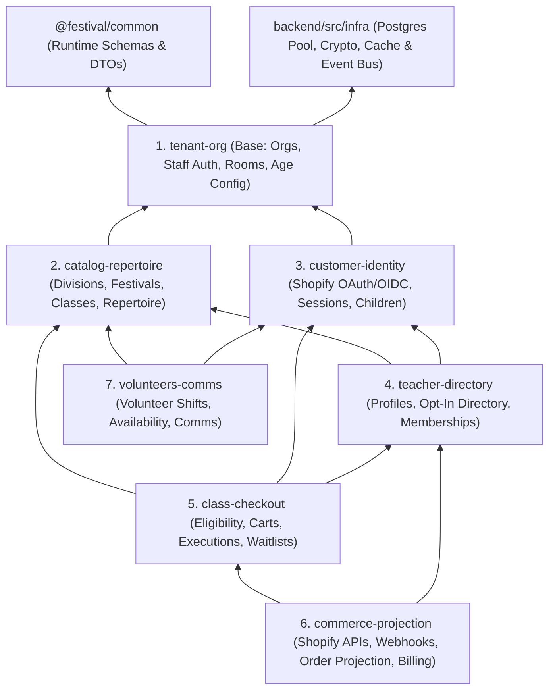

# Festival Bounded Contexts & Architecture Boundaries (2026)

## 1. Purpose, Scope, and Release Alignment

This specification defines the authoritative Strategic Domain-Driven Design (DDD) Context Map and mechanical boundary rules for `pafenorthwest/Festival`. It governs all feature work and modular decomposition across the **Release `v0.3.0`** baseline, the **Release `v0.4.0`** pre-Thanksgiving refactor sprint (`S00`–`S14`), and the **Release `v1.0.0`** December QA hardening cycle.

The boundaries defined here reconcile existing product specifications ([Phase1-Account-Memberships.md](./Phase1-Account-Memberships.md), [Phase-2-Class-Purchase-Entitlement.md](./Phase-2-Class-Purchase-Entitlement.md), [MUSICAL-REPERTOIRE.md](./MUSICAL-REPERTOIRE.md), and [VOLUNTEER-PORTAL.md](./VOLUNTEER-PORTAL.md)) with the live PostgreSQL 17 `orgs.*` schema ([postgres17-schema.sql](../database/postgres17-schema.sql)), backend Hono routes and services (`packages/backend/src/`), shared runtime schemas (`packages/common/src/`), and SolidJS frontend modules (`packages/frontend/src/`).

---

## 2. Anti-Overkill Policy

> [!IMPORTANT]
> **Strategic DDD Yes; Tactical DDD Ceremony No.** Boundaries exist to enable parallel, stateless multi-session engineering with zero merge conflicts and clear data ownership—not to introduce object-oriented framework overhead.

1. **Adopt Strategic DDD Ownership**: Partition tables, backend domain directories, shared runtime schemas, and frontend slices into **7 disjoint Bounded Contexts** connected by an acyclic dependency graph and typed cache-invalidation events.
2. **Reject Tactical DDD Ceremony**: Do **not** introduce abstract `AggregateRoot` or `Entity` base classes, `ValueObject` wrapper classes around primitive strings/numbers, CQRS command/query mediator buses, reflection-based DI containers, or event-sourcing frameworks.
3. **Plain TypeScript + SQL Read Models**: Implement business logic using plain TypeScript functions and focused `<=250`-line service/repository classes. Implement cross-table read views (such as parent registration dashboards and class eligibility lists) using direct, parameterized PostgreSQL 17 `JOIN` and CTE read-model queries rather than in-memory N+1 object hydration loops.
4. **Cohesive Unit Ceilings**: Enforce `<=500` lines per file, `<=250` lines per class, and `<=60` lines per function (target `<=40` lines, max 3 parameters; pass a single typed input object when more fields are required).

---

## 3. Summary Context Map (7 Bounded Contexts)

| # | Bounded Context | Backend Domain Dir (`packages/backend/src/domains/`) | Shared Schema (`packages/common/src/`) | Frontend Domain & API Client (`packages/frontend/src/`) | Published Domain Cache-Invalidation Events |
|---|---|---|---|---|---|
| 1 | **`tenant-org`** *(Base)* | `tenant-org/` | `tenant.ts` | `domains/admin-org/`, `lib/api/org-admin.ts`, `lib/api/auth.ts` | `OrgUpdated`, `RegistrationAgeConfigUpdated` |
| 2 | **`catalog-repertoire`** | `catalog-repertoire/` | `catalog.ts` | `domains/catalog/`, `lib/api/catalog.ts` | `FestivalCatalogUpdated`, `RepertoireUpdated` |
| 3 | **`customer-identity`** | `customer-identity/` | `customer.ts` | `domains/customer/`, `lib/api/customer.ts` | `CustomerIntegrationRotated`, `ChildUpdated` |
| 4 | **`teacher-directory`** | `teacher-directory/` | `directory.ts` | `domains/directory/`, `lib/api/directory.ts` | `TeacherDirectoryChanged`, `MembershipChanged` |
| 5 | **`class-checkout`** | `class-checkout/` | `registration.ts` | `domains/registration/`, `lib/api/registration.ts` | `CheckoutIntentResolved`, `ClassCapacityChanged` |
| 6 | **`commerce-projection`** | `commerce-projection/` | `commerce.ts` | `domains/admin-commerce/`, `lib/api/commerce.ts` | `ShopifySecretRotated`, `OrderProjected` |
| 7 | **`volunteers-comms`** | `volunteers-comms/` | `volunteers.ts` | `domains/volunteers/`, `lib/api/volunteers.ts` | *(None in `v0.4.0`)* |

---

## 4. Detailed Bounded Context Specifications

### 4.1 `tenant-org` (Base Context)
- **Authority Boundary**: Multi-tenant organization lifecycle, slug routing, IANA timezone configuration, registration-age cutoff dates, Firebase staff identity (`users`/`app_user`), staff role memberships and invitations, and physical venue rooms/piano configurations. Zero upward dependencies on any other domain context.
- **Owned `orgs.*` Tables**:
  - `orgs.organizations`, `orgs.registration_age_configurations`
  - `orgs.users`, `orgs.app_user`, `orgs.user_login_event`
  - `orgs.memberships`, `orgs.invites`
  - `orgs.rooms`, `orgs.room_piano_configurations`
- **Target Backend Slice (`packages/backend/src/domains/tenant-org/`)**:
  - `tenant-repository.ts`, `staff-membership-repository.ts`, `room-repository.ts` (extracted from `postgres-organization-repository.ts`)
  - `tenant-service.ts`, `staff-auth-service.ts`, `room-service.ts` (extracted from `organization-service.ts`)
  - `routes/` (organization admin CRUD, invites, staff role claims, room setup, public landing lookup)
- **Shared Schema & Frontend Slice**:
  - Runtime schemas & DTOs: `packages/common/src/tenant.ts`
  - Frontend UI & RPC: `packages/frontend/src/domains/admin-org/`, `packages/frontend/src/lib/api/org-admin.ts`, `packages/frontend/src/lib/api/auth.ts`
- **Published Invalidation Events**:
  - `OrgUpdated` (`{ organizationId, slug }`) — evicts organization-by-slug and public landing caches immediately.
  - `RegistrationAgeConfigUpdated` (`{ organizationId, slug }`) — evicts cached registration-age cutoff configuration so child age snapshots recalculate without stale 5-minute TTL drift.

### 4.2 `catalog-repertoire`
- **Authority Boundary**: Organization musical divisions, festival schedules and registration windows, class subtypes and instrument catalog values, configured festival classes (age bounds, piece limits, durations, capacities, audited Shopify product/variant GID links), and musical repertoire catalog works, contributors, classifications, CSV bootstrap/import (`#360`/`#359`), and repertoire review queues.
- **Owned `orgs.*` Tables**:
  - `orgs.organization_divisions`, `orgs.festivals`
  - `orgs.registration_catalog_values`, `orgs.festival_class_subtypes`
  - `orgs.festival_class_configurations`, `orgs.festival_class_capacity_audit_logs`
  - `orgs.repertoire_works`, `orgs.repertoire_contributors`, `orgs.repertoire_classifications`, `orgs.repertoire_work_contributors`, `orgs.repertoire_work_classifications`, `orgs.repertoire_review_items`
- **Target Backend Slice (`packages/backend/src/domains/catalog-repertoire/`)**:
  - `division-festival-repository.ts`, `registration-catalog-repository.ts`, `festival-class-repository.ts`, `repertoire-repository.ts`
  - `catalog-service.ts`, `festival-class-service.ts`, `repertoire-service.ts`, `repertoire-review-service.ts`
  - `routes/` (division/festival admin, class catalog admin, repertoire search, music review queue)
- **Shared Schema & Frontend Slice**:
  - Runtime schemas & DTOs: `packages/common/src/catalog.ts`
  - Frontend UI & RPC: `packages/frontend/src/domains/catalog/`, `packages/frontend/src/lib/api/catalog.ts`
- **Published Invalidation Events**:
  - `FestivalCatalogUpdated` (`{ organizationId, festivalId? }`) — evicts cached division, festival, and eligible-class read models.
  - `RepertoireUpdated` (`{ organizationId }`) — evicts cached repertoire work/classification lookups.

### 4.3 `customer-identity`
- **Authority Boundary**: Parent/participant authentication via Shopify Customer Account API (OAuth 2.0 PKCE/OIDC state, encrypted session tokens, CSRF tokens, same-origin logout), customer contact profiles with source provenance (`shopify` vs `festival`), staff profile-access consent and audit logs, and parent-managed child records with derived registration-age snapshots (birthdays are never persisted).
- **Owned `orgs.*` Tables**:
  - `orgs.shopify_customer_account_integrations`, `orgs.shopify_customer_oauth_states`, `orgs.shopify_customer_sessions`
  - `orgs.festival_customers`, `orgs.festival_customer_staff_consents`, `orgs.festival_customer_profile_access_audit`
  - `orgs.festival_children`, `orgs.festival_child_age_snapshots`
- **Target Backend Slice (`packages/backend/src/domains/customer-identity/`)**:
  - `customer-integration-repository.ts`, `customer-session-repository.ts`, `customer-profile-repository.ts`, `child-profile-repository.ts`
  - `customer-oauth-session-service.ts`, `customer-profile-service.ts`, `customer-child-profile-service.ts` (decomposed from `customer-account-service.ts`)
  - `routes/` (OAuth start/callback/logout, session bootstrap, customer account & child CRUD, admin customer search)
- **Shared Schema & Frontend Slice**:
  - Runtime schemas & DTOs: `packages/common/src/customer.ts`
  - Frontend UI & RPC: `packages/frontend/src/domains/customer/`, `packages/frontend/src/lib/api/customer.ts`
- **Published Invalidation Events**:
  - `CustomerIntegrationRotated` (`{ organizationId, integrationVersion }`) — invalidates cached Customer Account OAuth metadata and rejects superseded customer sessions.
  - `ChildUpdated` (`{ organizationId, customerId, childId }`) — invalidates per-customer eligibility memos when needed.

### 4.4 `teacher-directory`
- **Authority Boundary**: Teacher and accompanist participant profiles, division affiliations, public directory opt-in and admin approval workflow (`#361`), membership product offerings, division-count policies, active membership entitlement cohorts, and admin revocations.
- **Owned `orgs.*` Tables**:
  - `orgs.teacher_profiles`, `orgs.teacher_profile_divisions`
  - `orgs.accompanist_profiles`, `orgs.accompanist_profile_divisions`
  - `orgs.products`, `orgs.membership_division_policies`, `orgs.membership_division_policy_history`
  - `orgs.membership_entitlements`, `orgs.membership_entitlement_divisions`, `orgs.membership_entitlement_cohorts`, `orgs.membership_entitlement_revocations`, `orgs.membership_identity_emails`
  - `orgs.teacher_membership_entitlement_details`, `orgs.accompanist_membership_entitlement_details`
- **Target Backend Slice (`packages/backend/src/domains/teacher-directory/`)**:
  - `teacher-directory-repository.ts`, `membership-product-repository.ts`, `membership-entitlement-repository.ts`
  - `participant-directory-service.ts`, `public-membership-product-service.ts`, `membership-entitlement-service.ts`
  - `routes/` (`participant-profile.routes.ts`, public teacher/accompanist directory, membership offerings, admin membership management)
- **Shared Schema & Frontend Slice**:
  - Runtime schemas & DTOs: `packages/common/src/directory.ts`
  - Frontend UI & RPC: `packages/frontend/src/domains/directory/`, `packages/frontend/src/lib/api/directory.ts`
- **Published Invalidation Events**:
  - `TeacherDirectoryChanged` (`{ organizationId }`) — evicts public directory listings and registration teacher/accompanist picker caches.
  - `MembershipChanged` (`{ organizationId, customerId }`) — evicts public membership product and customer membership status caches.

### 4.5 `class-checkout`
- **Authority Boundary**: Class registration eligibility evaluation, cart assembly, registration metadata drafts (teacher/accompanist snapshots, musical pieces, 42-day pre-festival edit cutoff enforcement), idempotent checkout execution state machine and storefront binding (`#354`), lease recovery/restart flows, sold-out class waitlists, and post-purchase drop/transfer audit workflows.
- **Owned `orgs.*` Tables**:
  - `orgs.checkout_carts`, `orgs.checkout_intents`, `orgs.checkout_intent_lines`
  - `orgs.class_checkout_executions`, `orgs.class_checkout_execution_events`, `orgs.checkout_recovery_requests`
  - `orgs.registration_metadata`, `orgs.registration_repertoire_items`, `orgs.registration_repertoire_item_contributors`
  - `orgs.festival_class_waitlist_entries`, `orgs.festival_class_waitlist_events`
  - `orgs.registration_change_logs`
- **Target Backend Slice (`packages/backend/src/domains/class-checkout/`)**:
  - `checkout-intent-repository.ts`, `checkout-execution-repository.ts`, `registration-metadata-repository.ts`, `waitlist-repository.ts`
  - `class-eligibility-service.ts`, `class-checkout-execution-service.ts`, `checkout-recovery-service.ts`, `customer-registration-query-service.ts`, `waitlist-service.ts`
  - `routes/` (registration eligibility, cart/checkout start & restart, admin checkout recovery, registration metadata edits, waitlist endpoints)
- **Shared Schema & Frontend Slice**:
  - Runtime schemas & DTOs: `packages/common/src/registration.ts`
  - Frontend UI & RPC: `packages/frontend/src/domains/registration/`, `packages/frontend/src/lib/api/registration.ts`
- **Published Invalidation Events**:
  - `CheckoutIntentResolved` (`{ organizationId, customerId, checkoutIntentId }`) — refreshes customer checkout/registration status views.
  - `ClassCapacityChanged` (`{ organizationId, festivalId, festivalClassId }`) — evicts cached class availability/waitlist state.

### 4.6 `commerce-projection`
- **Authority Boundary**: Shopify Admin & Storefront API GraphQL transports, encrypted store credentials and webhook readiness verification, HMAC-verified `orders/paid` webhook ingestion and durable worker queue, paid order reconciliation, atomic entitlement issuance (`class_entitlements` and membership validation decisions), and billing ledgers, credits, invoices, and refund tracking.
- **Owned `orgs.*` Tables**:
  - `orgs.shopify_integrations`, `orgs.shopify_webhook_deliveries`, `orgs.shopify_order_projections`
  - `orgs.class_entitlements`
  - `orgs.membership_validation_decisions`, `orgs.membership_validation_decision_audits`, `orgs.membership_reconciliation_runs`
  - `orgs.billing_adjustments`, `orgs.billing_ledger`, `orgs.credit_balances`, `orgs.invoices`, `orgs.invoice_line_items`, `orgs.refund_events`
- **Target Backend Slice (`packages/backend/src/domains/commerce-projection/`)**:
  - `shopify-integration-repository.ts`, `webhook-delivery-repository.ts`, `order-projection-repository.ts`, `class-entitlement-repository.ts`, `billing-repository.ts`
  - `shopify-graphql-transport.ts`, `shopify-catalog-client.ts`, `shopify-orders-client.ts`, `shopify-webhooks-client.ts` (split from `admin-api-client.ts`)
  - `shopify-webhook-service.ts`, `shopify-order-projection-service.ts`, `reconciliation-service.ts`, `billing-service.ts`
  - `routes/` (admin Shopify integration setup, `/api/webhooks/shopify/orders-paid`, internal reconciliation, admin billing/decisions)
- **Shared Schema & Frontend Slice**:
  - Runtime schemas & DTOs: `packages/common/src/commerce.ts`
  - Frontend UI & RPC: `packages/frontend/src/domains/admin-commerce/`, `packages/frontend/src/lib/api/commerce.ts`
- **Published Invalidation Events**:
  - `ShopifySecretRotated` (`{ organizationId, integrationVersion }`) — flushes cached Admin/Storefront tokens and product offering caches (`ShopifyWebhookService.clearCaches` unified into domain bus).
  - `OrderProjected` (`{ organizationId, shopifyOrderGid, customerId? }`) — triggers downstream cache eviction across `class-checkout` capacity and `teacher-directory` memberships.

### 4.7 `volunteers-comms`
- **Authority Boundary**: Festival volunteer roles, AM/PM shift schedules, Firebase-authenticated volunteer signups and cancellations, child/accompanist festival-date hour availability matrices, and transactional email/SMS templates and delivery logs.
- **Owned `orgs.*` Tables**:
  - `orgs.volunteer_roles`, `orgs.volunteer_shifts`, `orgs.volunteers`, `orgs.volunteer_assignments`
  - `orgs.customer_festival_availability`
  - `orgs.message_templates`, `orgs.message_events`, `orgs.message_logs`
- **Target Backend Slice (`packages/backend/src/domains/volunteers-comms/`)**:
  - `volunteer-repository.ts`, `availability-repository.ts`, `message-repository.ts`
  - `volunteer-service.ts`, `availability-service.ts`, `communication-service.ts`
  - `routes/` (public/volunteer shift signup, admin volunteer management, customer availability, message templates)
- **Shared Schema & Frontend Slice**:
  - Runtime schemas & DTOs: `packages/common/src/volunteers.ts`
  - Frontend UI & RPC: `packages/frontend/src/domains/volunteers/`, `packages/frontend/src/lib/api/volunteers.ts`
- **Published Invalidation Events**: None required in `v0.4.0` (queries execute directly against indexed PostgreSQL tables).

### 4.8 Platform Infrastructure & Composition Root
Cross-cutting infrastructure outside domain business logic resides in dedicated non-domain layers:
- **Database Migration Ledger (`S06`)**: `orgs.schema_migrations` owned exclusively by `scripts/migrate.ts` and `database/migrations/*.sql`. Boot-time DDL in `initializePostgresSchema` is prohibited once `S06` lands.
- **Shared Backend Infrastructure (`packages/backend/src/infra/` & `routes/shared/`)**: PostgreSQL connection pool, AES-GCM secret keyring, `BoundedAsyncCache`, typed `DomainInvalidationBus`, `csrf-guard.ts`, declarative route-security builder, graceful `SIGTERM` drain, and the periodic `FOR UPDATE SKIP LOCKED` lease reaper (`S08`).
- **Composition Root (`packages/backend/src/app.ts`)**: Wires concrete repositories, port adapters, domain event subscribers, and typed Hono route groups (`AppType`).
- **Shopify Checkout Extension (`packages/shopify-confirmation/`)**: Standalone Shopify UI Extension communicating exclusively via public HTTPS return/status endpoints.

---

## 5. Acyclic Cross-Domain Dependency Graph & Communication Rules

### Permitted Cross-Domain Communication Rules
1. **Strict Directed Acyclic Graph (DAG)**: A domain module in `packages/backend/src/domains/<context>/` may only import from its own context, `@festival/common`, `packages/backend/src/infra/`, `packages/backend/src/routes/shared/`, or an upstream context explicitly permitted by the DAG table below:
   - `tenant-org`: *(none)*
   - `catalog-repertoire`: `tenant-org`
   - `customer-identity`: `tenant-org`
   - `teacher-directory`: `tenant-org`, `catalog-repertoire`, `customer-identity`
   - `volunteers-comms`: `tenant-org`, `catalog-repertoire`, `customer-identity`
   - `class-checkout`: `tenant-org`, `catalog-repertoire`, `customer-identity`, `teacher-directory`
   - `commerce-projection`: `tenant-org`, `catalog-repertoire`, `customer-identity`, `teacher-directory`, `class-checkout`
2. **Downward Calls via Narrow Ports Only**: When an upstream context needs downstream side effects or external transport—for example, `catalog-repertoire` provisioning a Shopify product during class creation, or `class-checkout` creating a Shopify Storefront cart—it defines a narrow TypeScript port interface (e.g., `ClassProductProvisionerPort`, `StorefrontCartPort`) within its own domain and receives the `commerce-projection` adapter via constructor injection in `app.ts`.
3. **Single-Writer SQL Ownership, Practical Read Joins**: Only the owning context's repositories may execute `INSERT`, `UPDATE`, `DELETE`, or `SELECT ... FOR UPDATE` on its owned `orgs.*` tables. Read-only `SELECT` queries may `JOIN` upstream `orgs.*` tables. As a specific exception, `class-checkout` may also join downstream `commerce-projection` table `orgs.class_entitlements` alongside upstream `orgs.festival_class_configurations` for parent registration dashboards. This SQL read does not permit a downstream code import or change table ownership. Every cross-context join must be covered by a PostgreSQL 17 integration test and validated by `scripts/check-sql.ts`.
4. **Zero Uninvalidated Cross-Domain Caches**: Every in-memory `BoundedAsyncCache` must subscribe to the corresponding domain invalidation event(s) on `DomainInvalidationBus` and must **never** cache `null` ("not found") responses across requests.

---

## 6. Mechanical Enforcement Contract (`architecture-boundaries.test.ts`)

Architectural drift across stateless sessions is prevented mechanically by `packages/backend/tests/architecture-boundaries.test.ts` (introduced in `S02` and enforced on every PR in `.github/workflows/pr-checks.yml`):

1. **Acyclic Import Verification**:
   - Parses TypeScript `import` / `export ... from` specifiers across all files under `packages/backend/src/domains/**` and `packages/frontend/src/domains/**`.
   - Fails immediately if any file imports a forbidden sibling or downstream domain, or reaches into another domain's internal files rather than its public `index.ts` barrel or `@festival/common`.
2. **File, Class, and Function Size Gates**:
   - Every file under `packages/backend/src/domains/**`, `packages/common/src/**`, and `packages/frontend/src/domains/**` must be `<= 500` lines (`0` unapproved exceptions). Legacy monolith files outside `domains/` are tracked on a monotonically shrinking allowlist from `S02` until `S09`–`S13` eliminate them completely.
   - Every class declaration in refactored modules must be `<= 250` lines, and every function/method must be `<= 60` lines (target `<= 40` lines).
3. **Static SQL & Type Gates**:
   - `scripts/check-sql.ts` runs as a blocking CI step validating both `sql.unsafe(...)` and `tx.unsafe(...)` call sites against the PostgreSQL parser.
   - Full `tsc --noEmit` runs across `packages/common`, `packages/backend` (including `tests/**/*.ts`), and `packages/frontend`.
4. **Retirement of Duplicate `InMemory*` SQL Emulators**:
   - Once `S02` activates `postgres:17-alpine` in CI (`POSTGRES_INTEGRATION_URL`), `InMemoryOrganizationRepository` (`2,333` lines) and sibling `InMemory*` SQL emulators (`~4,800` total lines) are frozen against new methods in `architecture-boundaries.test.ts`.
   - Sessions `S09`–`S11` delete each domain's `InMemory*` SQL emulator slice as its tests migrate to fast transactional PostgreSQL 17 integration suites and thin 10-line port stubs for pure unit logic.
