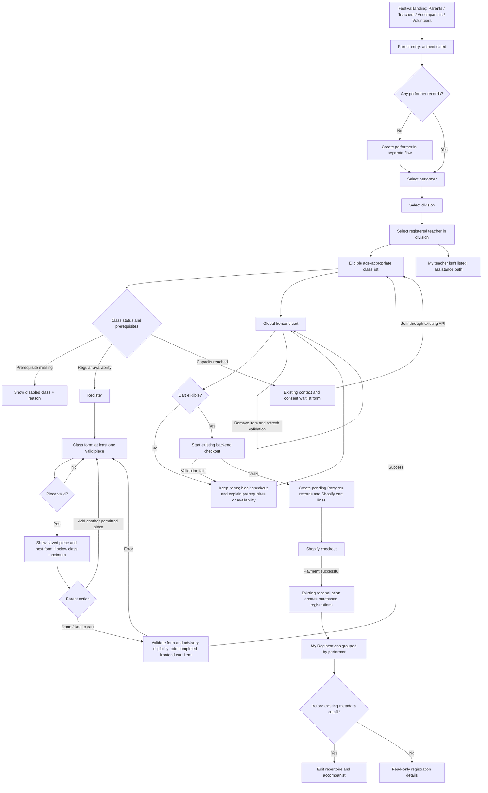

# Music Festival Registration — User Interface Specification

**Status:** Revised to preserve existing backend registration behavior  
**Version:** 1.9 — November 7, 2026  
**Audience:** Product, frontend, backend, QA  
**Scope:** Parent registration, class selection, repertoire entry, frontend cart, checkout, existing waitlist, and post-payment repertoire/accompanist editing.

## 1. Product goals and boundaries

Design a performer-centered, class-first registration experience that lets a parent register multiple classes, divisions, and children together. Optimize for a short implementation timeline by preserving the existing backend lifecycle: completed regular registrations are added to an in-memory frontend cart; pending Postgres records and Shopify cart lines are created together when checkout starts. Adding an item locally does not reserve capacity or create a backend registration.

The parent is authenticated before entering registration. Child creation is a separate existing workflow. Avoid server-side drafts, cart-line editing, custom seat holds, new incremental Shopify cart operations, and a new waitlist purchase flow. Reuse the existing separate contact/consent waitlist form and API.

**Decided:** Each regular class registration has its own repertoire. At least one valid piece is required before adding it to the frontend cart, subject to existing class-specific repertoire rules and piece maximums. The parent may add more pieces within the active form before adding the item. Once added, pre-payment changes use remove and re-register. After payment, both repertoire and accompanist may be edited until the existing cutoff; performer, teacher, division, and class remain fixed.

Waitlist entries remain separate from registration checkout: they use the existing contact/consent fields, do not require repertoire or a teacher selection in the waitlist payload, and do not become cart lines or purchases through this flow.

## 2. Flow diagram



**Flow notes:** The frontend cart is globally accessible within registration navigation. Removing an item refreshes validation without requiring navigation to the class list. After a successful Add to Cart, return to eligible classes with the same performer/division/teacher context. A local cart item has no guaranteed admission: checkout performs authoritative validation against current capacity. Preserve the existing behavior for an already-created backend/Shopify cart and payment reconciliation.

## 3. Navigation and page inventory

| Page | Route / routing boundary | Purpose |
|---|---|---|
| Festival Home | Existing `/org/:slug/festival/:festivalSlug` | Existing promenade/banner for Parents, Teachers, Accompanists, Volunteers |
| Performers | Existing `/org/:slug/account/children` | Separate account-level create/edit child records; no class selection or cart building |
| Registration | Existing `/org/:slug/festival/:festivalSlug/register` | Select performer, division, teacher; browse eligible classes and build new registrations |
| Class registration | Proposed child route or view within Registration; adapt to existing routing | Enter repertoire one piece at a time |
| Cart | Proposed dedicated route or view; adapt to existing routing | Review completed local items, remove items, validate eligibility; accessed from the header |
| Existing waitlist form | Existing route/modal | Join through the existing contact/consent workflow |
| Shopify checkout | Existing integration | Pay for eligible regular cart items |
| My Registrations | Reuse existing `/org/:slug/account/classes` and rename its current Classes label | Dedicated purchased-registration page, grouped by performer; account-wide with a festival filter when needed |
| Edit registration details | Proposed child route or view within My Registrations; adapt to existing routing | Post-payment repertoire and accompanist editing until the existing cutoff |

Existing routes above are retained rather than duplicated under new paths. Class-form, cart, and purchased-edit route names remain implementation choices. Selected registration context remains frontend navigation state; persistence of that context across refresh is not decided. The completed registration cart remains in memory, matching the existing implementation; reconnecting an already-created backend checkout is a separate concern.

### Parent navigation

Use one shared sidebar as the primary navigation across the parent experience. Remove the redundant top black account-navigation button row after moving its unique **Children** destination into the sidebar as **Performers**. Do not retain a second **Classes** destination alongside **My Registrations**.

| Navigation area | Contents | Behavior |
|---|---|---|
| Sidebar — Festival | **Festival Home**, **Performers**, **Registration**, **My Registrations** | Four distinct destinations with navigation icons and an active state for the current destination |
| Sidebar — Account | **Memberships**, **Contact Information**, **Order History**, **Availability** | Retain existing account destinations and their icons; Order History concerns orders/receipts, while My Registrations concerns purchased classes and permitted edits |
| Simplified header | Organization/festival identity, **Cart (count)**, account and sign-out controls | Keep the linked brand/home identity as a plain logo/name link. Give Cart, account, sign-out, and menu controls compact button treatment; do not repeat the sidebar destinations here |
| Page content | Contextual actions such as **Add Performer**, **Back**, **Add to Cart**, **Continue Registration**, and **Save Changes** | Keep task actions within the page rather than using them as a second global navigation row |

Use three responsive navigation states, preserving the same destinations and order:

- **Wide, 1101 px and above:** show icons with text labels in the full sidebar. A dark collapse/expand button may switch this sidebar to the compact icon rail without changing destinations.
- **Intermediate, 761–1100 px:** show a compact icon-only sidebar before introducing the hamburger menu. Retain an accessible name and a hover/focus label for every destination, plus a visible current-page indicator. Keep labels available to assistive technology even when visually hidden.
- **Mobile, 760 px and below:** show a hamburger button that opens the same sidebar with both icons and text labels. Expose the menu's expanded state and controlled navigation region; do not create another navigation hierarchy.

Keep the cart count and account controls accessible in the simplified header at all widths. The brand/home identity remains a semantic link with plain logo/name styling rather than button treatment. Cart remains a semantic link styled as a button; commands such as account, sign-out, and menu toggles remain buttons. Static organization/festival text does not need button treatment.

**Performers** manages child records independently of festival registrations. **Registration** creates new class selections for the active festival; keep that festival identity visible and preserve/resolve festival context when returning from an account page. **My Registrations** is a dedicated account-level purchased-registration page, reusing the existing Classes route; it can show registrations across festivals with a festival filter when needed. It is separate from the unpaid cart and from Order History.

The class form keeps **Registration** active in the sidebar; purchased-detail editing keeps **My Registrations** active. The cart uses the header shortcut's active state rather than adding another sidebar destination. Retain the existing festival landing page as the role-based gateway; do not add a redundant dashboard. Clicking the Parents banner: if no child exists, route to **Performers** creation and then return to **Registration**; otherwise enter **Registration** at performer selection.

Keep Festival Home simple and audience-focused, with a festival heading and **Register** section followed by four compact stacked audience choices in the existing order: **Teachers**, **Parents**, **Volunteers**, and **Accompanists**. Retain the existing blue (`#4459d6`), red (`#b94d36`), green (`#1f7a57`), and gold (`#b6872c`) hues as leading accents, paired with light tinted backgrounds and darker readable role labels. Blend these choices with the rest of the site using thin borders, 4 px corners, no heavy shadow, left-aligned labels at approximately 22 px/600 on desktop and 20 px on mobile, and a subtle directional arrow. Keep the audience choices left-aligned at 60% of the page content width and 64 px high. Match the other pages' 500-weight festival heading and restrained 22–24 px **Register** section heading. Do not show an **All Memberships** button below the choices; the existing **Memberships** sidebar destination remains. Preserve the shared sidebar/header shell, serif font, and page gradient so the role gateway feels part of the same site.

### Static mockup coverage

The five primary mockups are **Registration workspace**, **Class registration / piece editor**, **Cart**, **My Registrations**, and **Edit Repertoire / Accompanist**. All use the same sidebar and simplified header. Performers remains a clearly separate navigation destination for the existing child-record workflow; its presence does not merge child creation into Registration. Mockups use illustrative data and do not change the live application.

Festival Home is a supporting preview with simple audience choices whose soft color tints and original-hue accents blend with the other mockups. It does not replace or add to the five primary registration mockups.

## 4. Screen specifications

### 4.1 Registration workspace

- Persistent editable selectors: **Performer → Division → Teacher**.
- Changing performer resets division and teacher; changing division resets teacher. Changing any of these resets active class selection. Completed frontend cart items remain unchanged.
- Teacher selector includes only registered teachers in the selected division, plus **My teacher isn't listed** assistance link. No provisional/unregistered teacher entry.
- Show only age-appropriate classes. Classes with unmet registration prerequisites remain visible but disabled with clear reason; out-of-age classes are hidden.
- A registration prerequisite may be satisfied by a qualifying prior purchase or another qualifying completed frontend cart item, using existing eligibility rules.
- Class cards show class name, age bracket, status, prerequisite explanation, and a single primary action.
- At the configured capacity threshold, show **Join Waitlist** using the existing waitlist workflow. Do not silently convert a regular registration or submit a waitlist entry on the parent's behalf.
- Already-in-cart or previously purchased registrations should be labeled to avoid duplicates. Keep separate waitlist status distinguishable from purchased-registration status.
- After adding an item to the frontend cart, return to this class list with context retained.

### 4.2 Class registration and piece editor

- Class-first: select a regular class before entering repertoire.
- Show one piece form per step. Use the existing shared repertoire contract and current class policy for title, composer, movement, duration, catalog selection, and any other applicable fields. Duration remains required positive whole seconds under the existing contract.
- At least one valid piece is required for a regular registration; enforce the current class maximum and class-specific constraints.
- After saving a piece, automatically open the next empty piece form only when the class allows another piece. Show **Done / Add to Cart** alongside the ability to continue. Do not require that empty next piece to be completed or submit it as a piece.
- At the class piece maximum, show the completion action without another empty piece form.
- Back/Next within the active form retains data.
- Navigating away from an unfinished class registration shows **Discard changes?** confirmation. Confirm discards transient data; cancel stays in the form.
- No server-side drafts for unfinished class forms.
- On Add to Cart, validate mandatory fields, class policy, duplicates, and advisory eligibility using existing functionality; add only the completed entry to the in-memory frontend cart. Do not create Postgres records or Shopify lines at this point.
- On success, clear the active form and return to eligible classes with context preserved.
- Waitlist joining uses the existing separate form, not this repertoire editor.

### 4.3 Cart and checkout

- The global frontend cart can contain regular registrations for multiple children, divisions, teachers, and classes. Waitlist entries remain outside it.
- Cart items are complete at addition. No cart-line editing. To change an item before checkout, remove and re-register.
- Removing a prerequisite does not automatically remove dependent registrations. Retain them and block checkout with a clear explanation until a qualifying prerequisite is restored or the dependent item is removed.
- Provide **Continue registration** returning to prior context.
- Re-evaluate advisory eligibility after cart changes. At checkout, submit all current items to the existing backend checkout operation, which validates ownership, age, teacher, repertoire, duplicates, prerequisites, capacity, and other existing rules before creating pending records and the Shopify cart.
- A local regular item can become ineligible if configured capacity is reached after it was added. Preserve the item, explain the issue, and block checkout until resolved or removed. Offer an explicit route to the existing waitlist workflow; joining it does not convert or remove the cart item automatically.
- Preserve the existing treatment of already-created backend/Shopify carts and their paid reconciliation. Do not add new admission guarantees, seat reservations, or capacity policy changes. Separately configured Shopify hard inventory constraints still apply.
- The backend checkout intent/cart has its existing application-defined 30-minute lifetime beginning at checkout creation, not local Add to Cart. Existing resume uses the same session and idempotency key; retain/reuse that key for retries of the same checkout payload. A changed payload must not be submitted under an old key.
- Do not promise that the hosted Shopify checkout URL itself expires at 30 minutes. The application rejects expired intent reuse and payments outside its accepted lifetime using existing logic.
- In-memory frontend entries are not a durable server cart and are not restored merely by reconnecting an existing backend checkout. No account-wide cart discovery or new mutable server-cart API is required.

### 4.4 Existing waitlist

- Reuse the current waitlist form, contact/consent validation, authorization, join/withdraw operations, and persistence.
- No repertoire entry, teacher/repertoire metadata extension, Shopify cart line, or payment is introduced for waitlist joining.
- Show a clear success or existing-entry result from the existing API. Preserve the separate nature of waitlist entries and paid registrations, including historical paid-waitlisted registrations returned by the purchased-registration API.
- When navigating from a dirty registration form to waitlist joining, apply the same discard confirmation. Entered repertoire is not submitted through the waitlist API.

### 4.5 My Registrations and post-payment editing

- Show purchased registrations grouped by performer, with expandable lightweight groups.
- Each class row shows class, division, teacher, registration status, repertoire summary, accompanist where present, and **Edit** when permitted. Place an information icon beside Edit with the full help text **Edit Repertoire / Accompanist** in a tooltip. Make that help available on hover, keyboard focus, and tap; give the information trigger an accessible name and associate the tooltip through `aria-describedby`.
- Extend the existing purchased-registration response with `metadata.teacherName: string | null` from the stored registration snapshot, plus `metadataEditCutoffIso: string | null` and `canEditMetadata: boolean` on each registration item. Compute the cutoff/edit availability using current server logic. A null teacher name explicitly represents unavailable historical snapshot data; do not invent a name.
- After purchase, performer, teacher, division, and class are fixed. Both repertoire and accompanist remain editable through the existing authorized metadata update operation before cutoff.
- Preserve the existing cutoff exactly: 42 calendar days before festival start, at the start of that day in the organization's timezone. Do not add a configurable cutoff or change its boundary behavior.
- Use `metadataEditCutoffIso` and `canEditMetadata` for display of both repertoire and accompanist editing. If historical metadata, festival, or class configuration is unavailable, show details read-only; cutoff is null when it cannot be determined. After cutoff show details read-only with the reason. The server remains authoritative and rejects late updates, including when the cutoff passes while a form is open.
- Reuse the piece editor where practical; keep post-payment save/authorization separate from initial cart submission, and preserve current repertoire and active-accompanist validation.

## 5. Visual design and interaction

- Preserve the current site's serif font stack across page text, navigation, form controls, and buttons: `"Iowan Old Style", "Palatino Linotype", "URW Palladio L", P052, serif`. Use the existing system fallbacks rather than introducing a new body font.
- Preserve the existing page background: a blue `rgba(68, 89, 214, 0.16)` radial gradient at the top left fading at 28%, a gold `rgba(182, 135, 44, 0.12)` radial gradient at the top right fading at 22%, over a vertical gradient from `#fdfaf3` through `#f7f4ee` at 46% to `#efe8da`. Keep the main page background transparent and use restrained translucent surfaces so the gradient remains visible.
- Restore navigation icons consistent with the current site's Material Symbols Outlined vocabulary. Icons are decorative alongside an accessible destination name; never depend on the icon alone to provide the accessible label. Bundle mockup icon assets locally so previews do not depend on remote font loading.
- Align Festival Home with the restrained styling of the other pages while retaining its four audience choices and recognizable blue/red/green/gold hues. Use soft tinted backgrounds, original-hue leading accents, thin borders, 4 px corners, dark left-aligned labels, and a subtle arrow; remove the heavy banner shadow. Choices stay 60% wide and 64 px high, with approximately 22 px/600 desktop labels and 20 px mobile labels. Use the same 500-weight page heading and restrained section heading as the rest of the site. Keep **All Memberships** absent below the choices and preserve the shared sidebar, simplified header, serif fonts, and background gradient.
- Minimal UI treatment: thin neutral borders, restrained spacing, subtle hover backgrounds and approximately 120–180 ms transitions.
- Avoid decorative cards, complex animations, and dashboard-like visual noise.
- Full-width mobile-friendly form fields; one repertoire piece per screen.
- Distinguish **Available**, **Waitlist**, **Prerequisite unmet**, **In cart**, and **Purchased** with text, not color alone.
- Provide keyboard focus states, labels, accessible error messages, and explicit confirmation before discarding unsaved work.
- Use one obvious primary action per screen.
- Use the shared sidebar and simplified header consistently. Keep the brand/home identity link visually plain, and give Cart, account, sign-out, and menu controls visible button treatment. Keep the sidebar as the only primary navigation hierarchy, utility buttons compact, and the primary page action distinct; do not restore the duplicate account-navigation row.

## 6. Data and integration contracts

### 6.1 State boundaries

| State | Source | Lifetime |
|---|---|---|
| Selected performer/division/teacher | Frontend navigation state | Current registration navigation; context persistence across refresh TBD |
| Active incomplete class + pieces | Frontend transient state | Until added or explicitly discarded |
| Completed regular cart entries | Existing in-memory frontend cart | Current frontend session; no new durable cart persistence |
| Pending registration metadata and Shopify cart/line references | Existing backend checkout creation | Created at checkout; existing application-defined 30-minute intent/cart lifetime |
| Separate waitlist entry | Existing waitlist API and persistence | Existing join/withdraw lifecycle; no checkout participation |
| Purchased registration, repertoire, and accompanist | Existing Postgres implementation | Durable; edits limited by existing metadata cutoff |

### 6.2 Suggested frontend types (illustrative)

```ts
import type { RepertoirePiece } from '@festival/common';

type RegistrationContext = {
  performerId: string | null;
  divisionId: string | null;
  teacherId: string | null;
};

type ActiveClassRegistration = {
  classId: string;
  context: RegistrationContext;
  pieces: RepertoirePiece[];
  activePieceIndex: number;
  dirty: boolean;
};
```

These are frontend conceptual types, not replacements for existing database tables or API contracts. Reuse the current frontend cart and shared repertoire types. No regular/waitlist cart-intent discriminator or trusted add-time admission reference is introduced.

### 6.3 Service responsibilities

| Operation | Expected behavior |
|---|---|
| List performers | Existing API returns only children linked to authenticated parent |
| List divisions / teachers | Existing APIs filter teachers to active division and registration status |
| List classes / advisory eligibility | Existing age, prerequisite, duplicate, and capacity rules; frontend presents explanations |
| Add/remove frontend cart item | Frontend state only; no Postgres or Shopify write |
| Start regular cart checkout | Existing backend validates the whole submission, then creates pending records and Shopify lines |
| Join/withdraw waitlist | Existing separate contact/consent API; no repertoire or cart participation |
| Resume checkout | Existing same-session/idempotency behavior within application expiry; no new general cart discovery |
| Payment reconciliation | Preserve existing idempotency, expiry validation, and treatment of attached cart capacity |
| List purchased registrations | Extend existing response with snapshot teacher display information and exact effective cutoff/edit availability |
| Edit purchased metadata | Existing parent authorization, repertoire/accompanist validation, and cutoff enforcement |

### 6.4 Backend/common change boundary

The requested backend/common extension is limited to additive purchased-registration response fields: `metadata.teacherName: string | null`, `metadataEditCutoffIso: string | null`, and `canEditMetadata: boolean`. The availability flag applies to both repertoire and accompanist edits and is false when the required historical metadata/festival/class configuration is unavailable. Preserve existing cart creation timing, waitlist contracts, capacity evaluation, payment reconciliation, cutoff derivation, and metadata update capabilities. No database or API redesign is implied by the frontend conceptual types.

## 7. Error and edge-case behavior

1. **Teacher missing:** Show assistance path; do not permit bypass for regular registration.
2. **Unmet class prerequisite:** Show class disabled with requirement; re-evaluate after cart changes.
3. **Capacity reached during form entry or after local addition:** Show current ineligibility, retain entered/local cart data until the parent removes or discards it, and offer the existing waitlist workflow explicitly. Do not submit repertoire to waitlist or promise admission from local addition.
4. **Prerequisite removed from cart:** Preserve dependent registration and block checkout.
5. **Parent changes context with dirty form:** Confirm discard; completed cart items remain unchanged.
6. **Backend checkout expired:** Explain expiry and follow existing pending-record/reconciliation behavior. A fresh local registration/checkout may be required; do not imply automatic restoration of frontend entries.
7. **Payment fails:** Reuse the existing same-session checkout when recoverable and unexpired; rely on reconciliation for authoritative purchase status.
8. **Metadata cutoff reached:** Disable both repertoire and accompanist editing in UI and reject updates server-side using the unchanged cutoff.
9. **Concurrent purchases:** Recheck capacity when starting checkout. Preserve existing attached-cart reconciliation behavior and Shopify inventory constraints.
10. **Historical teacher snapshot missing:** Show an explicit unavailable/unknown teacher display state while keeping the registration usable; do not substitute an unrelated current teacher name.

## 8. Acceptance scenarios

- Parent with no child is directed to performer creation, then can enter registration.
- The shared sidebar exposes separate **Performers**, **Registration**, and **My Registrations** destinations; no duplicate top account-navigation row or competing Classes label remains.
- Performers creates/edits child records; Registration builds new class selections for the visible active festival; My Registrations reuses the existing purchased-classes route and remains separate from Cart and Order History.
- Every primary mockup uses the same simplified header with a plain linked brand/home identity, **Cart (count)**, and account controls. Cart, account, sign-out, and menu controls are visibly styled as buttons.
- The shared navigation shows icons and labels at wide widths, an icon-only rail at intermediate widths, and a hamburger-controlled menu with icons and labels on mobile. Icon-only destinations retain accessible names, hover/focus labels, keyboard focus, and current-page state.
- Mockups retain the current site's serif typography and page background gradient; local icon assets render without a remote font request.
- Class registration keeps Registration active; purchased metadata editing keeps My Registrations active; Cart is accessed and marked active in the header.
- Parent with children enters registration and selects performer, division, and registered teacher.
- Class list hides out-of-age classes and explains unmet prerequisites on visible disabled classes.
- For a class permitting another piece, saving the first piece opens the next empty form, and Add to Cart succeeds without completing that empty form. At the class piece maximum, no extra form is opened.
- Add to Cart changes frontend state only; Postgres pending records and Shopify cart lines are created when the existing checkout operation starts successfully.
- Parent adds multiple regular classes for one child without reselecting context.
- Parent switches child/division/teacher; completed frontend cart items remain intact.
- Parent joins a full class's waitlist through the existing contact/consent form without repertoire, Shopify lines, or checkout.
- Parent abandons a dirty form and receives a discard confirmation.
- Parent removes a solo prerequisite; dependent concerto stays in cart and checkout is blocked.
- Parent restores a qualifying prerequisite; checkout becomes available if all other validations pass.
- A regular local cart item that loses capacity can block checkout; the UI retains it and explains removal or the separate waitlist option.
- Parent retries the same unexpired backend checkout using its existing session/idempotency identity within the 30-minute application window.
- Purchased registrations appear grouped by performer and show stored snapshot teacher information or an explicit historical-data fallback.
- Editable purchased rows show a concise **Edit** action. The adjacent information icon reveals **Edit Repertoire / Accompanist** on hover, keyboard focus, or tap without changing the edit destination or permitted fields.
- Purchased rows expose accurate cutoff/edit availability consistent with the organization's timezone and unchanged 42-day rule.
- Parent can edit both repertoire and accompanist before cutoff; at and after cutoff both are read-only and server updates are rejected.
- Existing paid registration statuses and attached-cart reconciliation continue to behave as before.

## 9. Explicit non-goals for MVP

- Persist incomplete class-registration drafts or completed frontend cart entries across sessions.
- Edit existing cart lines in place.
- Reserve seats or guarantee admission when a class is selected or added locally.
- Create pending Postgres registrations or Shopify lines on Add to Cart.
- Introduce incremental backend cart add/remove operations or general account-wide cart discovery.
- Automatically delete dependent registrations when a prerequisite is removed.
- Replace the existing separate waitlist form, require repertoire for waitlist joining, or add waitlist purchase/cart participation.
- Add a new parent dashboard beyond existing festival landing/navigation.
- Redesign the existing Postgres pending-registration / Shopify checkout integration or capacity/reconciliation policy.
- Change the existing metadata cutoff or remove accompanist editing.

## 10. Open decisions / implementation verification

1. Registration context persistence after refresh: client memory, URL query parameters, or session storage. This concerns selector context, not durable registration drafts or completed cart persistence.
2. Exact repertoire fields, required-field rules, piece maximums, catalog requirements, and class-specific constraints must follow the current shared types and festival policy.
3. Verify frontend retry identity handling against the existing same-session/idempotency checkout resume path. Retain the 30-minute application window without claiming native Shopify hosted-checkout expiration.
4. Confirm whether separately configured hard Shopify inventory constraints can reject checkout; preserve them.
5. Verify the additive purchased-response fields `metadata.teacherName`, `metadataEditCutoffIso`, and `canEditMetadata`, including historical null/read-only cases; the frontend should consume these returned values.
6. Adapt proposed routes to existing routing and reuse current waitlist/checkout/update APIs.

---

**Decision summary:** One primary sidebar with separate Performers, Registration, and My Registrations destinations; restored navigation icons; full labels, intermediate icon rail, and mobile hamburger states; simplified identity/cart/account header with a plain linked brand and button treatment for utility controls; current-site serif typography and background gradient; performer-first entry; editable context selectors; age-appropriate catalog with disabled unmet prerequisites; class-first regular repertoire; one piece per screen with existing limits; optional next empty piece; no drafts; completed in-memory frontend cart entries; remove/re-register before payment; separate existing contact/consent waitlist; authoritative capacity checks at checkout; dependent items retained but checkout blocked; Postgres pending records and Shopify lines created at checkout; purchased registrations grouped by performer with snapshot teacher and accurate edit availability; repertoire and accompanist editing until the unchanged cutoff; minimal bordered UI.
