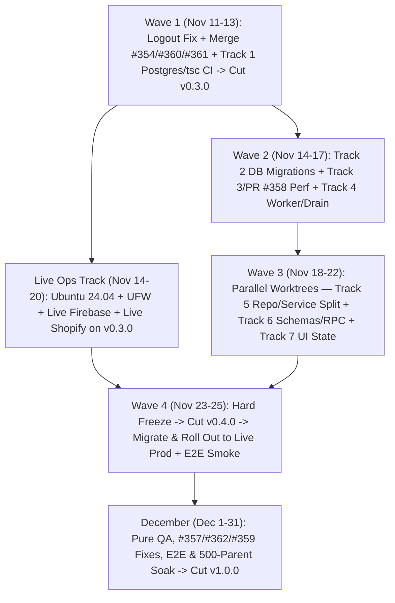

# Pre-Thanksgiving Master Program Plan & Stateless Session Ledger (`pafenorthwest/Festival`)

## Part 1 — Executive Strategy, Dual-Release Safety Architecture & Decisions

This specification is the repository-committed master execution plan and stateless session ledger governing `pafenorthwest/Festival` from **November 11, 2026** through **Thanksgiving (November 26, 2026)** and the **December 2026** QA soak cycle. Completing **both** (a) `#354` + `#361` + Live Shopify/Firebase Production **and** (b) the **Full 7-Track Codebase Refactor** before Thanksgiving—leaving **100% of December for testing and bug fixes**—is achieved safely by separating risk across **two pre-Thanksgiving releases (`v0.3.0` then `v0.4.0`)**:

1. **`v0.3.0` Feature Baseline (`Nov 11–13`, Days 1–3)**: Merge `#354` (with logout CSRF fix, auto-closing `#353`), `#360`, and `#361` (Teacher Directory), **plus Track 1 (Real Postgres 17 + `tsc` CI gate)**. Cut `v0.3.0` immediately.
2. **Parallel Live Infrastructure Track (`Nov 14–20`, Days 4–10)**: Provision Ubuntu 24.04, UFW (`#95`), TLS, Live Firebase, and Live Shopify against stable **`v0.3.0`**. External lead-time risks (DNS, TLS, Shopify scopes, Checkout UI Extension, Firebase domain auth) are retired **a full week before Thanksgiving**.
3. **Parallel Full Refactor Sprint (`Nov 14–22`, Days 4–12 -> `v0.4.0` Cutover `Nov 23–25`)**: With real Postgres 17 + full `tsc` running on every PR, autonomous subagent teams execute **Tracks 2–7 + PR `#358`** in isolated git worktrees. **Hard Refactor Freeze hits Nov 23**: everything green ships in **`v0.4.0`** onto the live host by Nov 24–25; any incomplete module split hits the circuit-breaker without ever threatening the live Thanksgiving site.
4. **December (`Dec 1–31` -> `v1.0.0`)**: **Zero structural refactoring.** 100% dedicated to class registration bug fixes (`#357`, `#362`, `#359`, `#327`–`#341`), Playwright E2E suites, adversarial failure injection, and 500-parent spike soak testing on the refactored codebase.

### Open Decisions Checklist (`D1`–`D4`)
- [x] **D1 (#361 Approval Policy — DECIDED 2026-11-11)**: Active paid Teacher Membership + checked opt-in box **auto-creates / auto-approves** public directory visibility immediately (`approved`), with Admin retaining a one-click visibility toggle. *(`S03` unblocked -> `READY`.)*
- [x] **D2 (#357 Checkout Edge Cases B1/B2 — DECIDED 2026-11-11)**: Defer `B1`/`B2` to the December Week 1 bug-fix sprint (since November live traffic is teacher memberships).
- [x] **D3 (#354 QA Dump Cleanup — DECIDED 2026-11-11)**: Stripped `+8,592` lines of `tasks/festival-registration-ui/validation/browser-*results.json` (5 files) on `ericp/registration-flow-redesign` prior to merging `#354`.
- [ ] **D4 (Production Infrastructure)**: `<prod-domain>` **CONFIRMED `2026-11-12` as `artsfestival.online`** (`https://artsfestival.online`); remaining items (DNS cutover access, Ubuntu 24.04 host SSH access, production Firebase project access, and production Shopify organization ownership) scheduled for Monday `2026-11-16` *(blocks `S05` execution until confirmed)*.

---

## Part 1B — Multi-Session Strategic DDD & Spec-Driven Operating Model

Spreading a full refactor across multiple stateless Antigravity sessions requires **strict file/domain ownership** and **immutable handoff specs**. Rather than inventing heavyweight ceremony, we combine **lightweight Strategic DDD** with the repository's **existing Spec-Driven Development (`specs/` + `goals/` + `tasks/`) harness** ([AGENTS.md](../AGENTS.md), [codex-config.yaml](../.codex/codex-config.yaml), [project-structure.md](../.codex/project-structure.md)):

> [!NOTE]
> **Anti-Overkill Rule**: Use **Strategic DDD** (Bounded Contexts, table/folder ownership, acyclic import rules, domain invalidation events) and **reject Tactical DDD ceremony** (zero abstract `AggregateRoot` base classes, `ValueObject` wrappers, CQRS mediator buses, or event-sourcing frameworks). Keep plain TypeScript functions, focused `<=500`-line services/repos, and SQL read models.

### 1B.1 Strategic DDD Context Map Summary (Authoritative Spec: [bounded-contexts-2026.md](./bounded-contexts-2026.md))
Reconciling [Phase1-Account-Memberships.md](./Phase1-Account-Memberships.md), [Phase-2-Class-Purchase-Entitlement.md](./Phase-2-Class-Purchase-Entitlement.md), [MUSICAL-REPERTOIRE.md](./MUSICAL-REPERTOIRE.md), and [VOLUNTEER-PORTAL.md](./VOLUNTEER-PORTAL.md) with live code yields **7 disjoint Bounded Contexts**:

| Bounded Context | Owned `orgs.*` Tables (Summary) | Target Backend Slice (`packages/backend/src/domains/`) | Common Schema & Frontend Slice | Emitted Domain Events |
|---|---|---|---|---|
| **1. `tenant-org`** *(Base)* | `organizations`, `users`, `app_user`, `memberships`, `invites`, `registration_age_configurations`, `rooms` | `tenant-org/` (org CRUD, staff auth/claims, rooms, timezone, age-cutoff config) | `common/src/tenant.ts` + `frontend/src/domains/admin-org/`, `lib/api/org-admin.ts` | `OrgUpdated`, `RegistrationAgeConfigUpdated` |
| **2. `catalog-repertoire`** | `organization_divisions`, `festivals`, `registration_catalog_values`, `festival_class_configurations`, `repertoire_*` | `catalog-repertoire/` (divisions, festivals, classes, pieces, `#360`/`#359` CSV) | `common/src/catalog.ts` + `frontend/src/domains/catalog/`, `lib/api/catalog.ts` | `FestivalCatalogUpdated`, `RepertoireUpdated` |
| **3. `customer-identity`** | `shopify_customer_account_integrations`, `festival_customers`, `shopify_customer_sessions`, `shopify_customer_oauth_states`, `festival_children`, `festival_child_age_snapshots` | `customer-identity/` (Shopify OAuth/PKCE/OIDC, sessions, parent profile, children + age snapshots) | `common/src/customer.ts` + `frontend/src/domains/customer/`, `lib/api/customer.ts` | `CustomerIntegrationRotated`, `ChildUpdated` |
| **4. `teacher-directory`** | `teacher_profiles`, `accompanist_profiles`, `products`, `membership_entitlements`, `membership_entitlement_revocations` | `teacher-directory/` (`#361` public teacher directory, membership checkout & status, cohorts) | `common/src/directory.ts` + `frontend/src/domains/directory/`, `lib/api/directory.ts` | `TeacherDirectoryChanged`, `MembershipChanged` |
| **5. `class-checkout`** | `checkout_carts`, `checkout_intents`, `class_checkout_executions`, `class_checkout_execution_events`, `checkout_recovery_requests`, `registration_metadata`, `festival_class_waitlist_entries`, `registration_change_logs` | `class-checkout/` (`#354` eligibility, cart handoff, lease recovery, waitlist, 42-day metadata edits, drop/transfer) | `common/src/registration.ts` + `frontend/src/domains/registration/`, `lib/api/registration.ts` | `CheckoutIntentResolved`, `ClassCapacityChanged` |
| **6. `commerce-projection`** | `shopify_integrations`, `shopify_webhook_deliveries`, `shopify_order_projections`, `class_entitlements`, `membership_validation_decisions`, `billing_*`, `invoices`, `refund_events` | `commerce-projection/` (Shopify Admin/Storefront transport, `ORDERS_PAID` webhook queue, order reconciliation, entitlement grant) | `common/src/commerce.ts` + `frontend/src/domains/admin-commerce/`, `lib/api/commerce.ts` | `ShopifySecretRotated`, `OrderProjected` |
| **7. `volunteers-comms`** | `volunteer_roles`, `volunteer_shifts`, `volunteers`, `volunteer_assignments`, `customer_festival_availability`, `message_*` | `volunteers-comms/` (volunteer shifts, availability, email/SMS templates) | `common/src/volunteers.ts` + `frontend/src/domains/volunteers/`, `lib/api/volunteers.ts` | — |

- **Mechanical Boundary Enforcement**: A fast unit test (`packages/backend/tests/architecture-boundaries.test.ts`) scans `import` specifiers across `packages/backend/src/domains/*` to enforce acyclic dependencies (`tenant-org` <- `catalog-repertoire` / `customer-identity` <- `teacher-directory` / `class-checkout` <- `commerce-projection`) and file-size ceilings (`<=500` lines/file), preventing cross-session architectural drift.

### 1B.2 Stateless Session Handoff & Context-Hygiene Protocol (`goals/` + `tasks/` + `.agents/skills/festival-session/SKILL.md`)
Every Antigravity session follows 4 strict context-management commitments plus the repo's SDD contract:
- **Context Commitments**: (1) **1 Packet (`S01`–`S14`) = 1 Fresh Conversation** using Git as durable memory once `S00` merges; (2) **Thin Coordinator + Subagent Delegation** so main chat never ingests giant files or raw logs; (3) **Progressive Disclosure** by placing the SDD/DDD runbook in `.agents/skills/festival-session/SKILL.md` while leaving [AGENTS.md](../AGENTS.md) lean and untouched; and (4) **`/compact` & `@` Mentions** as mid-session safety valves.
1. **Preflight (<60s)**: Activate `festival-session` skill; read `specs/pre-thanksgiving-program.md` (ledger) + [bounded-contexts-2026.md](./bounded-contexts-2026.md) + packet `goals/<slug>/goals.v0.md` (`State: locked`, `[G1..GN]` criteria) + `tasks/<slug>/spec.md` (`In scope` owned files, `Out of scope` locked files, exact `pwsh` verification commands).
2. **Isolated Branch / Worktree**: Create branch `refactor/<slug>` (or `feat/<slug>` / `fix/<slug>`). Touch **only** paths listed under `In scope` so parallel sessions merge with `exit=0`. Never stage or delete unrelated `goals/` or `tasks/` directories.
3. **Red-Green Implementation & Unified Gate**: Write/update deterministic tests first; implement (`<=500`L file, `<=250`L class, `<=60`L fn); pass full gate (`bun run verify:toolchain`, `bun run format:check`, `bun run lint`, `bun run build`, `bun run --cwd packages/frontend check:types`, `bun run test` with `POSTGRES_INTEGRATION_URL`, `bun run check:sql`).
4. **Independent Subagent Review & Ledger Update**: Invoke review subagent to populate `tasks/<slug>/code-review.md` (`Findings status: none`, `Findings JSON: []`, `Verdict: patch is correct`), merge PR to `main`, and flip packet status to `DONE` in `specs/pre-thanksgiving-program.md`.
5. **Recommended Slash Commands per Session**:
   - `/grill-me` or `/plan`: When authoring or refining architecture specs (`S00`).
   - `/goal`: For single-packet autonomous sessions (`S01`–`S08`, `S14`) that run until every check + `code-review.md` passes.
   - `/teamwork`: For Wave 3 (`S09`–`S13`), dispatching parallel subagents across disjoint bounded contexts simultaneously.
   - `/compact`: Mid-session if test logs grow context window.

### 1B.3 Master 15-Session Packet Matrix (`S00`–`S14`, Pre-Thanksgiving Stateless Ledger)

| ID | Packet Slug | Status | Wave / Dates | Bounded Context | Owned Paths (Disjoint Lock) | Depends On | Parallel Group | Deliverable / Exit Gate |
|---|---|---|---|---|---|---|---|---|
| **`S00`** | `s00-sdd-bounded-context-harness` | `DONE` | Prep (`Nov 11 AM`) | Architecture / SDD | `specs/bounded-contexts-2026.md`, `specs/pre-thanksgiving-program.md`, `.agents/skills/festival-session/SKILL.md`, `goals/s00..s14/*`, `tasks/s00..s14/spec.md` | — | Solo Kickoff | Context map + all 15 session packets + `festival-session` skill committed on `main`. |
| **`S01`** | `s01-pr354-logout-csrf-and-pr360-merge` | `DONE` | Wave 1 (`Nov 11`) | `customer-identity` / Edge | `#354` branch: `nginx/festival.conf`, `docker/nginx.festival.conf`, `csrf-guard.ts`, `admin-class-checkout-recovery.routes.ts`, `api-router.ts`, `app.ts`, `02-validate-env.sh` + `#360` | `S00` | Group W1-A | Logout `Origin: null` & recovery origin guards fixed, QA dumps stripped (`D3`), frontend `tsc` verified, `#354` (`95d2dd0`, `--no-ff`) & `#360` (`b00d1bd`) merged (`#353`/`#356` closed). |
| **`S02`** | `s02-ci-postgres-tsc-and-boundary-gates` | `DONE` | Wave 1 (`Nov 11–12`) | CI / Infra | `.github/workflows/pr-checks.yml`, `deploy.yml`, `packages/backend/tsconfig.json`, `scripts/check-sql.ts`, `architecture-boundaries.test.ts` | `S01` | Group W1-B *(parallel w/ `S03`)* | **Track 1**: Postgres 17 service active in CI (12 integration suites live), frontend/test `tsc` & `tx.unsafe` blocking. |
| **`S03`** | `s03-issue-361-public-teacher-directory` | `DONE` | Wave 1 (`Nov 12–13`) | `teacher-directory` | `participant-profile.routes.ts`, `PublicDirectoryPage.tsx`, Membership/Admin directory toggle components + tests | `S01` | Group W1-B *(parallel w/ `S02`)* | **Issue `#361`** merged; active & new teachers opt in + admin toggle verified in Postgres CI. |
| **`S04`** | `s04-release-v0-3-0-cutover` | `DONE` | Wave 1 (`Nov 13 PM`) | Release `v0.3.0` | 5 `package.json` versions, `CHANGELOG.md`, `release` branch, tag `v0.3.0` | `S02`, `S03` | Milestone Gate | **Release `v0.3.0` published**; GHCR images built. |
| **`S05`** | `s05-live-prod-firebase-shopify-launch` | `BLOCKED (D4)` | Ops (`Nov 14–20`) | Live Prod Ops | `/opt/Festival` Ubuntu 24.04 host, UFW (`#95`), TLS, Live Firebase, `cloud-setup/.env`, Live Shopify + `shopify-confirmation` | `S04` | **Parallel w/ `S06`–`S13`** | Live production site up on `v0.3.0` with real Firebase + real Shopify + PAFE 25 concertos seeded. |
| **`S06`** | `s06-schema-migrations-ledger-runner` | `DONE` | Wave 2 (`Nov 14–15`) | DB / Migrations | `database/migrations/`, `postgres-schema.ts`, `postgres17-schema.sql`, `scripts/migrate.ts`, `deploy.yml` | `S04` | Group W2-A | **Track 2**: `orgs.schema_migrations` runner live; boot-time DDL removed from `initializePostgresSchema`. |
| **`S07`** | `s07-pr358-cache-invalidation-and-read-models` | `DONE` | Wave 2 (`Nov 15–17`) | Perf / Cache (`#358`) | `#358` files + `bounded-async-cache.ts`, domain invalidation bus, `listRegistrationEligibleClasses`, `listClassRegistrations`, `evaluateEligibility`, `public-membership-product-service.ts` | `S06` | Group W2-B *(parallel w/ `S08`)* | **Track 3 + PR `#358`**: Event cache invalidation wired, `null` cache removed, hot-path N+1s replaced by SQL joins, `#358` merged. |
| **`S08`** | `s08-graceful-shutdown-and-lease-reaper` | `DONE` | Wave 2 (`Nov 15–17`) | Runtime / Worker | `packages/backend/src/index.ts`, `webhook-worker-queue.ts`, `reap-class-checkout-recovery.ts`, `docker/backend.Dockerfile`, `20261115010000_idx_class_checkout_executions_running.sql`, `postgres17-schema.sql` | `S04`, `S06` | Group W2-B *(parallel w/ `S07`)* | **Track 4**: `SIGTERM` graceful drain + compiled periodic `FOR UPDATE SKIP LOCKED` lease reaper + schema parity. |
| **`S09`** | `s09-split-tenant-org-and-catalog-repertoire` | `READY` | Wave 3 (`Nov 18–21`) | `tenant-org` & `catalog-repertoire` | `domains/tenant-org/**`, `domains/catalog-repertoire/**` (extracted from `postgres-organization-repository.ts` & `organization-service.ts`; retire `InMemory*` slices) | `S06`, `S07`, `S08` | **Group W3 (5x Parallel Worktrees)** | **Track 5A/B (Slice 1)**: Org, staff, rooms, divisions, festivals, classes, repertoire `<=500`L/file; `InMemory*` slices retired. |
| **`S10`** | `s10-split-customer-identity-and-teacher-directory` | `READY` | Wave 3 (`Nov 18–21`) | `customer-identity` & `teacher-directory` | `domains/customer-identity/**`, `domains/teacher-directory/**` (split `customer-account-service.ts` `2,122`L OAuth/profile/child slices & `postgres-customer-account-repository.ts`) | `S06`, `S07`, `S08` | **Group W3 (5x Parallel Worktrees)** | **Track 5A/B (Slice 2)**: OAuth/sessions, customer/child profiles & age snapshots, directory/memberships cleanly isolated `<=500`L/file. |
| **`S11`** | `s11-split-class-checkout-and-commerce-projection` | `DONE` | Wave 3 (`Nov 18–21`) | `class-checkout` & `commerce-projection` | `domains/class-checkout/**` (incl. `customer-registration-query-service.ts`), `domains/commerce-projection/**` (split `class-checkout-service.ts`, `admin-api-client.ts`, `shopify-order-projection-service.ts`, `postgres-membership-commerce-repository.ts`) | `S06`, `S07`, `S08` | **Group W3 (5x Parallel Worktrees)** | **Track 5A/B (Slice 3)**: Checkout, registration queries, recovery, Shopify clients, webhook projection modularized `<=500`L/file. |
| **`S12`** | `s12-common-schemas-and-typed-hono-rpc` | `READY` | Wave 3 (`Nov 19–22`) | `@festival/common` & API RPC | `packages/common/src/**`, `route-security.ts`, route builders, `packages/frontend/src/lib/api/**` (splitting `api.ts` `2,783`L) | `S09`–`S11` *(or incrementally per domain)* | **Group W3 / W3+** | **Track 6**: `valibot`/`zod` schemas in `common`, typed `hc<AppType>` domain clients, declarative route-security metadata. |
| **`S13`** | `s13-frontend-route-scoped-contexts` | `DONE` | Wave 3 (`Nov 18–22`) | Frontend UI / State | `packages/frontend/src/app/**`, `lib/routes.ts`, `VolunteerRolesPage.tsx`, `MusicReviewModal.tsx`, `useFestivalRegistrationPage.ts` | `S04` *(disjoint from backend `S09`–`S11`)* | **Group W3 (5x Parallel Worktrees)** | **Track 7**: `createFestivalAppState` (`589`L) + `Actions` (`755`L) split into route-scoped SolidJS contexts; `@solidjs/router` unified. |
| **`S14`** | `s14-release-v0-4-0-freeze-and-cutover` | `READY` | Wave 4 (`Nov 23–25`) | Release `v0.4.0` Cutover | `app.ts` final DI cleanup, 5 `package.json` (`0.4.0`), `CHANGELOG.md`, `release` PR, tag `v0.4.0`, live prod deploy & smoke | `S05`, `S09`–`S13` (**Nov 23 Freeze**) | Milestone Gate | **Release `v0.4.0` live in production before Thanksgiving**; 500-parent benchmark + live E2E smoke green. |

---

## Part 2 — Complete PR & Issue Audit + Cross-PR Matrix

### 2.1 Open Pull Requests & Priority Issues

| Item | Branch / Target | Diff | CI | Target Release | Verdict & Role in Plan |
|---|---|---|---|---|---|
| **PR [#354](https://github.com/pafenorthwest/Festival/pull/354)** | `ericp/registration-flow-redesign` -> `main` | 165 files (`+30,207 / -2,456`) | Green | **`v0.3.0` (Wave 1, Nov 11)** | Merge 1st (`--no-ff`) after fixing nginx/CSRF logout `403` and verifying frontend `tsc`. Zero removed routes/endpoints; embeds `#355` checkout execution store (`orgs.class_checkout_executions`). |
| **PR [#353](https://github.com/pafenorthwest/Festival/pull/353)** | `fix/issue-338-registration-auth-return-and-logout` -> `main` | 5 files (`+196 / -1`) | Green | **Auto-closed by `#354`** | Sole commit `ef8e23c` is already inside `#354` (`1d8be9b`), which widened `returnTo` from `/(register\|cart)$` to `/(?:register(?:/cart)?\|cart)$`. Do **not** squash-merge separately. |
| **PR [#360](https://github.com/pafenorthwest/Festival/pull/360)** | `codex/pafe-concerto-migration` -> `main` | 3 files (`+194 / -0`) | Green | **`v0.3.0` (Wave 1, Nov 11)** | Zero code overlap (`exit=0`). Ships 25 PAFE concertos (`database/bootstrap/pafe-concertos.csv` + `20261109000000_load_pafe_concertos.sql`). |
| **Issue [#361](https://github.com/pafenorthwest/Festival/issues/361)** | New PR -> `main` | Backend exists; UI missing | — | **`v0.3.0` (Wave 1, Nov 12–13)** | Wires teacher public-directory opt-in + admin toggle onto existing [participant-profile.routes.ts](../packages/backend/src/routes/participant-profile/participant-profile.routes.ts#L60). |
| **PR [#358](https://github.com/pafenorthwest/Festival/pull/358)** | `issue347_perf_fixes` -> `main` | 19 files (`+2,051 / -47`) | Green | **`v0.4.0` (Wave 2, Nov 15–16)** | Cuts 500-parent burst from `31.39s` (`99.4%` fail) to `1.53s` (`100%` pass). Merges in Wave 2 right after wiring event-driven cache invalidation & removing 5m negative `null` cache. |

### 2.2 Cross-PR `git merge-tree` Conflict & Migration Matrix
- **Git Merge Cleanliness**: All 6 branch pairs exit `0` (`CLEAN`, combined tree `4caa03eb780aff75e7a03ab4efad7c78550949a0`) when `ef8e23c` commit ancestry is preserved (`--no-ff`).
- **Database Migration Timestamps (Zero Collisions)**:
  1. `20261108000000_class_checkout_execution_recovery.sql` (`#354` — `orgs.class_checkout_executions` & `_events`)
  2. `20261108010000_class_checkout_storefront_binding.sql` (`#354` — `storefront_binding JSONB`)
  3. `20261109000000_load_pafe_concertos.sql` (`#360` — `psql` `\copy` seed for `slug = 'pafe'`)
- **Semantic Cross-PR Interactions**:
  - **`#354` + `#360`**: `PostgresRepertoireRepository.searchCatalogWorks` defaults to `LIMIT 20`, hiding 5 of `#360`'s 25 PAFE concertos on initial blank dropdown open in `FestivalPieceEditor.tsx`; `pafe-bootstrap-work-21` & `22` have duplicate Wieniawski labels.
  - **`#354` + `#358`**: `#354` adds an uncached `this.organizations.findOrganizationBySlug(slug)` call in `CustomerAccountService.listClassRegistrations()` and triggers 2 authenticated GET calls (`class-registrations` + `checkout/restart`) on page mount.

### 2.3 Complete Technical Defects Catalog
1. **Logout CSRF `403` & Global `Host` Fallback (`#353` & `#354` — Fix in Wave 1 `S01`)**:
   - [csrf-guard.ts](../packages/backend/src/routes/shared/csrf-guard.ts#L4-L20) (`resolveRequestOrigin`) trusts `X-Forwarded-Host` / `X-Forwarded-Proto` without `TRUST_PROXY_HEADERS` ([SECURITY.md](../SECURITY.md#L60)) and falls back to target `Host` across all 8 CSRF-guarded routers.
   - Meanwhile, [festival.conf](../nginx/festival.conf#L34) and [nginx.festival.conf](../docker/nginx.festival.conf#L18) set `Referrer-Policy: no-referrer`, so `<form method="POST">` in [`logoutCustomer`](../packages/frontend/src/lib/api.ts#L545-L556) sends literal `Origin: "null"`, skipping the fallback and **still failing `403`** (plus `:8080` nginx sends `X-Forwarded-Proto: http` != `https`).
2. **PR `#358` Cache, Size & Benchmark Defects (Fix in Wave 2 `S07`)**:
   - **5m Uninvalidated + Negative `null` Cache**: `organizationBySlugCache` & `registrationAgeConfigCache` in [customer-account-service.ts](../packages/backend/src/customer/customer-account-service.ts) never invalidate when [organization-service.ts](../packages/backend/src/services/organization-service.ts) updates `registrationAgeDate` or `timezone` (persisting wrong 90-day child ages and causing 5m `409`/`404` lockouts via cached `null`; 256 random 404 slugs evict active tenants).
   - **Size, Scenario 4 & Test Fixes**: `perf-advanced-scenarios.ts` (`602` lines > `600` ceiling); [postgres-customer-account-repository.ts](../packages/backend/src/customer/postgres-customer-account-repository.ts) (`885` lines; `85`/`73`-line methods > `60` limit); Scenario 4 Phase 2b re-joins `3251..3500` instead of `3501..3750`; `perf-advanced-scenarios.test.ts` reads live `process.env`; CTE `RETURNING` emits `Date` instances typed as ISO `string`s.
3. **PR `#354` Checkout Recovery Edge Cases (`#357` — Fix in December QA or Wave 2 per `D2`)**:
   - **`B1`**: Pre-dispatch rejections (`checkpoint === "prepared"`, `state === "rejected"`) other than `checkout_integration_changed`/`checkout_expired` do not map to `checkout_pre_dispatch_rejected` or retire `sessionStorage` `idempotencyKey` (`{ retireKey: true }`), locking retries on `409` for 30m.
   - **`B2`**: In `useFestivalRegistrationPage.ts` (`handleRefreshCheckout`), resolving Festival A's blocking checkout (`reasonCode: "checkout_completed"`) fails to call `cart.releaseCheckout({ retireKey: true })` on Festival B's frozen cart.
   - **Minor Polish**: `reap:class-checkout` omitted from runtime [backend.Dockerfile](../docker/backend.Dockerfile) (fixed in Wave 2 `S08`); partial index `(organization_id, lease_expires_at) WHERE state = 'running'` needed on `orgs.class_checkout_executions`; `orgTimezone` omitted in `PurchasedRegistrationEditor.tsx`; `admin-class-checkout-recovery.routes.ts` checks truthiness of `resolveRequestOrigin(c)` instead of `=== publicOrigin`.

---

## Part 3 — Pre-Thanksgiving Master Schedule (`Nov 11 – Nov 25, 2026`)

> [!IMPORTANT]
> **Hard Refactor Freeze Gate (`Nov 23, 5:00 PM`)**: Every Wave 2 and Wave 3 refactor PR merges strictly behind green Postgres 17 integration tests, `tsc --noEmit`, Biome, and `check:sql`. Anything not merged by Nov 23 pauses cleanly on its feature branch so `v0.4.0` deploys with 48 hours of buffer before Thanksgiving.

### Wave 1 (`Nov 11–13`, Days 1–3): Baseline Merges, `#361`, Track 1 CI Gate & Release `v0.3.0`
1. **Patch & Merge `#354` + `#360` (`S01`, `Nov 11`)**:
   - Set `Referrer-Policy: same-origin` in [festival.conf](../nginx/festival.conf#L34) and [nginx.festival.conf](../docker/nginx.festival.conf#L18); revert `Host`/`X-Forwarded-Host` fallback in [csrf-guard.ts](../packages/backend/src/routes/shared/csrf-guard.ts); enforce `resolveRequestOrigin(c) === publicOrigin` on admin recovery POST routes; cherry-pick base64 `+/=` regex in [02-validate-env.sh](../cloud-setup/02-validate-env.sh).
   - Merge `#354` (`--no-ff`, closing `#353` & `#356`) and `#360` into `main`.
2. **Refactor Track 1 — Lock the CI & Real-Postgres Safety Net (`S02`, `Nov 11–12`)**:
   - Add `services: postgres:17-alpine` + `POSTGRES_INTEGRATION_URL` to [pr-checks.yml](../.github/workflows/pr-checks.yml) and [deploy.yml](../.github/workflows/deploy.yml) (activating all 12 skipped `*.integration.test.ts` suites).
   - Add `bun run --cwd packages/frontend check:types` (`tsc --noEmit`), include `tests/**/*.ts` in backend [tsconfig.json](../packages/backend/tsconfig.json), make [check-sql.ts](../scripts/check-sql.ts) blocking on PRs, extend AST validation to `tx.unsafe(...)`, and add `packages/backend/tests/architecture-boundaries.test.ts`.
3. **Fix & Merge Issue `#361` — Public Teacher Directory (`S03`, `Nov 12–13`)**:
   - Wire customer profile/opt-in UI (pre-selected visibility checkbox on Teacher Membership / Account view for both new and existing active teacher members) + one-click Admin visibility/approval toggle onto [participant-profile.routes.ts](../packages/backend/src/routes/participant-profile/participant-profile.routes.ts#L60) and [PublicDirectoryPage.tsx](../packages/frontend/src/pages/PublicDirectoryPage.tsx#L95), with full unit + Postgres integration tests.
4. **Cut Release `v0.3.0` (`S04`, `Nov 13`)**:
   - Bump `"version": "0.3.0"` across root [package.json](../package.json) + 4 `packages/*/package.json` + [CHANGELOG.md](../CHANGELOG.md), merge `main` -> `release`, tag `v0.3.0`, and publish GitHub Release.

---

### Parallel Live Ops Runbook (`S05`, `Nov 14–20`, Days 4–10): Production Site, Live Firebase & Live Shopify on `v0.3.0`
1. **Ubuntu 24.04 Host & Network Hardening (`#95`, `Nov 14–15`)**:
   - Clone `/opt/Festival` at `v0.3.0`, run [01-host.sh](../cloud-setup/01-host.sh) as `root` (add 4 GB swap if 2 GB RAM), enable UFW (`IPV6=yes`, allow `80`/`443`/mgmt `22`, deny `3000`/`5432`/`8080`), configure DNS + TLS reverse proxy (`X-Forwarded-Proto https`, `Cross-Origin-Opener-Policy: same-origin-allow-popups`, raw webhook body preserved).
2. **Live Firebase & Stack Bring-Up (`Nov 16–17`)**:
   - Create production Firebase project + Web App (Google + Email link enabled, `artsfestival.online` authorized, Admin service account JSON).
   - Populate all 15 variables in `/opt/Festival/cloud-setup/.env` (`chmod 600`): `DB_PASSWORD`, `FIREBASE_*` (3), `FRONT_FIREBASE_*` (4), `FESTIVAL_SECRET_KEYS_JSON`, `FESTIVAL_ACTIVE_SECRET_KEY_ID`, `FESTIVAL_PUBLIC_ORIGIN`, `API_ALLOWED_ORIGINS`, `TRUST_PROXY_HEADERS=true`, `FESTIVAL_RECONCILIATION_TOKEN`, optional `ENABLE_DROP_TRANSFER=false`.
   - Run [02-validate-env.sh](../cloud-setup/02-validate-env.sh), [03-prepare-images.sh](../cloud-setup/03-prepare-images.sh), and `docker compose up -d`; set GitHub `production` environment secrets (`DEPLOY_HOST`, `DEPLOY_SSH_PRIVATE_KEY`, `DEPLOY_PUBLIC_URL`).
3. **Live Shopify Onboarding & Checkout Extension (`Nov 18–20`)**:
   - Production Shopify Store + Custom Admin App in same org (`Embedded = false`, `2026-07` webhooks, all 11 scopes: `read_customers,read_orders,read_products,write_products,write_inventory,read_publications,write_publications,customer_read_customers,customer_read_draft_orders,customer_read_metaobjects,customer_read_orders`).
   - Headless channel -> Confidential Customer Account API client (`customer_read_orders`, callback `/api/customer-auth/callback`, logout `/org/pafe/account`) + Storefront token.
   - Deploy `packages/shopify-confirmation` (`shopify app deploy --config production`) and set **Festival application origin** = `https://artsfestival.online` & **slug** = `pafe` on Thank-you & Order-status blocks.
   - Create `pafe` org via Firebase Admin, connect Shopify in `/org/pafe/admin/integrations` (confirming auto-registered `ORDERS_PAID` webhook), seed `#360` concertos via `docker compose run --rm -v /opt/Festival:/work:ro -w /work postgres psql ...`, and verify live Teacher Membership + `#361` Directory on `v0.3.0`.

---

### Wave 2 (`Nov 14–17`, Days 4–7): Foundation, DB Migrations, PR `#358` & Worker Refactors
1. **Refactor Track 2 — Unified DB Schema & Tracked Migration Runner (`S06`, `Nov 14–15`)**:
   - Build `orgs.schema_migrations` ledger + deterministic migration runner invoked pre-deploy in [deploy.yml](../.github/workflows/deploy.yml) and `05-rebuild-and-validate.sh`.
   - Add CI drift gate verifying `pg_dump --schema-only` matches [postgres17-schema.sql](../database/postgres17-schema.sql), and strip all 20+ boot-time `ALTER TABLE`/`CREATE TABLE` DDL statements from [`initializePostgresSchema`](../packages/backend/src/repo/postgres-schema.ts#L1050-L1188) and `/api/internal/ready`.
2. **Refactor Track 3 + PR `#358` — Read Models, Concurrency & Event-Driven Cache Invalidation (`S07`, `Nov 15–17`)**:
   - Introduce shared domain-event cache invalidator (replacing isolated `BoundedAsyncCache` silos; wire `OrganizationService` mutations and [`ShopifyWebhookService.clearCaches`](../packages/backend/src/commerce/shopify-webhook-service.ts#L199), remove 5m `null` caching).
   - Fix `#358` file/function splits, Scenario 4 (`3501..3750`), hermetic `parseConfig` test, CTE ISO strings, raise `compose.yml` Postgres `max_connections=200`, and merge `#358`.
   - Replace hot-path N+1s with single SQL queries: `GROUP BY festival_class_id` in [`listRegistrationEligibleClasses`](../packages/backend/src/customer/customer-account-service.ts#L1983-L2081), `LEFT JOIN` metadata in [`listClassRegistrations`](../packages/backend/src/customer/customer-account-service.ts#L1184-L1288) (using `organizationBySlugCache`), batch `findChild` in [`ClassCheckoutService.evaluateEligibility`](../packages/backend/src/checkout/class-checkout-service.ts#L191-L274), and cache [`PublicMembershipProductService.list`](../packages/backend/src/shopify/public-membership-product-service.ts#L38-L89).
3. **Refactor Track 4 — Graceful Shutdown & Durable Lease Reaper (`S08`, `Nov 15–17`, depends on `S04`, `S06`, parallel w/ `S07`)**:
   - Add `SIGTERM`/`SIGINT` drain in [index.ts](../packages/backend/src/index.ts) calling `shopifyWebhookService.drain()`.
   - Add partial index `(organization_id, lease_expires_at) WHERE state = 'running'` on `orgs.class_checkout_executions` across both `database/migrations/20261115010000_idx_class_checkout_executions_running.sql` and [postgres17-schema.sql](../database/postgres17-schema.sql) (passing `S06`'s `pg_dump --schema-only` CI parity gate), compile reaper entrypoints into `dist/`, and run an in-process periodic `FOR UPDATE SKIP LOCKED` worker reclaiming stale 15m webhook leases, expired `#354` checkout execution leases, and expired OAuth/session rows.

---

### Wave 3 (`Nov 18–22`, Days 8–12): Parallel Bounded-Domain Decomposition (Tracks 5, 6, 7)
Dispatch parallel subagent worktrees across disjoint module boundaries (`S09`–`S13`), enforcing repo limits (`<=500` lines/file, `<=250` lines/class, `<=60` lines/function):

1. **Refactor Track 5A — God Repository Split & `InMemory*` Retirement (`S09`–`S11`)**:
   - Decompose [`PostgresOrganizationRepository`](../packages/backend/src/repo/postgres-organization-repository.ts) (`3,636` lines / 85-method [`OrganizationRepository`](../packages/backend/src/repo/organization-repository.ts)) and [`PostgresMembershipCommerceRepository`](../packages/backend/src/commerce/postgres-membership-commerce-repository.ts) (`1,309` lines) into cohesive repositories across `domains/`: `TenantRepository`, `DivisionFestivalRepository`, `RegistrationCatalogRepository`, `ShopifyIntegrationRepository`, `MembershipEntitlementRepository`, `TeacherDirectoryRepository`, and `ClassCapacityRepository`.
   - Retire [`InMemoryOrganizationRepository`](../packages/backend/src/repo/in-memory-organization-repository.ts) (`2,333` lines) and duplicate `InMemory*` SQL emulators (`~4,800` lines) as suites migrate to fast transactional Postgres 17 tests + thin unit stubs.
2. **Refactor Track 5B — God Service & Shopify Client Decomposition (`S09`–`S11`)**:
   - Split [`CustomerAccountService`](../packages/backend/src/customer/customer-account-service.ts) (`2,122` lines) into `CustomerOAuthSessionService`, `CustomerProfileService`, and `CustomerChildProfileService` under `domains/customer-identity/` (`S10`) and `CustomerRegistrationQueryService` (`customer-registration-query-service.ts`) under `domains/class-checkout/` (`S11`).
   - Split [`ShopifyAdminApiClient`](../packages/backend/src/shopify/admin-api-client.ts) (`1,878` lines) into GraphQL transport + domain operations (`catalog`, `orders`, `webhooks`).
   - Split [`OrganizationService`](../packages/backend/src/services/organization-service.ts) (`1,416` lines), [`ClassCheckoutService`](../packages/backend/src/checkout/class-checkout-service.ts) (`1,390` lines), and [`ShopifyOrderProjectionService`](../packages/backend/src/commerce/shopify-order-projection-service.ts) (`1,327` lines), plus modularize DI wiring in [app.ts](../packages/backend/src/app.ts) (`639` lines).
3. **Refactor Track 6 — Shared Runtime Schemas (`@festival/common`) + Typed Hono RPC (`S12`)**:
   - Consolidate the 33 drifted frontend DTOs in [api.ts](../packages/frontend/src/lib/api.ts) (`2,783` lines) into `valibot`/`zod` schemas in `@festival/common`.
   - Export typed Hono route groups (`hc<AppType>`), split `api.ts` into domain clients (`api/auth.ts`, `api/org-admin.ts`, `api/catalog.ts`, `api/customer.ts`, `api/directory.ts`, `api/registration.ts`, `api/commerce.ts`, `api/volunteers.ts`), and replace the 919-line static tuple array in [route-security.ts](../packages/backend/src/routes/route-security.ts) with declarative route-builder auth metadata.
4. **Refactor Track 7 — Frontend State & Component Modularization (`S13`)**:
   - Decompose [createFestivalAppState.ts](../packages/frontend/src/app/createFestivalAppState.ts) (`589` lines, 40+ global signals) and [createFestivalActions.ts](../packages/frontend/src/app/createFestivalActions.ts) (`755` lines) into lazy route-scoped SolidJS contexts, unify [routes.ts](../packages/frontend/src/lib/routes.ts) regex parsing into `@solidjs/router`, and trim >500-line pages (`VolunteerRolesPage.tsx` `748`L, `MusicReviewModal.tsx` `636`L, `useFestivalRegistrationPage.ts` `673`L).

---

### Wave 4 (`S14`, `Nov 23–25`, Days 13–15): Hard Freeze, Release `v0.4.0` Cutover & Live Verification
1. **Nov 23 (Hard Freeze)**: Merge final green Wave 3 PRs; run full verification (`format:check`, `build`, frontend/backend/test `tsc`, unit + Postgres 17 integration suites, `check:sql`, `architecture-boundaries.test.ts`, and 500-parent `perf:scenarios` benchmark).
2. **Nov 24 (Release `v0.4.0`)**: Bump lockstep versions to `0.4.0`, merge `main` -> `release` (verify on `integration`), tag `v0.4.0`, and deploy via [deploy.yml](../.github/workflows/deploy.yml) onto the live production host.
3. **Nov 25 (Pre-Thanksgiving Sign-Off)**:
   - [ ] `/healthz`, `/api/organizations/pafe/landing`, and `orgs.schema_migrations` ledger verified
   - [ ] Firebase Admin login + role claims + reconciliation cron verified
   - [ ] Shopify Customer OAuth login + `<form>` POST logout (`200`/`302`, zero `403`) verified
   - [ ] Live Teacher Membership checkout -> `ORDERS_PAID` webhook -> `/org/pafe/directory` (`#361`) + Admin toggle verified
   - [ ] Checkout UI Extension return flow verified on Thank-you & Order-status pages

---

## Part 4 — December Pure Testing, Bug-Fix & Soak Plan (`Dec 1 – Dec 31`)

> [!TIP]
> Because the full refactor and `v0.4.0` ship before Thanksgiving, **zero architectural churn occurs in December**. Every test written and bug fixed in December hardens the exact modular code that will serve registration opening day.

1. **Week 1 (`Dec 1–7`) — Checkout Recovery & Repertoire Functional Fixes**:
   - Close `#357` (`B1` pre-dispatch rejection key retirement, `B2` cross-festival blocker unfreeze), [#362](https://github.com/pafenorthwest/Festival/issues/362) (concerto typeahead combobox + *"Enter my own piece"* manual entry + `LIMIT 100`), [#359](https://github.com/pafenorthwest/Festival/issues/359) (admin Concerto CSV import/export), and `PurchasedRegistrationEditor` `orgTimezone` formatting.
2. **Week 2 (`Dec 8–14`) — Registration Backlog & UX Bug Bash**:
   - Resolve open class-registration issues (`#327`–`#330` order repertoire 404s & piece limits, `#333`–`#336` layout/badges/dates, `#340` Add-to-Cart blocker explanations, `#341` prerequisite warnings).
3. **Week 3 (`Dec 15–21`) — End-to-End Browser Matrix & Failure-Injection Testing**:
   - Build deterministic Playwright E2E suite in CI covering multi-child cart assembly, concerto + non-concerto repertoire, sold-out waitlist handoff, 42-day metadata edit cutoff, abandoned cart restart, Shopify `429`/`5xx` timeouts, and delayed/replayed `ORDERS_PAID` webhooks.
4. **Week 4 (`Dec 22–31`) — 500-Parent Spike Soak & `v1.0.0` Registration Release**:
   - Run full 500-parent concurrent multi-scenario soak tests (`perf:scenarios` including page-mount `class-registrations` + `checkout/restart` + `evaluateEligibility` + `start` + webhook burst), verify zero connection-pool saturation or lock timeouts, and cut **`v1.0.0`**.
