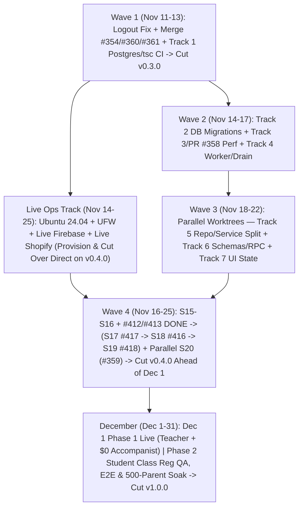

# Pre-Thanksgiving Master Program Plan & Stateless Session Ledger (`pafenorthwest/Festival`)

## Part 1 — Executive Strategy, Dual-Release Safety Architecture & Decisions

This specification is the repository-committed master execution plan and stateless session ledger governing `pafenorthwest/Festival` from **November 11, 2026** through **Thanksgiving (November 26, 2026)**, the **December 1, 2026 Phase 1 Live Launch**, and the **December 2026 Phase 2 QA soak cycle**. Completing **both** (a) `#354` + `#361` + `#417` + `#416` + `#418` + `#359` + Live Shopify/Firebase Production **and** (b) the **Full 7-Track Codebase Refactor** before December 1—leaving **100% of December engineering focused on Phase 2 Student Class Registration testing and bug fixes**—is achieved safely across **two pre-launch releases (`v0.3.0` then `v0.4.0`)**:

1. **`v0.3.0` Feature Baseline (`Nov 11–13`, Days 1–3)**: Merge `#354` (with logout CSRF fix, auto-closing `#353`), `#360`, and `#361` (Teacher Directory), **plus Track 1 (Real Postgres 17 + `tsc` CI gate)**. Cut `v0.3.0` immediately.
2. **Parallel Live Infrastructure Track (`Nov 14–20`, Days 4–10)**: Provision Ubuntu 24.04, UFW (`#95`), TLS, Live Firebase, and Live Shopify. Because Waves 1–3 (`S01`–`S13`) and Wave 4 stabilization (`#412`, `#413`, `S15` `#414`, `S16` `#415`) are already complete on `main`, `S05` + `S14` can provision and cut over directly on **`v0.4.0`** ahead of **`Dec 1`** once `D4` resolves and pre-launch packets **`S17` (`#417`)**, **`S18` (`#416`)**, **`S19` (`#418`)**, and parallel **`S20` (`#359`)** merge.
3. **Parallel Full Refactor Sprint & Pre-`Dec 1` Cutover (`Nov 14–22` -> `v0.4.0` Cutover `Nov 23–25`)**: With real Postgres 17 + full `tsc` running on every PR, autonomous subagent teams completed **Tracks 2–7 + PR `#358`** in isolated git worktrees, followed by `S15`–`S20`. **Hard Refactor Freeze hits Nov 23**: everything green ships in **`v0.4.0`** onto the live host ahead of **`Dec 1, 2026`**, when **Phase 1 Live Registration** opens for **Teachers (paid Shopify checkout) + Accompanists (`$0` unpaid form; paid Accompanist `#133` deferred to summer)** alongside Admin Concerto Repertoire CSV curation (`#359`).
4. **December (`Dec 1–31` -> `v1.0.0` Phase 2 Student Class Registration)**: **Phase 1 (Teacher + `$0` Accompanist Registration) runs live in production starting `Dec 1`** with **zero structural refactoring.** `#332`, `#362`, `#327`, `#330`, `#336` (`#412`), `#410` checkout restoration code (`#413`), `#359` Admin Concerto CSV import/export (`S20`), and two `#357` subitems (`[P2]` Storefront credentials in `#408` and `[P1]` edited-restored-cart late-payment check in `#409`) land in `v0.4.0` ahead of `Dec 1`, leaving December (`Dec 1–31`) 100% dedicated to **Phase 2 Student Class Registration** QA: remaining `#357` items (`B1`, `B2`, `[P2]` expired attached running worker), `#328`–`#329`, `#333`–`#335`, `#340`–`#341`, Playwright E2E suites, adversarial failure injection, and 500-parent spike soak testing ahead of `v1.0.0`.

### Open Decisions Checklist (`D1`–`D7`)
- [x] **D1 (#361 Approval Policy — DECIDED 2026-11-11)**: Active paid Teacher Membership + checked opt-in box **auto-creates / auto-approves** public directory visibility immediately (`approved`), with Admin retaining a one-click visibility toggle. *(`S03` unblocked -> `READY`.)*
- [x] **D2 (#357 Checkout Edge Cases B1/B2 — DECIDED 2026-11-11)**: Defer `B1`/`B2` to the December Week 1 bug-fix sprint (since December 1 Phase 1 live traffic is Teacher + `$0` Accompanist memberships while Phase 2 Student Class Registration is in QA).
- [x] **D3 (#354 QA Dump Cleanup — DECIDED 2026-11-11)**: Stripped `+8,592` lines of `tasks/festival-registration-ui/validation/browser-*results.json` (5 files) on `ericp/registration-flow-redesign` prior to merging `#354`.
- [ ] **D4 (Production Infrastructure)**: `<prod-domain>` **CONFIRMED `2026-11-12` as `artsfestival.online`** (`https://artsfestival.online`); remaining items (DNS cutover access, Ubuntu 24.04 host SSH access, production Firebase project access, and production Shopify organization ownership) scheduled for Monday `2026-11-16` *(blocks `S05` execution until confirmed; once unblocked and `S17`–`S20` merge, `S05` + `S14` cut over directly on `v0.4.0` ahead of `Dec 1`)*.
- [x] **D5 (Dec 1 Teacher + Unpaid Accompanist Launch, #417 Account CTA & #416 Accompanist Directory Parity — DECIDED 2026-11-16)**: Live production opens **December 1, 2026** with **Phase 1: Paid Teacher Membership (Shopify) + Unpaid Accompanist Membership (`$0` form; paid Accompanist `#133` deferred to summer)**, while December (`Dec 1–31` -> `v1.0.0`) is dedicated to **Phase 2: Student Class Registration** QA, bug fixes, E2E, and 500-parent soak. Prior to final `v0.4.0` cutover (`S14`), land sequential packets **`S17` (`#417`)** (`Acquire Memberships` section + side-by-side `Annual Teacher` / `Annual Accompanist` primary buttons on `/org/:slug/account/memberships`) followed by **`S18` (`#416`)** (remove copy-pasted Shopify contact-sharing consent checkbox, Privacy Policy note, and `staffAccessConsent` gate from Accompanist form with `0` DB migrations; add explicit pre-checked Public Directory opt-in checkbox + account self-service card + Admin one-click visibility toggle; auto-approve opted-in active accompanists while preserving Admin `'rejected'` hides and existing opt-outs; and enforce active `accompanist_membership` on public directory listings).
- [x] **D6 (#418 Admin Teacher Division Count Rule — DECIDED 2026-11-17)**: Organization `Admin` post-creation Teacher division updates (`PATCH /api/admin/orgs/:orgSlug/profiles/teachers/:profileId/divisions` and Admin UI) require **strictly `1` active organization division (`exactly 1`)** *(`S19` locked -> `READY`)*.
- [x] **D7 (Open Issues Triage — DECIDED 2026-11-19)**: Pull `#334` (Entitlements state badges wrapping list), `#335` (Admin membership card details/actions split & vertical stack), and `#329` (validate repertoire piece shape/count/fields before `catalogWorkId` resolution) into new pre-Thanksgiving packet **`S21` (`v0.4.2`)**; split Playwright E2E into two waves — pull Phase 1 Launch E2E Smoke ahead of `Dec 1` into new packet **`S22`** (automating `int` Phases 1–3 for `v0.4.2` sign-off), while Phase 2 Class Registration & Failure-Injection E2E remains in December Week 3; hold off `#328` to December Week 2 per Admin request; defer `#410` to December Week 1 alongside `#357` and `#260`; track `#216` and `#30` against `v0.4.1`/December Week 4; keep `#247`, `#246`, `#172`, `#133`, `#98`, and `#38` post-`v1.0`.

---

## Part 1B — Multi-Session Strategic DDD & Spec-Driven Operating Model

Spreading a full refactor across multiple stateless Antigravity sessions requires **strict file/domain ownership** and **immutable handoff specs**. Rather than inventing heavyweight ceremony, we combine **lightweight Strategic DDD** with the repository's **existing Spec-Driven Development (`specs/` + `goals/` + `tasks/`) harness** ([AGENTS.md](../AGENTS.md), [codex-config.yaml](../.codex/codex-config.yaml), [project-structure.md](../.codex/project-structure.md)):

> [!NOTE]
> **Anti-Overkill Rule**: Use **Strategic DDD** (Bounded Contexts, table/folder ownership, acyclic import rules, domain invalidation events) and **reject Tactical DDD ceremony** (zero abstract `AggregateRoot` base classes, `ValueObject` wrappers, CQRS mediator buses, or event-sourcing frameworks). Keep plain TypeScript functions, focused `<=500`-line services/repos, and SQL read models.

### 1B.1 Strategic DDD Context Map Summary (Authoritative Spec: [bounded-contexts-2026.md](./bounded-contexts-2026.md))
Reconciling [Phase1-Account-Memberships.md](./Phase1-Account-Memberships.md), [Phase-2-Class-Purchase-Entitlement.md](./Phase-2-Class-Purchase-Entitlement.md), [MUSICAL-REPERTOIRE.md](./MUSICAL-REPERTOIRE.md), and [VOLUNTEER-PORTAL.md](./VOLUNTEER-PORTAL.md) with live code yields **7 disjoint Bounded Contexts**:

| Bounded Context | Owned `orgs.*` Tables (Summary) | Target Backend Slice (`packages/backend/src/domains/`) | Common Schema & Frontend Slice | Emitted Domain Events |
|---|---|---|---|---|
| **1. `tenant-org`** *(Base)* | `organizations`, `users`, `app_user`, `memberships`, `invites`, `registration_age_configurations`, `rooms` | `tenant-org/` (org CRUD, staff auth/claims, rooms, timezone, age-cutoff config) | `common/src/tenant.ts` + `frontend/src/domains/admin-org/`, `lib/api/org-admin.ts` | `OrgUpdated`, `RegistrationAgeConfigUpdated` |
| **2. `catalog-repertoire`** | `organization_divisions`, `festivals`, `registration_catalog_values`, `festival_class_configurations`, `repertoire_*` | `catalog-repertoire/` (divisions, festivals, classes, pieces, `#360`/`#359` CSV) | `common/src/catalog.ts` + `frontend/src/domains/catalog/`, `lib/api/catalog.ts` | `FestivalCatalogUpdated`, `RepertoireUpdated` |
| **3. `customer-identity`** | `shopify_customer_account_integrations`, `festival_customers`, `shopify_customer_sessions`, `shopify_customer_oauth_states`, `festival_children`, `festival_child_age_snapshots` | `customer-identity/` (Shopify OAuth/PKCE/OIDC, sessions, parent profile, children + age snapshots) | `common/src/customer.ts` + `frontend/src/domains/customer/`, `lib/api/customer.ts` | `CustomerIntegrationRotated`, `ChildUpdated` |
| **4. `teacher-directory`** | `teacher_profiles`, `accompanist_profiles`, `products`, `membership_entitlements`, `membership_entitlement_revocations` | `teacher-directory/` (`#361` public teacher directory, membership checkout & status, cohorts) | `common/src/directory.ts` + `frontend/src/domains/directory/`, `lib/api/directory.ts` | `TeacherDirectoryChanged`, `MembershipChanged` |
| **5. `class-checkout`** | `checkout_carts`, `checkout_intents`, `class_checkout_executions`, `class_checkout_execution_events`, `checkout_recovery_requests`, `registration_metadata`, `festival_class_waitlist_entries`, `registration_change_logs` | `class-checkout/` (`#354` eligibility, cart handoff, lease recovery, waitlist, 42-day metadata edits, drop/transfer) | `common/src/registration.ts` + `frontend/src/domains/registration/`, `lib/api/registration.ts` | `CheckoutIntentResolved`, `ClassCapacityChanged` |
| **6. `commerce-projection`** | `shopify_integrations`, `shopify_webhook_deliveries`, `shopify_order_projections`, `class_entitlements`, `membership_validation_decisions`, `billing_*`, `invoices`, `refund_events` | `commerce-projection/` (Shopify Admin/Storefront transport, `ORDERS_PAID` webhook queue, order reconciliation, entitlement grant) | `common/src/commerce.ts` + `frontend/src/domains/admin-commerce/`, `lib/api/commerce.ts` | `ShopifySecretRotated`, `OrderProjected` |
| **7. `volunteers-comms`** | `volunteer_roles`, `volunteer_shifts`, `volunteers`, `volunteer_assignments`, `customer_festival_availability`, `message_*` | `volunteers-comms/` (volunteer shifts, availability, email/SMS templates) | `common/src/volunteers.ts` + `frontend/src/domains/volunteers/`, `lib/api/volunteers.ts` | — |

- **Mechanical Boundary Enforcement**: A fast unit test (`packages/backend/tests/architecture-boundaries.test.ts`) scans `import` specifiers across `packages/backend/src/domains/*` to enforce acyclic dependencies (`tenant-org` <- `catalog-repertoire` / `customer-identity` <- `teacher-directory` / `class-checkout` <- `commerce-projection`) and file-size ceilings (`<=500` lines/file), preventing cross-session architectural drift.

### 1B.2 Stateless Session Handoff & Context-Hygiene Protocol (`goals/` + `tasks/` + `.agents/skills/festival-session/SKILL.md`)
Every Antigravity session follows 4 strict context-management commitments plus the repo's SDD contract:
- **Context Commitments**: (1) **1 Packet (`S01`–`S22`) = 1 Fresh Conversation** using Git as durable memory once `S00` merges; (2) **Thin Coordinator + Subagent Delegation** so main chat never ingests giant files or raw logs; (3) **Progressive Disclosure** by placing the SDD/DDD runbook in `.agents/skills/festival-session/SKILL.md` while leaving [AGENTS.md](../AGENTS.md) lean and untouched; and (4) **`/compact` & `@` Mentions** as mid-session safety valves.
1. **Preflight (<60s)**: Activate `festival-session` skill; read `specs/pre-thanksgiving-program.md` (ledger) + [bounded-contexts-2026.md](./bounded-contexts-2026.md) + packet `goals/<slug>/goals.v0.md` (`State: locked`, `[G1..GN]` criteria) + `tasks/<slug>/spec.md` (`In scope` owned files, `Out of scope` locked files, exact `pwsh` verification commands).
2. **Isolated Branch / Worktree**: Create branch `refactor/<slug>` (or `feat/<slug>` / `fix/<slug>`). Touch **only** paths listed under `In scope` so parallel sessions merge with `exit=0`. Never stage or delete unrelated `goals/` or `tasks/` directories.
3. **Red-Green Implementation & Unified Gate**: Write/update deterministic tests first; implement (`<=500`L file, `<=250`L class, `<=60`L fn); pass full gate (`bun run verify:toolchain`, `bun run format:check`, `bun run lint`, `bun run build`, `bun run --cwd packages/frontend check:types`, `bun run test` with `POSTGRES_INTEGRATION_URL`, `bun run check:sql`).
4. **Independent Subagent Review & Ledger Update**: Invoke review subagent to populate `tasks/<slug>/code-review.md` (`Findings status: none`, `Findings JSON: []`, `Verdict: patch is correct`), merge PR to `main`, and flip packet status to `DONE` in `specs/pre-thanksgiving-program.md`.
5. **Recommended Slash Commands per Session**:
   - `/grill-me` or `/plan`: When authoring or refining architecture specs (`S00`).
   - `/goal`: For single-packet autonomous sessions (`S01`–`S08`, `S14`) that run until every check + `code-review.md` passes.
   - `/teamwork`: For Wave 3 (`S09`–`S13`), dispatching parallel subagents across disjoint bounded contexts simultaneously.
   - `/compact`: Mid-session if test logs grow context window.

### 1B.3 Master 23-Session Packet Matrix (`S00`–`S22`, Pre-Thanksgiving & Pre-`Dec 1` Stateless Ledger)

| ID | Packet Slug | Status | Wave / Dates | Bounded Context | Owned Paths (Disjoint Lock) | Depends On | Parallel Group | Deliverable / Exit Gate |
|---|---|---|---|---|---|---|---|---|
| **`S00`** | `s00-sdd-bounded-context-harness` | `DONE` | Prep (`Nov 11 AM`) | Architecture / SDD | `specs/bounded-contexts-2026.md`, `specs/pre-thanksgiving-program.md`, `.agents/skills/festival-session/SKILL.md`, `goals/s00..s14/*`, `tasks/s00..s14/spec.md` | — | Solo Kickoff | Context map + all 15 session packets + `festival-session` skill committed on `main`. |
| **`S01`** | `s01-pr354-logout-csrf-and-pr360-merge` | `DONE` | Wave 1 (`Nov 11`) | `customer-identity` / Edge | `#354` branch: `nginx/festival.conf`, `docker/nginx.festival.conf`, `csrf-guard.ts`, `admin-class-checkout-recovery.routes.ts`, `api-router.ts`, `app.ts`, `02-validate-env.sh` + `#360` | `S00` | Group W1-A | Logout `Origin: null` & recovery origin guards fixed, QA dumps stripped (`D3`), frontend `tsc` verified, `#354` (`95d2dd0`, `--no-ff`) & `#360` (`b00d1bd`) merged (`#353`/`#356` closed). |
| **`S02`** | `s02-ci-postgres-tsc-and-boundary-gates` | `DONE` | Wave 1 (`Nov 11–12`) | CI / Infra | `.github/workflows/pr-checks.yml`, `deploy.yml`, `packages/backend/tsconfig.json`, `scripts/check-sql.ts`, `architecture-boundaries.test.ts` | `S01` | Group W1-B *(parallel w/ `S03`)* | **Track 1**: Postgres 17 service active in CI (12 integration suites live), frontend/test `tsc` & `tx.unsafe` blocking. |
| **`S03`** | `s03-issue-361-public-teacher-directory` | `DONE` | Wave 1 (`Nov 12–13`) | `teacher-directory` | `participant-profile.routes.ts`, `PublicDirectoryPage.tsx`, Membership/Admin directory toggle components + tests | `S01` | Group W1-B *(parallel w/ `S02`)* | **Issue `#361`** merged; active & new teachers opt in + admin toggle verified in Postgres CI. |
| **`S04`** | `s04-release-v0-3-0-cutover` | `DONE` | Wave 1 (`Nov 13 PM`) | Release `v0.3.0` | 5 `package.json` versions, `CHANGELOG.md`, `release` branch, tag `v0.3.0` | `S02`, `S03` | Milestone Gate | **Release `v0.3.0` published**; GHCR images built. |
| **`S05`** | `s05-live-prod-firebase-shopify-launch` | `BLOCKED (D4)` | Ops (`Nov 14–25`, Pre-`Dec 1`) | Live Prod Ops | `/opt/Festival` Ubuntu 24.04 host, UFW (`#95`), TLS, Live Firebase, `cloud-setup/.env`, Live Shopify + `shopify-confirmation` | `S04` *(provisions direct on `v0.4.0` w/ `S14` post-`S19`/`S20`)* | **Ops Track (Direct `v0.4.0` Cutover)** | Live production site up with real Firebase + real Shopify + `#360` bootstrap SQL (`20261109000000_load_pafe_concertos.sql`) seeding initial `pafe-bootstrap-work-*` IDs followed by `#359` (`S20`) Admin CSV export/re-import verification & browser curation, provisioning directly on `v0.4.0` ahead of `Dec 1` Phase 1 launch once `D4` resolves and `S17`–`S20` merge. |
| **`S06`** | `s06-schema-migrations-ledger-runner` | `DONE` | Wave 2 (`Nov 14–15`) | DB / Migrations | `database/migrations/`, `postgres-schema.ts`, `postgres17-schema.sql`, `scripts/migrate.ts`, `deploy.yml` | `S04` | Group W2-A | **Track 2**: `orgs.schema_migrations` runner live; boot-time DDL removed from `initializePostgresSchema`. |
| **`S07`** | `s07-pr358-cache-invalidation-and-read-models` | `DONE` | Wave 2 (`Nov 15–17`) | Perf / Cache (`#358`) | `#358` files + `bounded-async-cache.ts`, domain invalidation bus, `listRegistrationEligibleClasses`, `listClassRegistrations`, `evaluateEligibility`, `public-membership-product-service.ts` | `S06` | Group W2-B *(parallel w/ `S08`)* | **Track 3 + PR `#358`**: Event cache invalidation wired, `null` cache removed, hot-path N+1s replaced by SQL joins, `#358` merged. |
| **`S08`** | `s08-graceful-shutdown-and-lease-reaper` | `DONE` | Wave 2 (`Nov 15–17`) | Runtime / Worker | `packages/backend/src/index.ts`, `webhook-worker-queue.ts`, `reap-class-checkout-recovery.ts`, `docker/backend.Dockerfile`, `20261115010000_idx_class_checkout_executions_running.sql`, `postgres17-schema.sql` | `S04`, `S06` | Group W2-B *(parallel w/ `S07`)* | **Track 4**: `SIGTERM` graceful drain + compiled periodic `FOR UPDATE SKIP LOCKED` lease reaper + schema parity. |
| **`S09`** | `s09-split-tenant-org-and-catalog-repertoire` | `DONE` | Wave 3 (`Nov 18–21`) | `tenant-org` & `catalog-repertoire` | `domains/tenant-org/**`, `domains/catalog-repertoire/**` (extracted from `postgres-organization-repository.ts` & `organization-service.ts`; retire `InMemory*` slices) | `S06`, `S07`, `S08` | **Group W3 (5x Parallel Worktrees)** | **Track 5A/B (Slice 1)**: Org, staff, rooms, divisions, festivals, classes, repertoire `<=500`L/file; `InMemory*` slices retired. |
| **`S10`** | `s10-split-customer-identity-and-teacher-directory` | `DONE` | Wave 3 (`Nov 18–21`) | `customer-identity` & `teacher-directory` | `domains/customer-identity/**`, `domains/teacher-directory/**` (split `customer-account-service.ts` `2,122`L OAuth/profile/child slices & `postgres-customer-account-repository.ts`) | `S06`, `S07`, `S08` | **Group W3 (5x Parallel Worktrees)** | **Track 5A/B (Slice 2)**: OAuth/sessions, customer/child profiles & age snapshots, directory/memberships cleanly isolated `<=500`L/file. |
| **`S11`** | `s11-split-class-checkout-and-commerce-projection` | `DONE` | Wave 3 (`Nov 18–21`) | `class-checkout` & `commerce-projection` | `domains/class-checkout/**` (incl. `customer-registration-query-service.ts`), `domains/commerce-projection/**` (split `class-checkout-service.ts`, `admin-api-client.ts`, `shopify-order-projection-service.ts`, `postgres-membership-commerce-repository.ts`) | `S06`, `S07`, `S08` | **Group W3 (5x Parallel Worktrees)** | **Track 5A/B (Slice 3)**: Checkout, registration queries, recovery, Shopify clients, webhook projection modularized `<=500`L/file. |
| **`S12`** | `s12-common-schemas-and-typed-hono-rpc` | `DONE` | Wave 3 (`Nov 19–22`) | `@festival/common` & API RPC | `packages/common/src/**`, `route-security.ts`, route builders, `packages/frontend/src/lib/api/**` (splitting `api.ts` `2,783`L) | `S09`–`S11` *(or incrementally per domain)* | **Group W3 / W3+** | **Track 6**: `valibot`/`zod` schemas in `common`, typed `hc<AppType>` domain clients, declarative route-security metadata. |
| **`S13`** | `s13-frontend-route-scoped-contexts` | `DONE` | Wave 3 (`Nov 18–22`) | Frontend UI / State | `packages/frontend/src/app/**`, `lib/routes.ts`, `VolunteerRolesPage.tsx`, `MusicReviewModal.tsx`, `useFestivalRegistrationPage.ts` | `S04` *(disjoint from backend `S09`–`S11`)* | **Group W3 (5x Parallel Worktrees)** | **Track 7**: `createFestivalAppState` (`589`L) + `Actions` (`755`L) split into route-scoped SolidJS contexts; `@solidjs/router` unified. |
| **`S14`** | `s14-release-v0-4-0-freeze-and-cutover` | `[G1]-[G3] DONE (v0.4.0 released: PR #428/#429, release 364e543, tag v0.4.0, GHCR Run 44432128555; int.artsfestival.online UI walkthrough Phases 1–3 PASS: Phases 1–2 post-PR #435 (8d0c5bb, Run 44457776486, Issues #431–#434 closed), Phase 3 Admin post-PR #440 (650ccac, Run 44465072507, Issues #437–#439 closed); v0.4.1 released as latest cutover artifact: Prep PR #442 (d2fcee1), Promotion PR #443 (release b93edf9), tag v0.4.1, release CD Run 44467055788, GHCR Run 44467580512; v0.4.2 prep in progress: PR #446 (ca84970) + PR #447 (484b17d) landed on main, awaiting S22; [G4] live prod rollout ready for S05 once D4 secrets configured)` | Wave 4 (`Nov 23–25`, Pre-`Dec 1`) | Release `v0.4.0` Cutover | `app.ts` final DI cleanup, 5 `package.json` (`0.4.0`), `CHANGELOG.md`, `release` PR, tag `v0.4.0`, live prod deploy & smoke | `S05`, `S09`–`S13`, `S15`–`S20` (**Nov 23 Freeze**; `#413` merged `2d90c74`; `#410` live partial-payment acceptance tracked separately) | Milestone Gate | **Release `v0.4.0` live in production ahead of `Dec 1` Phase 1 launch (Teacher + `$0` Accompanist + `#359` Concerto CSV)**; 500-parent benchmark + live E2E smoke green. |
| **`S15`** | `s15-backend-pool-cache-and-ci-hardening` | `DONE` | Wave 4A (`Nov 16`) | `customer-identity` / `tenant-org` / CI | `refresh-concurrency-limiter.ts`, `customer-session-repository.ts`, `customer-token-refresh.ts`, `tenant-organization-service.ts`, `.github/workflows/{pr-checks,integration}.yml`, `file-size-ratchet.test.ts`, `file-size-ratchet-baseline.ts` | `S09`–`S13` | Merged PR `#414` (`e55b67e`) | Bounded token-refresh concurrency limiter (`503` acquire timeout before `sql.reserve()`, keeping `pg_try_advisory_lock` + CAS, `0` DB migrations) + per-session coalescing (`#407`, `1A`), wire 4h public org cache invalidation (`#383`, `2A`), leave `__Host-` OAuth cookie unchanged (`3B`), add `push:[main]` + `integration.yml` CI parity (`2A`), and enforce `500`L-new / `2,000`L-existing file-size ratchet (`4A`). |
| **`S16`** | `s16-post-410-session-scope-and-size-trim` | `DONE` | Wave 4B (`Nov 16`) | `customer` UI / `AppRoutes` / `CHANGELOG` | `CustomerIdentityContext.tsx`, `AppRoutes.tsx`, `CHANGELOG.md` | `PR #413`, `S15` | Merged PR `#415` (`13ebbd0`) | Update both `createEffect` and `isCurrentRequest()` in `CustomerIdentityContext` to `activeOrgSlug` memo (`#385`/`#393`, preserving `#413` `refreshOnReturn` without `unauthenticated` flash or per-click Shopify calls), remove unused `AppRoutes` provider, finalize `0.4.0` `CHANGELOG`, and verify under `500`L-new / `2,000`L-existing ratchet (no forced `500`L splits on grandfathered files). |
| **`S17`** | `s17-issue-417-account-membership-acquisition-buttons` | `DONE` | Wave 4C (`Nov 17–18`) | `teacher-directory` / Customer Account UI | `CustomerAccountMembershipsPage.tsx`, `customerMembershipStatus.ts`, `styles.css` (scoped acquisition row), `customer-membership-status.test.ts`, `customer-account.test.ts` | `S16` | Sequential before `S18` (shared `CustomerAccountMembershipsPage.tsx` + account test lock) | **Issue `#417`**: Direct-child `<h1>Acquire Memberships</h1>` above `<h1>Memberships</h1>` + side-by-side default primary `<Button type="button">` row (`Annual Teacher` left -> `/org/:slug/membership`, `Annual Accompanist` right -> `/org/:slug/accompanist-membership`) with independent ownership evaluation across all `CustomerMembershipStatusEntry["status"]` states, mouse/keyboard inertness when disabled, and post-acquisition refresh. *(Refined in PR `#447` (`484b17d`): heading updated to `Current Memberships` with `.teachers`/`.accompanists` role-colored action buttons and helper copy.)* |
| **`S18`** | `s18-issue-416-accompanist-public-directory-parity` | `DONE` | Wave 4D (`Nov 18–20`) | `teacher-directory` | `AccompanistMembershipPage.tsx`, `common/src/commerce.ts`, `lib/api/{directory,commerce}.ts`, `CustomerAccountMembershipsPage.tsx`, `CustomerTeacherDirectoryCard.tsx`, `AdminTeacherDirectoryPanel.tsx`, `adminTeacherDirectoryHelpers.ts`, `teacherDirectoryHelpers.ts`, `publicDirectoryHelpers.ts`, `customer-membership.routes.ts`, `domains/teacher-directory/**`, `infra/s10-infra.ts`, `repo/{profile-moderation,postgres-profile-directory-*,in-memory-org-profiles}.ts` + tests | `S17` | Sequential after `S17` (before `S19`) | **Issue `#416`**: Remove copy-pasted Accompanist `staffAccessConsent` checkbox/Privacy Policy gate (`0` DB migrations; preserve `CUSTOMER_SESSION_COOKIE`), add explicit pre-checked Public Directory opt-in checkbox + account self-service card + Admin one-click toggle, auto-approve opted-in active accompanists while preserving Admin `'rejected'` hides and existing opt-outs, and enforce active non-superseded `accompanist_membership` on public directory listings. |
| **`S19`** | `s19-issue-418-admin-only-teacher-division-edits` | `DONE` | Wave 4E (`Nov 19–21`) | `teacher-directory` & `@festival/common` | `common/src/{directory,profile}.ts`, `participant-profile.routes.ts`, `services/{participant-profile,accompanist-membership}-service.ts`, `commerce/membership-status-service.ts`, `domains/teacher-directory/**`, `repo/{organization-repository*,postgres-organization-repository,postgres-membership-grant-delegate,postgres-profile-directory-*,in-memory-*}.ts`, `lib/api/directory.ts`, `CustomerTeacherDirectoryCard.tsx`, `CustomerAccountMembershipsPage.tsx`, `AdminTeacherDirectoryPanel.tsx`, `adminTeacherDirectoryHelpers.ts`, `teacherDirectoryHelpers.ts`, `nginx/*.conf`, `docker/nginx.festival.conf` + tests | `S18` | Sequential after `S18` (`12+` shared `teacher-directory` & account UI files) | **Issue `#418`**: Reject customer `divisionIds` (`400`) on `PUT /profiles/teacher` & render Teacher divisions read-only after creation; seed initial profile divisions from active grant; add Admin `PATCH .../teachers/:profileId/divisions` + single-division Admin editor (`D6`: `exactly 1` active org division); keep `orgs.membership_entitlement_divisions` immutable while resolving effective active Teacher division(s) from `orgs.teacher_profile_divisions` across `listCustomerMembershipStatus`, `listActiveTeachersForDivision`, `findActiveTeacherEntitlementGrant`, and `loadActiveTeacherRoster` when `teacher_profiles` exists; and enforce Accompanist division policy (`exactly_one`, `one_to_two`, `one_to_all`) in UI + server preserving dual-role independence. |
| **`S20`** | `s20-issue-359-admin-concerto-csv-import-export` | `DONE` | Wave 4C–E (`Nov 17–21`) | `catalog-repertoire` & `@festival/common` | `common/src/{repertoire,concerto-repertoire-csv,catalog,index}.ts`, `domains/catalog-repertoire/**`, `repertoire/{repertoire-repository,in-memory-repertoire-helpers}.ts`, `composition/{catalog-repertoire,runtime}.ts`, `routes/admin-org/admin-concerto-repertoire.routes.ts`, `routes/{route-groups,route-group-options,api-router,route-security}.ts`, `lib/api/{concerto-catalog,catalog}.ts`, `api.ts`, `AdminConcertoRepertoirePage.tsx`, `adminConcertoRepertoireHelpers.ts`, `AdminHomePage.tsx`, `app/{AdminRoutes,lazyPages,createFestivalAppState,useFestivalLifecycle}.ts*`, `lib/{routes,routePaths}.ts`, `nginx/*.conf`, `docker/nginx.festival.conf` + tests | `S16` | **Parallel w/ `S17`–`S19` (100% disjoint `catalog-repertoire` worktree)** | **Issue `#359`**: Admin-only Concerto Repertoire CSV template, export, dry-run preview (additions, updates, unchanged, full removal list, row/field errors, explicit clear-all confirmation, catalog state digest), and single-transaction atomic replacement preserving work IDs, shared contributors, non-`concerto` classifications, and historical registration links. |
| **`S21`** | `s21-v0-4-2-membership-admin-ui-and-repertoire-limits` | `DONE` | Wave 4 (`v0.4.2`) | `teacher-directory` UI & `class-checkout` | `AdminMembershipProductsPage.tsx`, `AdminEntitlementReportPanel.tsx`, `AdminEntitlementTable.tsx`, `AdminIntegrationsPage.tsx`, `AdminShopifyReconciliationPanel.tsx`, `adminEntitlementReportHelpers.ts`, `styles.css`, `domains/class-checkout/{class-checkout-validation,class-checkout-line-helpers,class-checkout-line-runner}.ts`, `customer/customer-registration-legacy-helper.ts`, `checkout/class-checkout-helpers.ts` + tests | `S14` (`v0.4.1`) | Merged PR `#446` (`ca84970`, `D7`) | **Issues `#335`, `#334`, `#329` + `consolidate-admin-memberships` (PR `#446`, `ca84970`)**: Admin membership card top-details/bottom-right wrapping actions vertical stack (`#335`), Entitlements state badges wrapping horizontal list (`#334`), pre-lookup repertoire piece validation across checkout (`class-checkout-line-runner.ts`, `4a7cebc`) & metadata edits (`#329`), consolidated 6-column `AdminEntitlementTable.tsx` with `AdminShopifyReconciliationPanel.tsx` moved to `AdminIntegrationsPage.tsx` (`1979fec`), and teacher edit lock preserved across report reloads (`080534f`). |
| **`S22`** | `s22-phase1-playwright-e2e-smoke` | `READY` | Wave 4 (`v0.4.2` / Pre-`Dec 1`) | E2E QA / CI | `playwright.config.ts`, `e2e/phase1/**`, root `package.json` (`test:e2e`, `test:e2e:phase1`), `.github/workflows/{pr-checks,e2e-phase1}.yml`, E2E-only seed/auth helpers | `S21` | Wave 4 (`v0.4.2` / Pre-`Dec 1`, `D7`) | **Phase 1 Launch Playwright E2E Smoke**: Deterministic Playwright harness (ephemeral local Postgres 17 stack + optional `int.artsfestival.online` target) automating Phases 1–3 (`#383`/`#384`/`#361`/`#416` + PR `#447` homepage `{slug, name}` org tiles, organizer login, footer disclaimer; `S16`/`#417` `Current Memberships` buttons/`#418`/`#353`; `#334`/`#335` + PR `#446` consolidated 6-col Entitlements table & `/admin/integrations` reconciliation move/`#359`/admin subroutes; `0` console errors & `0` HTTP `5xx`), wired into CI, plus full `v0.4.2` verification pass (unit + 24 Postgres 17 integration suites + Phase 1 E2E + `perf-test.yml`). |

---

## Part 2 — Complete PR & Issue Audit + Cross-PR Matrix

### 2.1 Open Pull Requests & Priority Issues

| Item | Branch / Target | Diff | CI | Target Release | Verdict & Role in Plan |
|---|---|---|---|---|---|
| **PR [#354](https://github.com/pafenorthwest/Festival/pull/354)** | `ericp/registration-flow-redesign` -> `main` | 165 files (`+30,207 / -2,456`) | Green | **`v0.3.0` (Wave 1, Nov 11)** | Merge 1st (`--no-ff`) after fixing nginx/CSRF logout `403` and verifying frontend `tsc`. Zero removed routes/endpoints; embeds `#355` checkout execution store (`orgs.class_checkout_executions`). |
| **PR [#353](https://github.com/pafenorthwest/Festival/pull/353)** | `fix/issue-338-registration-auth-return-and-logout` -> `main` | 5 files (`+196 / -1`) | Green | **Auto-closed by `#354`** | Sole commit `ef8e23c` is already inside `#354` (`1d8be9b`), which widened `returnTo` from `/(register\|cart)$` to `/(?:register(?:/cart)?\|cart)$`. Do **not** squash-merge separately. |
| **PR [#360](https://github.com/pafenorthwest/Festival/pull/360)** | `codex/pafe-concerto-migration` -> `main` | 3 files (`+194 / -0`) | Green | **`v0.3.0` (Wave 1, Nov 11)** | Zero code overlap (`exit=0`). Ships 25 PAFE concertos (`database/bootstrap/pafe-concertos.csv` + `20261109000000_load_pafe_concertos.sql`). |
| **Issue [#361](https://github.com/pafenorthwest/Festival/issues/361)** | New PR -> `main` | Backend exists; UI missing | — | **`v0.3.0` (Wave 1, Nov 12–13)** | Wires teacher public-directory opt-in + admin toggle onto existing [participant-profile.routes.ts](../packages/backend/src/routes/participant-profile/participant-profile.routes.ts#L60). |
| **PR [#358](https://github.com/pafenorthwest/Festival/pull/358)** | `issue347_perf_fixes` -> `main` | 19 files (`+2,051 / -47`) | Green | **`v0.4.0` (Wave 2, Nov 15–16)** | Cuts 500-parent burst from `31.39s` (`99.4%` fail) to `1.53s` (`100%` pass). Merges in Wave 2 right after wiring event-driven cache invalidation & removing 5m negative `null` cache. |

### 2.2 Cross-PR `git merge-tree` Conflict & Migration Matrix
- **Git Merge Cleanliness**: All 6 branch pairs exit `0` (`CLEAN`, combined tree `4caa03eb780aff75e7a03ab4efad7c78550949a0`) when `ef8e23c` commit ancestry is preserved (`--no-ff`).
- **Database Migration Timestamps (Zero Collisions)**:
  1. `20261108000000_class_checkout_execution_recovery.sql` (`#354` — `orgs.class_checkout_executions` & `_events`)
  2. `20261108010000_class_checkout_storefront_binding.sql` (`#354` — `storefront_binding JSONB`)
  3. `20261109000000_load_pafe_concertos.sql` (`#360` — `psql` `\copy` seed for `slug = 'pafe'`)
- **Semantic Cross-PR Interactions**:
  - **`#354` + `#360`**: `PostgresRepertoireRepository.searchCatalogWorks` defaults to `LIMIT 20`, hiding 5 of `#360`'s 25 PAFE concertos on initial blank dropdown open in `FestivalPieceEditor.tsx`; `pafe-bootstrap-work-21` & `22` have duplicate Wieniawski labels.
  - **`#354` + `#358`**: `#354` adds an uncached `this.organizations.findOrganizationBySlug(slug)` call in `CustomerAccountService.listClassRegistrations()` and triggers 2 authenticated GET calls (`class-registrations` + `checkout/restart`) on page mount.

### 2.3 Complete Technical Defects Catalog
1. **Logout CSRF `403` & Global `Host` Fallback (`#353` & `#354` — Fix in Wave 1 `S01`)**:
   - [csrf-guard.ts](../packages/backend/src/routes/shared/csrf-guard.ts#L4-L20) (`resolveRequestOrigin`) trusts `X-Forwarded-Host` / `X-Forwarded-Proto` without `TRUST_PROXY_HEADERS` ([SECURITY.md](../SECURITY.md#L60)) and falls back to target `Host` across all 8 CSRF-guarded routers.
   - Meanwhile, [festival.conf](../nginx/festival.conf#L34) and [nginx.festival.conf](../docker/nginx.festival.conf#L18) set `Referrer-Policy: no-referrer`, so `<form method="POST">` in [`logoutCustomer`](../packages/frontend/src/lib/api.ts#L545-L556) sends literal `Origin: "null"`, skipping the fallback and **still failing `403`** (plus `:8080` nginx sends `X-Forwarded-Proto: http` != `https`).
2. **PR `#358` Cache, Size & Benchmark Defects (Fix in Wave 2 `S07`)**:
   - **5m Uninvalidated + Negative `null` Cache**: `organizationBySlugCache` & `registrationAgeConfigCache` in [customer-account-service.ts](../packages/backend/src/customer/customer-account-service.ts) never invalidate when [organization-service.ts](../packages/backend/src/services/organization-service.ts) updates `registrationAgeDate` or `timezone` (persisting wrong 90-day child ages and causing 5m `409`/`404` lockouts via cached `null`; 256 random 404 slugs evict active tenants).
   - **Size, Scenario 4 & Test Fixes**: `perf-advanced-scenarios.ts` (`602` lines > `600` ceiling); [postgres-customer-account-repository.ts](../packages/backend/src/customer/postgres-customer-account-repository.ts) (`885` lines; `85`/`73`-line methods > `60` limit); Scenario 4 Phase 2b re-joins `3251..3500` instead of `3501..3750`; `perf-advanced-scenarios.test.ts` reads live `process.env`; CTE `RETURNING` emits `Date` instances typed as ISO `string`s.
3. **PR `#354` Checkout Recovery Edge Cases (`#357` — Partially Fixed in `#397`/`#408`/`#409`; Remaining `B1`/`B2`/Worker Polish in December QA)**:
   - **Fixed Prior to `v0.4.0`**:
     - `[P2]` Missing/undecryptable local Storefront credentials (`#408`, `3c337fc`) — **FIXED**: `class-checkout-cart-recovery.ts` keeps local credential failures retryable instead of marking carts unrecoverable.
     - `[P1]` Edited-restored-cart late-payment check (`#409`, `0dfc141`) — **FIXED**: ancestor-chain late-payment validation spans edited restored carts alongside self-service unpaid expired attached checkout restart.
     - Abandoned checkout restart & null Shopify line totals (`#397`, `e96ad91`) — **FIXED**.
     - Admin recovery origin canonicalization (`#408`, `4fbb68d`) — **FIXED**: `admin-class-checkout-recovery.routes.ts` normalizes configured origins against `resolveRequestOrigin(c)` (building on the `S01` `=== publicOrigin` fix).
   - **Remaining Open Items**:
     - **`B1`**: In [registrationPageActions.ts](../packages/frontend/src/domains/registration/registrationPageActions.ts#L197-L215), `error instanceof ApiError && error.recovery` takes precedence before the `409` `checkout_pre_dispatch_rejected` branch, blocking `sessionStorage` `idempotencyKey` retirement (`{ retireKey: true }`), and initial `[400, 404, 422]` validation release calls `ctx.cart.releaseCheckout()` without `{ retireKey: true }`.
     - **`B2`**: In `handleRefreshCheckout` ([registrationPageActions.ts](../packages/frontend/src/domains/registration/registrationPageActions.ts#L224-L248)), resolving Festival A's blocking checkout (`reasonCode: "checkout_completed"`) updates recovery state without calling `ctx.cart.releaseCheckout({ retireKey: true })` on Festival B's frozen cart.
     - **`[P2]` Expired Attached `running` Worker Admission Block & Polish**: Expired attached `running` worker execution rows still block new admission until reaped; `orgTimezone` remains omitted in [PurchasedRegistrationEditor.tsx](../packages/frontend/src/pages/PurchasedRegistrationEditor.tsx); root [package.json](../package.json#L26) `reap:class-checkout` still points to `.ts` (`bun packages/backend/scripts/reap-class-checkout-recovery.ts`) and needs compiled `.js` target verification in runtime deployments (`backend.Dockerfile` and partial index `20261115010000_idx_class_checkout_executions_running.sql` landed in `S08`).

### 2.4 Post-S14 Remote Main Reconciliation (`#383`–`#415` Merged & `S17`–`S20` Pre-`v0.4.0` Packets, Nov 14–17)
Between `#382` (`464c15e`) and `#415` (`13ebbd0`), **18 PRs** landed on `origin/main` ahead of schedule (`#383`–`#385`, `#391`–`#397`, `#407`–`#409`, `#411`–`#415`):

- **Delivered Early (`#383`–`#409`, Nov 14–15)**:
  - `#332` public front-page organization tile grid, cached organization listing, and signup copy (`#383`), plus seasonal `/org/:slug` SVG festival banners (`#384`).
  - Fresh Docker PostgreSQL 17 volume bootstrap `#386` (`#391`).
  - Multi-account and route isolation `#387`/`#388`/`#390` (`#385` `CustomerIdentityProvider` hoisted to app shell, `#392` `AdminUsersPage` roster scoped to active Firebase UID + org, `#393` parent registration drafts/carts isolated per customer session, `#395` registration workspace keyed by `(org, festival)`).
  - Discovery resilience `#389` (`#394` preserving customer sessions across transient Shopify OAuth discovery `503` failures).
  - Concerto `pg_trgm` trigram typeahead & manual entry `#362`/`#327` plus `#330` `CustomerAccountOrdersPage` repertoire save 404 fix (`#396`).
  - Deferred eligibility until customer CSRF token loads, null Shopify line totals, and abandoned checkout restart `#403` (`#397`).
  - Browser-bound `HttpOnly` OAuth callback cookie `#399` and advisory-locked cross-instance customer token refresh `#401` (`#407`).
  - Auth/CSRF/recovery/credential boundary hardening `#398`/`#400`/`#402`/`#404`–`#406` plus `#357` `[P2]` retryable local Storefront credential failures (`#408`).
  - Self-service restart for unpaid expired attached class checkouts, `CCR-*` validation, and `#357` `[P1]` edited-restored-cart ancestor-chain late-payment guard (`#409`).
- **Merged `2026-11-16` (`#412`–`#415`)**:
  - **PR `#412` (`84df859`, closing `#336`)**: Positioned admin class (`FestivalClassModal`) and waitlist (`FestivalClassWaitlistModal`) dialogs via a viewport-anchored `Portal` backdrop instead of clipping inside transformed panels (`FestivalClassModal.tsx`, `FestivalAdminClassesPage.tsx`, `styles.css`).
  - **PR `#413` (`2d90c74`, `#410` Implementation + `can_read_orders` / OAuth Login-Readiness Decoupling)**: `88` files changed with `0` DB migrations; implemented cross-session pending Shopify checkout restoration (`domains/class-checkout`, `domains/commerce-projection`, `registrationCartState.ts`, `useFestivalRegistrationPage.ts`, `AppHeader.tsx`, NGINX allowlists, and `specs/pending-shopify-checkout-restoration.md`) alongside decoupling `can_read_orders` from OAuth login readiness. Issue `#410` remains open separately for live partial-payment E2E acceptance.
  - **PR `#414` (`S15`, `e55b67e` — Review Adjustments `1A`, `2A`, `3B`, `4A`)**: Added `RefreshConcurrencyLimiter` (`503` acquire timeout before `await sql.reserve()`, preserving `pg_try_advisory_lock` + `encrypted_tokens` CAS with `0` DB migrations) + per-session coalescing (`#407`), wired `TenantOrganizationService.publicOrganizationListCache` (`4`h TTL) to `DomainCacheInvalidator` (`#383`), preserved `__Host-` OAuth cookies (`customer-auth.routes.ts` untouched), added `push: [main]` in `pr-checks.yml` + `integration.yml` Postgres 17 CI parity, and added the `500`L-new / `2,000`L-existing file-size ratchet (`#216`).
  - **PR `#415` (`S16`, `13ebbd0` — Post-`#413` Session Scope & Pre-Cutover Cleanup)**: Scoped both `createEffect` and `isCurrentRequest()` in [CustomerIdentityContext.tsx](../packages/frontend/src/domains/customer/CustomerIdentityContext.tsx) to an `activeOrgSlug` memo (`!disposed && request === latestRequest && activeOrgSlug() === targetSlug`, preserving `#413`'s `refreshOnReturn` without flashing `customerSession` to `unauthenticated` or triggering per-click live Shopify GraphQL calls), removed the unused `<ClassRegistrationProvider>` wrapper in [AppRoutes.tsx](../packages/frontend/src/app/AppRoutes.tsx), and synced [CHANGELOG.md](../CHANGELOG.md) `## [0.4.0]`.
- **Pre-`v0.4.0` Launch Packets (`S17` `#417` -> `S18` `#416` -> `S19` `#418` Sequential + Parallel `S20` `#359`)**:
  - **Phase 1 Live Scope (`Dec 1, 2026`)**: Live production opens `Dec 1` with **Paid Teacher Membership (Shopify)** + **Unpaid Accompanist Membership (`$0` form; paid Accompanist `#133` deferred to summer)** + **Admin Concerto Repertoire CSV import/export (`#359`)**, while Phase 2 Student Class Registration hardens through December (`Dec 1–31` -> `v1.0.0`).
  - **`S17` (`#417`, Wave 4C `Nov 17–18`) -> `S18` (`#416`, Wave 4D `Nov 18–20`) -> `S19` (`#418`, Wave 4E `Nov 19–21`, `DONE`)**: Sequenced strictly in the `teacher-directory` / Customer Account slice because they share [CustomerAccountMembershipsPage.tsx](../packages/frontend/src/pages/CustomerAccountMembershipsPage.tsx), [CustomerTeacherDirectoryCard.tsx](../packages/frontend/src/pages/CustomerTeacherDirectoryCard.tsx), [AdminTeacherDirectoryPanel.tsx](../packages/frontend/src/pages/AdminTeacherDirectoryPanel.tsx), `domains/teacher-directory/**`, and customer/profile test suites. `S17` adds direct-child `<h1>Acquire Memberships</h1>` + side-by-side primary `Annual Teacher` / `Annual Accompanist` buttons; `S18` removes the Accompanist `staffAccessConsent` gate (`0` DB migrations), adds pre-checked Public Directory opt-in + account card + Admin toggle, and aligns moderation/active-grant filtering with `#361`; `S19` (`D6` locked: `exactly 1` active org division) restricts post-creation Teacher division edits to Organization Admins (`400` on customer `divisionIds`, read-only Teacher divisions in Account, immutable `orgs.membership_entitlement_divisions` with `teacher_profiles` effective-division resolution across status/picker/eligibility/roster, and Accompanist division policy enforcement across `exactly_one`/`one_to_two`/`one_to_all`).
  - **Parallel `S20` (`#359`, Wave 4C–E `Nov 17–21`, `DONE`)**: Pulled forward from December Week 1 into `v0.4.0` inside an isolated `catalog-repertoire` worktree (`100%` disjoint from `S17` and `S18`, and disjoint across all domain/UI modules from `S19`; only shared route-inventory/NGINX files `nginx/*.conf`, `docker/nginx.festival.conf`, and `route-security.test.ts` rebase cleanly when whichever of `S19`/`S20` merges second). Delivers Admin-only Concerto CSV template download, catalog export, dry-run preview with row/field validation, full removal list, explicit clear-all confirmation, catalog state digest, and single-transaction atomic replacement ahead of `S05`/`S14` live onboarding.
- **Post-`v0.4.1` Mainline Merges (`#445`–`#447`, Nov 19–21)**:
  - **PR `#445` (`f786592`)**: Thanksgiving festival issues review — codified Decision `D7` and locked pre-Thanksgiving `S21` (`#335`, `#334`, `#329`) and `S22` (Phase 1 Playwright E2E smoke) packets.
  - **PR `#446` (`ca84970`, `S21` + `consolidate-admin-memberships`)**: Shipped `#335` (vertical membership card layout), `#334` (wrapping Entitlements badge list), `#329` (pre-lookup repertoire piece validation including multi-line count enforcement in `class-checkout-line-runner.ts`, `4a7cebc`), consolidated 6-column `AdminEntitlementTable.tsx` with `AdminShopifyReconciliationPanel.tsx` moved to `AdminIntegrationsPage.tsx` (`1979fec`), and preserved teacher edit lock across report reloads (`080534f`).
  - **PR `#447` (`484b17d`, `ericp/minor-ui-tweaks`)**: Redesigned public `HomePage.tsx` with `{slug, name}` organization tiles, organizer login, and footer disclaimer; updated `CustomerAccountMembershipsPage.tsx` heading to `Current Memberships` with `.teachers`/`.accompanists` role-colored action buttons and helper copy.
- **Post-`v0.4.0` / December Architectural & UX Follow-Ups**:
  - PR `#447` review follow-ups: investigate potential `onIdTokenChanged` timing race in `routeAfterOrganizerLogin` ([createFestivalDataLoaders.ts](../packages/frontend/src/app/createFestivalDataLoaders.ts)) and restore empty-state `Organizations` heading in [HomePage.tsx](../packages/frontend/src/pages/HomePage.tsx).
  - Wire [CustomerRegistrationQueryService](../packages/backend/src/domains/class-checkout/customer-registration-query-service.ts) at runtime to retire `CustomerRegistrationLegacyHelper`.
  - `#396` `ConcertoTitleField` / `PurchasedRegistrationEditor` UX polish (avoiding the `"Choose a catalog work"` trap on non-concerto rows, changing linked concertos, and re-editing manual pieces).
  - Surface a visible load-error banner on [CustomerAccountOrdersPage.tsx](../packages/frontend/src/pages/CustomerAccountOrdersPage.tsx).
  - Migrate the `volunteers-comms` domain directory and retire remaining `InMemory*` test doubles.

---

## Part 3 — Pre-Thanksgiving Master Schedule (`Nov 11 – Nov 25, 2026`)

> [!IMPORTANT]
> **Hard Refactor Freeze Gate (`Nov 23, 5:00 PM`)**: Every Wave 2 and Wave 3 refactor PR merges strictly behind green Postgres 17 integration tests, `tsc --noEmit`, Biome, and `check:sql`. Anything not merged by Nov 23 pauses cleanly on its feature branch so `v0.4.0` deploys with 48 hours of buffer before Thanksgiving.

### Wave 1 (`Nov 11–13`, Days 1–3): Baseline Merges, `#361`, Track 1 CI Gate & Release `v0.3.0`
1. **Patch & Merge `#354` + `#360` (`S01`, `Nov 11`)**:
   - Set `Referrer-Policy: same-origin` in [festival.conf](../nginx/festival.conf#L34) and [nginx.festival.conf](../docker/nginx.festival.conf#L18); revert `Host`/`X-Forwarded-Host` fallback in [csrf-guard.ts](../packages/backend/src/routes/shared/csrf-guard.ts); enforce `resolveRequestOrigin(c) === publicOrigin` on admin recovery POST routes; cherry-pick base64 `+/=` regex in [02-validate-env.sh](../cloud-setup/02-validate-env.sh).
   - Merge `#354` (`--no-ff`, closing `#353` & `#356`) and `#360` into `main`.
2. **Refactor Track 1 — Lock the CI & Real-Postgres Safety Net (`S02`, `Nov 11–12`)**:
   - Add `services: postgres:17-alpine` + `POSTGRES_INTEGRATION_URL` to [pr-checks.yml](../.github/workflows/pr-checks.yml) and [deploy.yml](../.github/workflows/deploy.yml) (activating all 12 skipped `*.integration.test.ts` suites).
   - Add `bun run --cwd packages/frontend check:types` (`tsc --noEmit`), include `tests/**/*.ts` in backend [tsconfig.json](../packages/backend/tsconfig.json), make [check-sql.ts](../scripts/check-sql.ts) blocking on PRs, extend AST validation to `tx.unsafe(...)`, and add `packages/backend/tests/architecture-boundaries.test.ts`.
3. **Fix & Merge Issue `#361` — Public Teacher Directory (`S03`, `Nov 12–13`)**:
   - Wire customer profile/opt-in UI (pre-selected visibility checkbox on Teacher Membership / Account view for both new and existing active teacher members) + one-click Admin visibility/approval toggle onto [participant-profile.routes.ts](../packages/backend/src/routes/participant-profile/participant-profile.routes.ts#L60) and [PublicDirectoryPage.tsx](../packages/frontend/src/pages/PublicDirectoryPage.tsx#L95), with full unit + Postgres integration tests.
4. **Cut Release `v0.3.0` (`S04`, `Nov 13`)**:
   - Bump `"version": "0.3.0"` across root [package.json](../package.json) + 4 `packages/*/package.json` + [CHANGELOG.md](../CHANGELOG.md), merge `main` -> `release`, tag `v0.3.0`, and publish GitHub Release.

---

### Parallel Live Ops Runbook (`S05`, `Nov 14–25`, Pre-`Dec 1`): Production Site, Live Firebase & Live Shopify (Direct `v0.4.0` Provisioning)
> [!NOTE]
> Because Waves 1–3 (`S01`–`S13`) and Wave 4 stabilization (`#412`–`#415`) have already landed on `main`, once `D4` resolves and `S17`–`S20` merge, `S05` + `S14` can provision `/opt/Festival` and cut over directly on **`v0.4.0`** ahead of **`Dec 1, 2026`** (instead of staging `v0.3.0` first).

1. **Ubuntu 24.04 Host & Network Hardening (`#95`, `Nov 14–15`)**:
   - Clone `/opt/Festival` (at `v0.4.0` post-`S19`/`S20`), run [01-host.sh](../cloud-setup/01-host.sh) as `root` (add 4 GB swap if 2 GB RAM), enable UFW (`IPV6=yes`, allow `80`/`443`/mgmt `22`, deny `3000`/`5432`/`8080`), configure DNS + TLS reverse proxy (`X-Forwarded-Proto https`, `Cross-Origin-Opener-Policy: same-origin-allow-popups`, raw webhook body preserved).
2. **Live Firebase & Stack Bring-Up (`Nov 16–17`)**:
   - Create production Firebase project + Web App (Google + Email link enabled, `artsfestival.online` authorized, Admin service account JSON).
   - Populate all 15 variables in `/opt/Festival/cloud-setup/.env` (`chmod 600`): `DB_PASSWORD`, `FIREBASE_*` (3), `FRONT_FIREBASE_*` (4), `FESTIVAL_SECRET_KEYS_JSON`, `FESTIVAL_ACTIVE_SECRET_KEY_ID`, `FESTIVAL_PUBLIC_ORIGIN`, `API_ALLOWED_ORIGINS`, `TRUST_PROXY_HEADERS=true`, `FESTIVAL_RECONCILIATION_TOKEN`, optional `ENABLE_DROP_TRANSFER=false`.
   - Run [02-validate-env.sh](../cloud-setup/02-validate-env.sh), [03-prepare-images.sh](../cloud-setup/03-prepare-images.sh), and `docker compose up -d`; set GitHub `production` environment secrets (`DEPLOY_HOST`, `DEPLOY_SSH_PRIVATE_KEY`, `DEPLOY_PUBLIC_URL`).
3. **Live Shopify Onboarding & Checkout Extension (`Nov 18–20`)**:
   - Production Shopify Store + Custom Admin App in same org (`Embedded = false`, `2026-07` webhooks, all 11 scopes: `read_customers,read_orders,read_products,write_products,write_inventory,read_publications,write_publications,customer_read_customers,customer_read_draft_orders,customer_read_metaobjects,customer_read_orders`).
   - Headless channel -> Confidential Customer Account API client (`customer_read_orders`, callback `/api/customer-auth/callback`, logout `/org/pafe/account`) + Storefront token.
   - Deploy `packages/shopify-confirmation` (`shopify app deploy --config production`) and set **Festival application origin** = `https://artsfestival.online` & **slug** = `pafe` on Thank-you & Order-status blocks.
   - Create `pafe` org via Firebase Admin, connect Shopify in `/org/pafe/admin/integrations` (confirming auto-registered `ORDERS_PAID` webhook), run `#360` bootstrap SQL (`20261109000000_load_pafe_concertos.sql` via `docker compose run --rm -v /opt/Festival:/work:ro -w /work postgres psql ...`) first to seed the initial `pafe-bootstrap-work-*` IDs and then verify lossless export/re-import round-trips and browser curation in the `#359` (`S20`) Admin Concerto Repertoire CSV UI (blank `work_id` for new works; unknown non-blank `work_id`s rejected), and verify live Paid Teacher Membership (`#361`, `#418` Admin-only Teacher division edits), `$0` Unpaid Accompanist Membership + Public Directory (`#416`, `#418` Accompanist policy), and Account `Acquire Memberships` buttons (`#417`) ahead of `Dec 1`.

---

### Wave 2 (`Nov 14–17`, Days 4–7): Foundation, DB Migrations, PR `#358` & Worker Refactors
1. **Refactor Track 2 — Unified DB Schema & Tracked Migration Runner (`S06`, `Nov 14–15`)**:
   - Build `orgs.schema_migrations` ledger + deterministic migration runner invoked pre-deploy in [deploy.yml](../.github/workflows/deploy.yml) and `05-rebuild-and-validate.sh`.
   - Add CI drift gate verifying `pg_dump --schema-only` matches [postgres17-schema.sql](../database/postgres17-schema.sql), and strip all 20+ boot-time `ALTER TABLE`/`CREATE TABLE` DDL statements from [`initializePostgresSchema`](../packages/backend/src/repo/postgres-schema.ts#L1050-L1188) and `/api/internal/ready`.
2. **Refactor Track 3 + PR `#358` — Read Models, Concurrency & Event-Driven Cache Invalidation (`S07`, `Nov 15–17`)**:
   - Introduce shared domain-event cache invalidator (replacing isolated `BoundedAsyncCache` silos; wire `OrganizationService` mutations and [`ShopifyWebhookService.clearCaches`](../packages/backend/src/commerce/shopify-webhook-service.ts#L199), remove 5m `null` caching).
   - Fix `#358` file/function splits, Scenario 4 (`3501..3750`), hermetic `parseConfig` test, CTE ISO strings, raise `compose.yml` Postgres `max_connections=200`, and merge `#358`.
   - Replace hot-path N+1s with single SQL queries: `GROUP BY festival_class_id` in [`listRegistrationEligibleClasses`](../packages/backend/src/customer/customer-account-service.ts#L1983-L2081), `LEFT JOIN` metadata in [`listClassRegistrations`](../packages/backend/src/customer/customer-account-service.ts#L1184-L1288) (using `organizationBySlugCache`), batch `findChild` in [`ClassCheckoutService.evaluateEligibility`](../packages/backend/src/checkout/class-checkout-service.ts#L191-L274), and cache [`PublicMembershipProductService.list`](../packages/backend/src/shopify/public-membership-product-service.ts#L38-L89).
3. **Refactor Track 4 — Graceful Shutdown & Durable Lease Reaper (`S08`, `Nov 15–17`, depends on `S04`, `S06`, parallel w/ `S07`)**:
   - Add `SIGTERM`/`SIGINT` drain in [index.ts](../packages/backend/src/index.ts) calling `shopifyWebhookService.drain()`.
   - Add partial index `(organization_id, lease_expires_at) WHERE state = 'running'` on `orgs.class_checkout_executions` across both `database/migrations/20261115010000_idx_class_checkout_executions_running.sql` and [postgres17-schema.sql](../database/postgres17-schema.sql) (passing `S06`'s `pg_dump --schema-only` CI parity gate), compile reaper entrypoints into `dist/`, and run an in-process periodic `FOR UPDATE SKIP LOCKED` worker reclaiming stale 15m webhook leases, expired `#354` checkout execution leases, and expired OAuth/session rows.

---

### Wave 3 (`Nov 18–22`, Days 8–12): Parallel Bounded-Domain Decomposition (Tracks 5, 6, 7)
Dispatch parallel subagent worktrees across disjoint module boundaries (`S09`–`S13`), enforcing repo limits (`<=500` lines/file, `<=250` lines/class, `<=60` lines/function):

1. **Refactor Track 5A — God Repository Split & `InMemory*` Retirement (`S09`–`S11`)**:
   - Decompose [`PostgresOrganizationRepository`](../packages/backend/src/repo/postgres-organization-repository.ts) (`3,636` lines / 85-method [`OrganizationRepository`](../packages/backend/src/repo/organization-repository.ts)) and [`PostgresMembershipCommerceRepository`](../packages/backend/src/commerce/postgres-membership-commerce-repository.ts) (`1,309` lines) into cohesive repositories across `domains/`: `TenantRepository`, `DivisionFestivalRepository`, `RegistrationCatalogRepository`, `ShopifyIntegrationRepository`, `MembershipEntitlementRepository`, `TeacherDirectoryRepository`, and `ClassCapacityRepository`.
   - Retire [`InMemoryOrganizationRepository`](../packages/backend/src/repo/in-memory-organization-repository.ts) (`2,333` lines) and duplicate `InMemory*` SQL emulators (`~4,800` lines) as suites migrate to fast transactional Postgres 17 tests + thin unit stubs.
2. **Refactor Track 5B — God Service & Shopify Client Decomposition (`S09`–`S11`)**:
   - Split [`CustomerAccountService`](../packages/backend/src/customer/customer-account-service.ts) (`2,122` lines) into `CustomerOAuthSessionService`, `CustomerProfileService`, and `CustomerChildProfileService` under `domains/customer-identity/` (`S10`) and `CustomerRegistrationQueryService` (`customer-registration-query-service.ts`) under `domains/class-checkout/` (`S11`).
   - Split [`ShopifyAdminApiClient`](../packages/backend/src/shopify/admin-api-client.ts) (`1,878` lines) into GraphQL transport + domain operations (`catalog`, `orders`, `webhooks`).
   - Split [`OrganizationService`](../packages/backend/src/services/organization-service.ts) (`1,416` lines), [`ClassCheckoutService`](../packages/backend/src/checkout/class-checkout-service.ts) (`1,390` lines), and [`ShopifyOrderProjectionService`](../packages/backend/src/commerce/shopify-order-projection-service.ts) (`1,327` lines), plus modularize DI wiring in [app.ts](../packages/backend/src/app.ts) (`639` lines).
3. **Refactor Track 6 — Shared Runtime Schemas (`@festival/common`) + Typed Hono RPC (`S12`)**:
   - Consolidate the 33 drifted frontend DTOs in [api.ts](../packages/frontend/src/lib/api.ts) (`2,783` lines) into `valibot`/`zod` schemas in `@festival/common`.
   - Export typed Hono route groups (`hc<AppType>`), split `api.ts` into domain clients (`api/auth.ts`, `api/org-admin.ts`, `api/catalog.ts`, `api/customer.ts`, `api/directory.ts`, `api/registration.ts`, `api/commerce.ts`, `api/volunteers.ts`), and replace the 919-line static tuple array in [route-security.ts](../packages/backend/src/routes/route-security.ts) with declarative route-builder auth metadata.
4. **Refactor Track 7 — Frontend State & Component Modularization (`S13`)**:
   - Decompose [createFestivalAppState.ts](../packages/frontend/src/app/createFestivalAppState.ts) (`589` lines, 40+ global signals) and [createFestivalActions.ts](../packages/frontend/src/app/createFestivalActions.ts) (`755` lines) into lazy route-scoped SolidJS contexts, unify [routes.ts](../packages/frontend/src/lib/routes.ts) regex parsing into `@solidjs/router`, and trim >500-line pages (`VolunteerRolesPage.tsx` `748`L, `MusicReviewModal.tsx` `636`L, `useFestivalRegistrationPage.ts` `673`L).

---

### Wave 4 (`S14` + `S15`–`S20`, `Nov 16–25`): Stabilization, `#417`/`#416`/`#418`/`#359` Pre-Launch Completion, Release `v0.4.0` Cutover & Pre-`Dec 1` Verification
1. **Nov 17–21 (`S17` -> `S18` -> `S19` + Parallel `S20`) & Nov 23 (Hard Freeze)**: Land sequential `teacher-directory` packets `S17` (`#417`), `S18` (`#416`), and `S19` (`#418`, `D6` locked: `exactly 1` active division) alongside parallel `catalog-repertoire` packet `S20` (`#359` Admin Concerto CSV import/export); run full verification (`format:check`, `build`, frontend/backend/test `tsc`, unit + Postgres 17 integration suites, `check:sql`, `architecture-boundaries.test.ts`, `file-size-ratchet.test.ts`, and 500-parent `perf:scenarios` benchmark).
2. **Nov 24 (Release `v0.4.0`)**: Confirm lockstep `0.4.0` versions and `CHANGELOG.md`, merge `main` -> `release` (verify on `integration`), tag `v0.4.0`, and deploy via [deploy.yml](../.github/workflows/deploy.yml) onto the live production host ahead of the **`Dec 1, 2026` Phase 1 Live Launch**.
3. **Nov 25 (Pre-Thanksgiving / Pre-`Dec 1` Live Sign-Off)**:
   - [ ] `/healthz`, `/api/organizations/pafe/landing`, and `orgs.schema_migrations` ledger verified
   - [ ] Firebase Admin login + role claims + reconciliation cron verified
   - [ ] Shopify Customer OAuth login + `<form>` POST logout (`200`/`302`, zero `403`) verified
   - [ ] `/org/pafe/account/memberships` `Acquire Memberships` (`Annual Teacher` / `Annual Accompanist`, `#417`) ownership states & acquisition navigation verified
   - [ ] Live Teacher Membership checkout -> `ORDERS_PAID` webhook -> `/org/pafe/directory` (`#361`) + Admin toggle + read-only customer Teacher divisions / Admin division correction (`#418`) verified
   - [ ] Live `$0` Accompanist Membership registration (`/org/pafe/accompanist-membership`) -> auto-approved `/org/pafe/directory` (`#416`) opt-in/opt-out + Account directory card (with `#418` Accompanist division policy enforcement) + Admin visibility toggle verified (paid Accompanist `#133` deferred to summer)
   - [ ] `#360` `20261109000000_load_pafe_concertos.sql` initial `pafe-bootstrap-work-*` seed applied first, followed by `#359` (`S20`) Admin Concerto Repertoire CSV template download, lossless export/re-import round-trip, and browser curation (blank `work_id` for new works; unknown non-blank `work_id` rejected) verified
   - [ ] Checkout UI Extension return flow verified on Thank-you & Order-status pages

**Integration Walkthrough Progress (https://int.artsfestival.online, 2026-11-18, Phases 1–2 at SHA `8d0c5bb`, Phase 3 at SHA `650ccac`)**:
- **Phase 1 (Public) — PASS**: `#383` org grid, `#384` SVG banner, `#361`/`#416` public directory, and `#416` `$0` accompanist form without `staffAccessConsent`.
- **Phase 2 (Authenticated Customer) — PASS**: `#413`/`S16` zero unauthenticated flash, `#417` `Acquire Memberships`, `#418` read-only Teacher division, and `#353` `<form method="POST">` logout with 0 `403`s.
- **Phase 1–2 fixes shipped & verified live via PR `#435` (`8d0c5bb`, Integration Deployment Run `44457776486`)**: `#431`, `#432`, `#433`, `#434` (all closed).
- **Phase 3 (Authenticated Admin) — PASS** (SHA `650ccac`, PR `#440` closing `#437`, `#438`, `#439`; Integration Deployment Run `44465072507`; `0` console errors, `0` HTTP `5xx` errors):
  - Admin directory moderation (`approved`/`rejected` toggle, `#361`, `#416`): PASS (Teachers verified & reverted; `0` Accompanist listings in `pafe`).
  - Admin Teacher division editor (strictly 1 active division, `#418`): PASS (single-division enforcement + immediate card unlock after `#437` fix; reverted cleanly).
  - Admin Concerto Repertoire CSV (`#359`): PASS (template download, catalog export, dry-run diff preview). Note: Concerto typeahead (`#362`) is parent/customer-flow only (`FestivalPieceEditor`/`FestivalRepertoireModal`) with `0` works in catalog.
  - Modals (`FestivalClassModal` & `FestivalClassWaitlistModal`, `#336`): PASS (viewport-anchored Portal backdrop, zero clipping, single `Close` button after `#439` fix).
  - Direct admin subroute navigation (`/settings`, `/roster`, `/rooms`, `/volunteers`): PASS after `#438` fix.
- **`v0.4.1` Released (Latest Artifact Ready for `S05` Live Production Cutover)**:
  - Prep PR `#442` (`d2fcee1`), Promotion PR `#443` (`main` -> `release`, SHA `b93edf96daaef6bf7cd009214205ad6111a7f4f7`), annotated tag `v0.4.1` (`b93edf9`).
  - Integration CD (`release`): Run `44467055788` (`success`); Production / GHCR CD (`v0.4.1`): Run `44467580512` (`success`, `ghcr.io/pafenorthwest/festival-{backend,frontend}:v0.4.1` + `:latest`).
  - GitHub Release: `https://github.com/pafenorthwest/Festival/releases/tag/v0.4.1`.
- **`v0.4.2` Pre-Release Status (On `main`, Awaiting `S22` & Cutover)**:
  - PR `#446` (`ca84970`, `S21` + `consolidate-admin-memberships`) and PR `#447` (`484b17d`, homepage & `Current Memberships` UI updates) are merged on `main`.
  - Awaiting `S22` Phase 1 Playwright E2E smoke verification and `v0.4.2` release cutover (`main` -> `release`, tag `v0.4.2`).

---

## Part 4 — December Plan: `Dec 1` Phase 1 Live Operations & Phase 2 Student Class Registration QA/Soak (`Dec 1 – Dec 31`)

> [!TIP]
> **Phase 1 Live Launch (`Dec 1, 2026`)**: Paid Teacher Membership (Shopify), Unpaid Accompanist Membership (`$0` form; paid Accompanist `#133` deferred to summer), and Admin Concerto Repertoire CSV management (`#359`) open live in production on `Dec 1` atop `v0.4.0`. Because the full refactor and `v0.4.0` ship prior to `Dec 1`, **zero architectural churn occurs in December**—every test written and bug fixed during `Dec 1–31` hardens **Phase 2 Student Class Registration** ahead of `v1.0.0`.

1. **Week 1 (`Dec 1–7`) — Phase 1 Live Monitoring + Phase 2 Checkout Recovery, Repertoire UX & Query Runtime Cutover**:
   - Monitor live `Dec 1` Phase 1 Teacher + `$0` Accompanist registrations while closing remaining Phase 2 `#357` items (`B1` pre-dispatch rejection key retirement, `B2` cross-festival blocker unfreeze, `[P2]` expired attached `running` worker admission block, and `reap:class-checkout` script target verification) alongside `#410` (live partial-payment pending checkout restoration acceptance) and `#260`, `PurchasedRegistrationEditor` `orgTimezone` formatting + `#396` `ConcertoTitleField` UX polish + `CustomerAccountOrdersPage` load-error banner, and runtime `CustomerRegistrationQueryService` wiring (retiring `CustomerRegistrationLegacyHelper`; `#359` Admin Concerto CSV import/export pulled forward into `v0.4.0` `S20`).
2. **Week 2 (`Dec 8–14`) — Phase 2 Student Class Registration Backlog & UX Bug Bash**:
   - Resolve open class-registration and admin UI issues: `#328` (canonical work details, held off from pre-Thanksgiving per Admin request), `#333`, `#340` (Add-to-Cart blocker explanations), and `#341` (prerequisite warnings). (`#329`, `#334`, and `#335` moved to pre-Thanksgiving `S21` for `v0.4.2`; `#327`/`#330` delivered in `#396` and `#336` closed via `#412`.)
3. **Week 3 (`Dec 15–21`) — Phase 2 Class Registration & Failure-Injection Playwright E2E**:
   - Extend the Phase 1 Playwright harness established in `S22` with deterministic **Phase 2** Class Registration & Failure-Injection E2E suites in CI covering multi-child cart assembly, concerto + non-concerto repertoire, sold-out waitlist handoff, 42-day metadata edit cutoff, abandoned cart restart (`#357`/`#410`), Shopify `429`/`5xx` timeouts, and delayed/replayed `ORDERS_PAID` webhooks.
4. **Week 4 (`Dec 22–31`) — 500-Parent Spike Soak & `v1.0.0` Phase 2 Student Class Registration Release**:
   - Run full 500-parent concurrent multi-scenario soak tests (`#30`; `perf:scenarios` including page-mount `class-registrations` + `checkout/restart` + `evaluateEligibility` + `start` + webhook burst), verify zero connection-pool saturation or lock timeouts, and cut **`v1.0.0`**.
